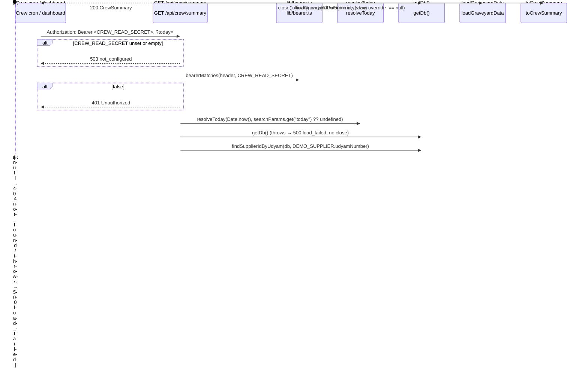

# Design Document: crew-api

## Overview

crew-api adds `GET /api/crew/summary`: a read-only, bearer-authenticated JSON feed of the Demo_Supplier's graveyard for the Crew app (roadmap section 7a). It reuses the dashboard's load path (`findSupplierIdByUdyam` → `loadGraveyardData` → `buildGraveyard`) and adds no money, date or legal logic.

The work splits into two new units plus small edits:
- `apps/web/lib/crew/summary.ts`: the response types and a pure mapper `toCrewSummary(view, todayOverride)`. Its only value transformation is `formatINR(paise, "full")`.
- `apps/web/app/api/crew/summary/route.ts`: auth, Today, database, load, then the mapper. Status codes and headers live here; values do not.
- `bearerMatches` moves from the Ladder_Run_Route into `apps/web/lib/bearer.ts` unchanged, and both routes import it.

Design decisions:
- **Mapper outside the route file.** Next.js route modules may export only HTTP handlers and route config (`runtime`, `maxDuration`, …). Putting `toCrewSummary` in `lib/crew/` lets tests import it directly and keeps Requirement 1.1 ("no other HTTP method handler") obvious.
- **Own disclaimer constant.** The route cannot import `DISCLAIMER` from `@dues-banshee/agent` (Requirement 5.2), and `FOOTER_TEXT` lives in a React component file. `lib/crew/summary.ts` declares `CREW_DISCLAIMER` with the exact text, pinned by the route test. The same pattern exists in `lib/call/call-copy.ts` (`CALL_DISCLAIMER`).
- **No error object in logs.** Requirement 2.6 and 7.6 forbid the thrown error's message in any `console` argument, so the route logs a fixed stage label only. `loadGraveyardData` keeps its existing `console.error("loadGraveyardData failed", err)`; it is mocked in the route tests.

## Architecture



The proxy never sees this route: no `config.matcher` entry matches `/api/crew/summary`, so the bearer secret is its only credential. Every response carries `Cache-Control: no-store`.

## Components and Interfaces

### Files

| File | Change |
|---|---|
| `apps/web/lib/bearer.ts` | New. `export function bearerMatches(header: string \| null, secret: string): boolean`, plus its private `sha256`, moved verbatim from the Ladder_Run_Route. |
| `apps/web/app/api/ladder/run/route.ts` | Delete local `sha256`/`bearerMatches` and the `node:crypto` import; `import { bearerMatches } from "@/lib/bearer"`. No other change. |
| `apps/web/proxy.ts` | Comment only: name `/api/crew/summary` next to `/api/ladder/run` as deliberately absent. Matcher array unchanged (9 entries). |
| `apps/web/.env.example` | Append `CREW_READ_SECRET=` after `DEMO_BUYER_WHATSAPP=`. |
| `apps/web/lib/crew/summary.ts` | New. `CrewSummary` types, `CREW_DISCLAIMER`, `toCrewSummary`. Imports only `formatINR` and types from `@dues-banshee/engine` and `GraveyardView` from `@/lib/graveyard/build-graveyard`. |
| `apps/web/app/api/crew/summary/route.ts` | New. `export const runtime = "nodejs"` and `export async function GET`. |
| `apps/web/test/lint.test.ts` | Add the agent/voice import scan over `app/api/crew` and `lib/crew` with its detector test, and the `CREW_READ_SECRET` `.env.example` assertion (reuses `emptyEnvNames`, `listWebSources`, `stripComments`). |
| `apps/web/test/money-lint.test.ts` | Add `app/api/crew` and `lib/crew` to `SCANNED_DIRS`. |
| `apps/web/test/crew-summary-route.test.ts` | New route tests (+ Property 2). |
| `apps/web/test/crew-summary.property.test.ts` | New mapper tests (+ Property 1). |

`lib/crew` is added to both scans as well as `app/api/crew` because the mapper lives there; Requirement 5.2 and 5.3 name only `app/api/crew`, and scanning one more directory does not conflict with them.

### Route handler

```ts
// apps/web/app/api/crew/summary/route.ts
export const runtime = "nodejs";

const NO_STORE = { "Cache-Control": "no-store" } as const;
const json = (body: unknown, status: number): Response => Response.json(body, { status, headers: NO_STORE });

export async function GET(request: Request): Promise<Response> {
  const secret = process.env.CREW_READ_SECRET;
  if (!secret) return json({ error: "not_configured" }, 503);
  if (!bearerMatches(request.headers.get("authorization"), secret)) return json({ error: "Unauthorized" }, 401);

  const resolved = resolveToday(Date.now(), new URL(request.url).searchParams.get("today") ?? undefined);

  let handle: ReturnType<typeof getDb>;
  try {
    handle = getDb();
  } catch {
    console.error("crew summary failed", { stage: "getDb" });
    return json({ error: "load_failed" }, 500);
  }
  try {
    const id = await findSupplierIdByUdyam(handle.db, DEMO_SUPPLIER.udyamNumber);
    if (id === null) return json({ error: "not_found" }, 404);
    const result = await loadGraveyardData(handle.db, id, resolved.today);
    if (result.kind === "stale") return json({ error: "not_found" }, 404);
    if (result.kind === "error") return json({ error: "load_failed" }, 500);
    return json(toCrewSummary(result.view, resolved.override !== null), 200);
  } catch {
    console.error("crew summary failed", { stage: "load" });
    return json({ error: "load_failed" }, 500);
  } finally {
    await handle.close();
  }
}
```

`LADDER_RUN_SECRET` is never read in this file, which is how Requirement 2.5 holds.

### Mapper

```ts
// apps/web/lib/crew/summary.ts
export const CREW_DISCLAIMER = "Reminders a supplier sends to its own buyers. Not legal advice.";

const money = (paise: Paise): CrewMoney => ({ paise, text: formatINR(paise, "full") });

export function toCrewSummary(view: GraveyardView, todayOverride: boolean): CrewSummary {
  const t = view.totals;
  return {
    supplierName: view.supplierName,
    today: view.today,
    todayOverride,
    rulesAsOf: view.rulesAsOf,
    disclaimer: CREW_DISCLAIMER,
    totals: {
      outstanding: money(t.outstandingPaise),
      interestAccrued: t.interestAccruedPaise === null ? null : money(t.interestAccruedPaise),
      deductionsAtRisk: money(t.deductionsAtRiskPaise),
      explodedCount: t.explodedCount,
      paidCount: t.paidCount,
    },
    tombstones: view.tombstones.map((v) => ({
      id: v.id, buyerId: v.buyerId, buyerName: v.buyerName, invoiceNumber: v.invoiceNumber,
      state: v.state, stateText: v.stateText, stateRuleId: v.stateRuleId,
      principal: { paise: v.principalPaise, text: v.principalText },
      dueDate: v.dueDate, dueDateText: v.dueDateText, daysOverdue: v.daysOverdue,
      interest: v.interest === null ? null : { paise: v.interest.paise, text: v.interest.text },
      taxBomb: v.taxBomb === null ? null : {
        status: v.taxBomb.status, daysLeft: v.taxBomb.daysLeft,
        deductionAtRiskPaise: v.taxBomb.deductionAtRiskPaise,
        deductionAtRiskText: formatINR(v.taxBomb.deductionAtRiskPaise, "full"),
      },
      nextLabel: v.nextLabel,
    })),
  };
}
```

Fields are listed explicitly (no `...v` spread), so `look`, `ariaLabel`, `caveat` and `next` cannot leak and the TypeScript return type rejects extra keys at the object literal.

## Data Models

```ts
import type { CalendarDate, Paise, TaxBombStatus } from "@dues-banshee/engine";
import type { TombstoneState } from "@/lib/graveyard/build-graveyard";

export interface CrewMoney { paise: Paise; text: string } // text = formatINR(paise, "full")

export interface CrewTombstone {
  id: string;
  buyerId: string;
  buyerName: string;
  invoiceNumber: string;
  state: TombstoneState;
  stateText: string;
  stateRuleId: "IT-43BH" | "MSMED-SCOPE" | null;
  principal: CrewMoney;
  dueDate: CalendarDate | null;
  dueDateText: string | null;
  daysOverdue: number;
  interest: CrewMoney | null;
  taxBomb: { status: TaxBombStatus; daysLeft: number; deductionAtRiskPaise: Paise; deductionAtRiskText: string } | null;
  nextLabel: string;
}

export interface CrewSummary {
  supplierName: string;
  today: CalendarDate;
  todayOverride: boolean;
  rulesAsOf: CalendarDate | null;
  disclaimer: string;
  totals: {
    outstanding: CrewMoney;
    interestAccrued: CrewMoney | null;
    deductionsAtRisk: CrewMoney;
    explodedCount: number;
    paidCount: number;
  };
  tombstones: CrewTombstone[];
}

export type CrewError = { error: "not_configured" | "Unauthorized" | "not_found" | "load_failed" };
```

Sharma Traders at `?today=2026-11-12` (Requirement 4.8):

```json
{ "invoiceNumber": "LPC/26-27/0412", "buyerName": "Sharma Traders", "state": "armed", "stateRuleId": "IT-43BH",
  "principal": { "paise": 41200000, "text": "₹4,12,000" }, "dueDate": "2026-10-17", "dueDateText": "17 Oct 2026",
  "daysOverdue": 26, "interest": { "paise": 512794, "text": "₹5,127.94" },
  "taxBomb": { "status": "armed", "daysLeft": 139, "deductionAtRiskPaise": 41200000, "deductionAtRiskText": "₹4,12,000" },
  "nextLabel": "Next: WhatsApp nudge" }
```

## Correctness Properties

*A property is a characteristic or behavior that should hold true across all valid executions of a system-essentially, a formal statement about what the system should do. Properties serve as the bridge between human-readable specifications and machine-verifiable correctness guarantees.*

Only two parts of this feature vary meaningfully with input: the mapper (any graveyard shape) and the bearer check (any presented token). Everything else is a fixed status path and is covered by example tests. The six mapper criteria (Requirements 4.1–4.6) are one projection rule, so they are one property.

### Property 1: The mapper is an exact projection of the view

*For any* `GraveyardView` (any number of tombstones, any states, nullable `interest`, `taxBomb`, `dueDate`, `stateRuleId`, `rulesAsOf` and `interestAccruedPaise`, and paise from 0 to 10^12) and any boolean `todayOverride`, `toCrewSummary(view, todayOverride)` returns:
- exactly the seven top-level keys, with `supplierName`, `today`, `rulesAsOf` equal to the view's, `todayOverride` equal to the argument and `disclaimer` equal to `CREW_DISCLAIMER`;
- `totals` whose `outstanding`, `interestAccrued` (null iff the view's is null) and `deductionsAtRisk` carry the view's paise with `text === formatINR(paise, "full")`, and whose counts equal the view's;
- `tombstones` with the same length and the same `id` sequence as `view.tombstones`, each holding exactly the 14 listed keys (so never `look`, `ariaLabel`, `caveat` or `next`), each copied value equal to the view's, `principal` equal to `{ paise: principalPaise, text: principalText }`, and `taxBomb` null iff the view's is null, otherwise with `deductionAtRiskText === formatINR(deductionAtRiskPaise, "full")`.

**Validates: Requirements 4.1, 4.2, 4.3, 4.4, 4.5, 4.6**

### Property 2: Only the Crew_Secret opens the route

*For any* non-empty Crew_Secret and any `Authorization` value that is not exactly `Bearer <Crew_Secret>` (missing, no scheme, empty token, a different token, the Crew_Secret with extra or missing characters, or a Ladder_Secret that differs from the Crew_Secret), excluding any value whose leading/trailing-whitespace-trimmed form equals `Bearer <Crew_Secret>` (Fetch `Headers` trims header values), `GET` responds 401 with body `{"error":"Unauthorized"}` and `Cache-Control: no-store`, and `getDb` is not called.

**Validates: Requirements 2.4, 2.5**

## Error Handling

| Case | Status | Body | `getDb` called? | `close` called? |
|---|---|---|---|---|
| `CREW_READ_SECRET` unset or `""` | 503 | `{"error":"not_configured"}` | no | no |
| Header missing, malformed, empty token or wrong token (incl. Ladder_Secret) | 401 | `{"error":"Unauthorized"}` | no | no |
| `getDb()` throws (e.g. `DATABASE_URL` unset) | 500 | `{"error":"load_failed"}` | yes (threw) | no |
| `findSupplierIdByUdyam` returns null | 404 | `{"error":"not_found"}` | yes | once |
| `findSupplierIdByUdyam` throws | 500 | `{"error":"load_failed"}` | yes | once |
| Load_Result `stale` | 404 | `{"error":"not_found"}` | yes | once |
| Load_Result `error` | 500 | `{"error":"load_failed"}` | yes | once |
| Load_Result `ok` | 200 | `CrewSummary` | yes | once |

Every row sets `Cache-Control: no-store`. An invalid `?today=` is not an error: Today falls back to the IST date and `todayOverride` is false. Logs carry only `"crew summary failed"` and a `{ stage }` label, never the error, token or secret. If `close()` itself throws, the request fails as an unhandled 500 from Next.js; this is the same behaviour as the Ladder_Run_Route and is accepted.

## Testing Strategy

Vitest, run with `pnpm --filter web test`. fast-check is a root devDependency (`package.json`, `^4.10.2`), not listed in `apps/web/package.json`, but 15 existing `apps/web/test/*.property.test.ts` files already import it, so no dependency is added.

**Property tests** (one test per property, `{ numRuns: 100 }` minimum, tagged with a comment):
- `crew-summary.property.test.ts`: `// Feature: crew-api, Property 1: The mapper is an exact projection of the view`. Generates `GraveyardView` objects directly with `fc.record` (tombstone fields from `fc.constantFrom` over the real state, rule-ID and tax-bomb status unions, `fc.option` for nullable fields, `look`/`caveat`/`next` filled with arbitrary values so leaks would show). Expected texts are computed with the real `formatINR`.
- `crew-summary-route.test.ts`: `// Feature: crew-api, Property 2: Only the Crew_Secret opens the route`. `fc.asyncProperty` over header values built from a mix of `fc.constant(undefined)`, `fc.string()` tokens filtered to `!== secret` and without line breaks, mutations of the secret, and the Ladder_Secret, then filters out any value whose trimmed form equals `Bearer <Crew_Secret>` because Fetch `Headers` trims leading/trailing spaces and tabs; asserts 401, body, header and `getDb` not called, clearing mocks between runs.

**Example tests** (`crew-summary-route.test.ts`, in the style of `ladder-run-route.test.ts`): `vi.hoisted` mocks of `getDb` (`@/lib/db`), `findSupplierIdByUdyam` (`@dues-banshee/db`, spread over the actual module so `DEMO_SUPPLIER` is real) and `loadGraveyardData` (`@/lib/graveyard/load`); fake timers at `2026-11-12T20:00:00Z` (IST 2026-11-13). The `ok` view is `buildGraveyard(SUPPLIER, demoRecords(), { annualBps: 575, asOf: "2026-10-07" }, today)` built from `DEMO_INVOICES` as in `build-graveyard.test.ts` (copy its fixed-id helper). Cases:
- 503 for unset and empty secret; 401 for missing header, wrong token and the Ladder_Secret (with `LADDER_RUN_SECRET` stubbed to a different value); `getDb` not called on these.
- 404 for a null lookup (and `loadGraveyardData` not called) and for `stale`; 500 for `error`, a throwing lookup and a throwing `getDb()` (no `close` expected there).
- 200 at `?today=2026-11-12`: the exact Sharma Traders tombstone of Requirement 4.8, `today`, `todayOverride: true`, `disclaimer`, `loadGraveyardData` called once with the demo id and `"2026-11-12"`, and no `look`/`ariaLabel`/`caveat`/`next` keys.
- `?today=2027-02-30`: `loadGraveyardData` receives `"2026-11-13"`, body `today` `"2026-11-13"`, `todayOverride: false`.
- `Cache-Control: no-store` on 200, 401, 404 and 500; `close` called once on every 200/404/500 path where `getDb` returned.
- Secret hygiene: on the 200 path and on a throwing-lookup 500 whose error message contains the Crew_Secret, neither the secret nor the message appears in the body or in any argument of spied `console.error`/`warn`/`log`.
- Module shape: `runtime === "nodejs"` and `GET` is the only HTTP-method export.

**Scans and smoke checks:**
- `lint.test.ts`: a detector for static import, dynamic `import()` and re-export of `@dues-banshee/agent` / `@dues-banshee/voice` (with subpaths), with near-misses (name in a comment, `@dues-banshee/db` import); the real scan over `app/api/crew` and `lib/crew` asserts it found `app/api/crew/summary/route.ts`. The `.env.example` block asserts `emptyEnvNames` contains `CREW_READ_SECRET`.
- `money-lint.test.ts`: `SCANNED_DIRS` gains `app/api/crew` and `lib/crew`.
- `ladder-run-route.test.ts` and `proxy.test.ts` pass without edits (Requirements 1.3, 2.2).
