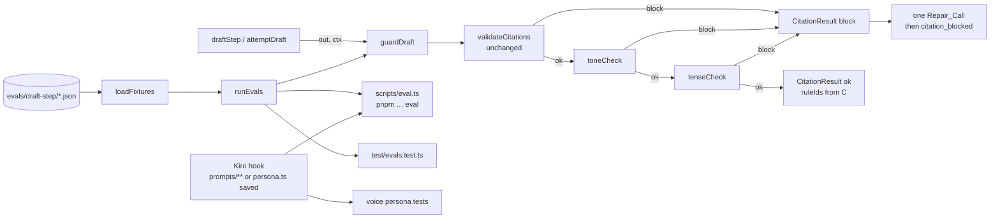

# Design Document: guardrails-evals
## Overview
The spec adds two pure checks (Tone_Check, Tense_Check) and one pure wrapper (Draft_Guard) to `packages/agent/src/core/`, and swaps the two `validateCitations` calls in `draft-step.ts` for the Draft_Guard. The existing block → one Repair_Call → `citation_blocked` path carries the new reasons unchanged. Recorded fixtures in `evals/draft-step/` pin the Draft_Guard; a table in the existing start-call refusal test pins call hours; a Kiro hook re-runs the evals on prompt saves; the source lint gains three rules.
Nothing calls an LLM or the network. `validateCitations`, `allowedRuleIds`, `inCallWindow`, `startCallRefusal` and the Engine are not changed.
Key decisions:
| Decision | Choice | Why |
|---|---|---|
| Where the checks run | `guardDraft` wraps `validateCitations` and is called at both existing call sites in `attemptDraft` | One repair path for every reason (Req 3.3–3.5). `validateCitations` keeps its signature and results, so its tests stay valid (Req 7.3). |
| What the checks read | The Model_Output template, before `fillPlaceholders` | Buyer names, invoice numbers and money never reach the phrase matcher (Req 1.8), and tense patterns can anchor on the literal `{{due_date}}` token (Req 2.4). |
| Address-required steps | `ADDRESS_REQUIRED: Readonly<Record<LadderStep, boolean>>` | A `Record` is exhaustive over steps, and it is not an array or `Set` literal, so the new step-set lint rule (Req 7.4) does not flag it. |
| Matching | Lowercase, collapse whitespace to one space, whole-word regex per entry with Unicode letter/digit boundaries | Deterministic, no LLM judge; "please" alone never matches "please please". |
| Tense patterns | 4 explicit regexes, each anchored on `{{due_date}}` | `{{principal}} abhi bhi due hai` never matches (Req 2.4). Few false positives. |
| Overdue | `draftStep` computes it from Engine `dueDate(record.invoice)` and Today | The checks do no date maths (Req 2.6). |
| Fixture format | One JSON file per fixture, validated with zod | Easy to add by hand; schema failure fails the run (Req 4.5). |
| Runner | Pure `runEvals(fixtures)` in `src/evals/`, used by a `tsx` CLI and by a Vitest file | Same loader and same results in `eval` and `test` (Req 4.6). |
| Error kind on a guard block | Keep `citation_blocked` | No change to the Tool_Log, the DB or the UI (Req 3.5). |
New dependencies: none (`tsx` and `zod` are already in `packages/agent`).
## Architecture

### File map
```
evals/draft-step/*.json                         19 Eval_Fixtures (new)
packages/agent/
  package.json                                  + "eval": "tsx scripts/eval.ts"
  src/core/citations.ts                         BLOCK_REASONS const + BlockReason derived from it (+4 values)
  src/core/tone-phrases.ts                      THREAT_LIST, BEGGING_LIST (new)
  src/core/tone.ts                              toneCheck, ADDRESS_REQUIRED (new)
  src/core/tense.ts                             tenseCheck, FUTURE_TENSE_PATTERNS (new)
  src/core/match.ts                             normalise, phraseRegex (new)
  src/core/draft-guard.ts                       guardDraft (new)
  src/draft-step.ts                             guardDraft at both call sites; overdue into ctx and prompt
  src/prompts/draft-step.ts                     DraftPromptInput.overdue; Tense section
  src/evals/fixture.ts                          FIXTURE_SCHEMA, loadFixtures (new)
  src/evals/run.ts                              runEvals, formatReport (new)
  scripts/eval.ts                               CLI (new)
  test/tone.test.ts, test/tense.test.ts         unit tests (new)
  test/draft-guard.property.test.ts             properties 1–3 (new)
  test/evals.test.ts                            fixtures in Vitest + demo-context check (new)
  test/repair.test.ts                           + tone-block repair case
  test/citations.test.ts, prompt.test.ts, prompt-data.property.test.ts, source-lint.test.ts   extended: add `overdue` to existing draftPrompt inputs; never remove a test
apps/web/test/start-call-refusal.property.test.ts                 + Call_Hours_Case table
.kiro/hooks/guardrails-evals-on-save.json       new hook file
```
## Components
### BlockReason
`citations.ts` gains `export const BLOCK_REASONS = [...existing nine, "missing_address", "threat_phrase", "begging_phrase", "overdue_tense"] as const` and `type BlockReason = (typeof BLOCK_REASONS)[number]`. The existing nine keep their names and order. `validateCitations` never returns the new four.
### Matching helpers (`match.ts`)
```ts
/** Lowercase, then every run of whitespace (incl. \n, \t) becomes one space. */
export function normalise(text: string): string;
/** Whole-word, case-insensitive regex for one phrase: escaped, inner spaces as " ", Unicode boundaries. */
export function phraseRegex(phrase: string): RegExp; // (?<![\p{L}\p{N}])<escaped>(?![\p{L}\p{N}]), flags "iu"
```
Regexes are built once at module load and are non-global, so there is no `lastIndex` state.
### Tone_Check (`tone.ts`, `tone-phrases.ts`)
```ts
export const ADDRESS_REQUIRED: Readonly<Record<LadderStep, boolean>> = {
  whatsapp_nudge: true, whatsapp_paylink: true, voice_call: false, legal_notice: true, odr_pack: false,
};
export function toneCheck(text: string, step: LadderStep): CitationResult | null; // null = pass
```
1. `ADDRESS_REQUIRED[step]` and no match of `/\{\{buyer_name\}\}\s+ji(?![\p{L}\p{N}])/iu` ⇒ `missing_address`, offending `null`.
2. First THREAT_LIST entry (list order) that matches ⇒ `threat_phrase`, offending = the entry.
3. First BEGGING_LIST entry that matches ⇒ `begging_phrase`, offending = the entry.

`step` is a ladder code, not buyer data, so Req 1.8 still holds: buyer names and invoice numbers cannot change the result.
Initial lists (lowercase, whole words; Req 1.6 minimums are 8 and 6):
| List | English | Hinglish |
|---|---|---|
| THREAT_LIST | `legal action will be taken`, `we will take legal action`, `strict action`, `final warning`, `last warning`, `you will regret`, `face the consequences`, `blacklist`, `police`, `we will sue` | `warna`, `dekh lenge`, `anjaam`, `bhugatna padega`, `case kar denge`, `court mein ghaseet`, `sabak sikha`, `chhodenge nahi`, `aakhri chetavani` |
| BEGGING_LIST | `i beg`, `begging you`, `please please`, `have mercy`, `we are desperate`, `we are helpless` | `haath jodkar`, `minnat`, `daya karo`, `reham`, `bahut majboor`, `aapke pair` |

A test asserts that no entry equals or contains, as a whole word, any of `please`, `interest`, `msme`, `odr`, `facilitation council`, `samadhaan`, `kripya`, `request` (Req 1.6), and that the polite phrases `dekh lena`, `or else` and `vinti hai` match no entry.
### Tense_Check (`tense.ts`)
```ts
export function tenseCheck(text: string, overdue: boolean): CitationResult | null;
```
Not Overdue ⇒ `null`. Otherwise the first matching pattern, run on `normalise(text)`, gives `overdue_tense` with the matched substring as offending.
| # | Pattern (after `normalise`, `iu`) | Catches |
|---|---|---|
| H1 | `\{\{due_date\}\} (?:ko\|tak) due (?:hai\|hoga\|hogi\|ho jayega)(?![\p{L}])` | `{{due_date}} ko due hai` |
| H2 | `\{\{due_date\}\} (?:ko\|tak) (?:payment\|bhugtan) (?:karna hai\|dena hai\|hoga\|due hai)(?![\p{L}])` | `{{due_date}} tak payment karna hai` |
| E1 | `(?:is\|are\|will be\|falls\|fall) due (?:on\|by) \{\{due_date\}\}` | `is due on {{due_date}}` |
| E2 | `(?:is\|are\|will be) payable (?:on\|by) \{\{due_date\}\}` | `is payable by {{due_date}}` |

Past forms (`ko due tha`, `due ho chuka hai`, `was due on`) and amount sentences without `{{due_date}}` match none of them.
### Draft_Guard (`draft-guard.ts`)
```ts
export interface GuardContext {
  step: LadderStep;
  allowed: readonly RuleId[];
  ruleIds: readonly string[];   // RULE_IDS in production
  bankRateExists: boolean;
  overdue: boolean;
}
export function guardDraft(out: ModelOutput, ctx: GuardContext): CitationResult {
  const c = validateCitations(out, ctx.allowed, ctx.ruleIds, ctx.bankRateExists);
  if (!c.ok) return c;
  return toneCheck(out.text, ctx.step) ?? tenseCheck(out.text, ctx.overdue) ?? c;
}
```
### draftStep changes
- `const due = dueDate(record.invoice); const overdue = due.applicable && today > due.dueDate;` (CalendarDate strings compare in date order, as in `apps/web/lib/call/callable.ts`; no `compareDates`, which the Engine does not export, and no Engine change; `dueDate` is already called for this invoice by `allowedRuleIds`, so no new throw path).
- Both `validateCitations(...)` calls become `guardDraft(output, { step, allowed, ruleIds: RULE_IDS, bankRateExists: bankRate !== null, overdue })`.
- `promptBase` gains `overdue`. The repair note is `{ reason, offending }` as today, so the new reasons reach the model the same way.
- Tool_Log rows are unchanged: `citation` holds the guard result (Req 3.6).
### Draft prompt
`DraftPromptInput` gains required `overdue: boolean`. When `true`, `buildSystem` adds, after the Figures section:
```
Tense:
- The due date has passed. Write of it in the past tense, for example "{{due_date}} ko due tha" or "was due on {{due_date}}".
```
When `false`, the section is absent. The data block is unchanged.
### Fixtures and runner (`src/evals/`)
```ts
export const FIXTURE_SCHEMA = z.object({
  name: z.string().regex(/^[a-z0-9-]+$/),
  context: z.object({
    subject: z.enum(["sharma_2026_11_12", "synthetic"]),
    step: z.enum(LADDER_STEPS),
    language: z.enum(["hinglish", "english"]),
    allowed: z.array(z.enum(RULE_IDS)),
    bankRateExists: z.boolean(),
    overdue: z.boolean(),
  }).strict(),
  output: MODEL_OUTPUT_SCHEMA,
  expected: z.union([z.literal("accept"), z.enum(BLOCK_REASONS)]),
}).strict();
export function loadFixtures(dir = DEFAULT_DIR): Fixture[];   // DEFAULT_DIR = <repo>/evals/draft-step; throws FixtureError(file, issues) on bad JSON/schema or duplicate name
export function runEvals(fixtures: Fixture[]): EvalResult[];  // { name, expected, actual, pass }
export function formatReport(results: EvalResult[]): string; // "PASS|FAIL <name>  expected=<e>  actual=<a>" lines + "<p>/<t> passed"
```
`actual` is `"accept"` or the block reason. `runEvals` calls `guardDraft(output, { ...context, ruleIds: RULE_IDS })`.
`scripts/eval.ts` prints `formatReport` and sets `process.exitCode = 1` when any result fails or `loadFixtures` throws (the error names the file).
Fixture set (all `sharma_2026_11_12`, Overdue, unless noted):
| # | Name | Step / lang | Point | Expected |
|---|---|---|---|---|
| 1 | accept-hinglish-nudge | nudge / hi | `{{due_date}} ko due tha` | accept |
| 2 | accept-english-paylink-please | paylink / en | "please" near-miss | accept |
| 3 | accept-english-interest | nudge / en | factual `{{interest}}` + MSMED-16 | accept |
| 4 | accept-hinglish-principal-still-due | nudge / hi | `{{principal}} abhi bhi due hai` | accept |
| 5 | accept-english-notice-council | legal_notice / en | Facilitation Council as information | accept |
| 6 | accept-voice-brief-no-address | voice_call / en | address not required | accept |
| 7 | accept-not-overdue-future | nudge / hi, synthetic, not Overdue | `{{due_date}} ko due hai` | accept |
| 8 | block-hinglish-no-ji | nudge / hi | `Namaste {{buyer_name}},` | missing_address |
| 9 | block-english-notice-dear-sir | legal_notice / en | no Address_Form | missing_address |
| 10 | block-hinglish-warna | nudge / hi | `warna` | threat_phrase |
| 11 | block-english-final-warning | paylink / en | `final warning` | threat_phrase |
| 12 | block-hinglish-haath-jodkar | nudge / hi | `haath jodkar` | begging_phrase |
| 13 | block-english-i-beg | nudge / en | `I beg` | begging_phrase |
| 14 | block-hinglish-due-hai | nudge / hi | `{{due_date}} ko due hai` | overdue_tense |
| 15 | block-english-is-due-on | nudge / en | `is due on {{due_date}}` | overdue_tense |
| 16 | block-hinglish-literal-date | nudge / hi | `17 Oct 2026 ko due hai` | literal_figure |
| 17 | block-no-citation | nudge / en | `ruleIds: []` | missing_citation |
| 18 | block-invalid-rule | nudge / en | `MSMED-99` | invalid_rule_id |
| 19 | block-uncited-interest | nudge / en | `{{interest}}` without MSMED-16 | uncited_placeholder |

Every block fixture except 8, 9, 17–19 holds the Address_Form, so it reaches the check it targets.
Demo-context check (Req 4.3), in `test/evals.test.ts`: for each `sharma_2026_11_12` fixture, the decision is `nextEscalationStep(sharma, history, "2026-11-12")`, where `history` has one `StepEvent` per step ranked below the fixture's step, all on `2026-10-18` (25 days back, past the default 7-day gap). The test asserts the decision is `advance` at the fixture's step, `context.allowed` equals `allowedRuleIds(sharmaFacts, decision, "2026-11-12", bankRate)` with the demo Bank_Rate (575 bps from 2026-10-07) or `null` per `bankRateExists`, and `context.overdue` is `true`. The Sharma record is built from `DEMO_INVOICES[0]` as in `demo-sharma.test.ts` (due 2026-10-17).
### Call-hours table (`apps/web/test/start-call-refusal.property.test.ts`)
A `describe.each`-style table; `inWindow` comes from `inCallWindow(Date.parse(iso))` of `@dues-banshee/voice` and goes into `startCallRefusal` with `found`, `configured`, `callable` true and `buyerCallsToday` 0:
| Case | IST instant | UTC ISO | Supplier | demoCallsToday | Expected |
|---|---|---|---|---|---|
| Mon 09:59 | 2026-11-16 09:59 | 2026-11-16T04:29:00Z | normal | 0 | `outside_window` |
| Mon 10:00 | 2026-11-16 10:00 | 2026-11-16T04:30:00Z | normal | 0 | `null` |
| Sat 18:59 | 2026-11-21 18:59 | 2026-11-21T13:29:00Z | normal | 0 | `null` |
| Sat 19:00 | 2026-11-21 19:00 | 2026-11-21T13:30:00Z | normal | 0 | `outside_window` |
| Sun 12:00 | 2026-11-22 12:00 | 2026-11-22T06:30:00Z | normal | 0 | `outside_window` |
| Demo Sun 22:00, below cap | 2026-11-22 22:00 | 2026-11-22T16:30:00Z | demo | 19 | `null` |
| Demo Sun 22:00, at cap | 2026-11-22 22:00 | 2026-11-22T16:30:00Z | demo | `DEMO_CALL_LIMIT` | `demo_limit` |

The test also asserts each instant's IST weekday, so a wrong date in the table fails loudly. WhatsApp code is not touched (Req 5.4).
### Hook (`.kiro/hooks/guardrails-evals-on-save.json`)
```json
{
  "version": "v1",
  "hooks": [
    {
      "name": "Guardrail evals on prompt save",
      "trigger": "PostFileSave",
      "action": {
        "type": "command",
        "command": "pnpm --filter @dues-banshee/agent eval && pnpm --filter @dues-banshee/voice exec vitest --run persona"
      },
      "description": "Re-runs the offline draft evals and the voice persona tests when a prompt or the voice persona changes. No network or LLM calls.",
      "matcher": "packages/agent/src/prompts/.*\\.ts$|packages/voice/src/persona\\.ts$",
      "enabled": true
    }
  ]
}
```
`vitest --run persona` filters to `persona.test.ts` and `persona.property.test.ts`. The voice suite already runs offline. `engine-tests-on-save.json` is untouched (Req 6.4).
### Source lint additions (`source-lint.test.ts`)
Same file walk (`packages/agent/src`, `apps/web`, tests and build output skipped).
- `stepSetHits(file, text)`: for each bracket literal `\[[^[\]]*\]` (this covers `new Set([...])` and plain arrays), count distinct quoted Ladder_Step names; 2 or more ⇒ hit `file:line: ladder-step set literal`. The existing ordered-array rule stays as it is.
- `stepRankHits(file, text)`: `LADDER_STEPS\s*\.\s*(indexOf|findIndex)\s*\(` ⇒ hit; and `(indexOf|findIndex)` called directly on a bracket literal holding a Ladder_Step name ⇒ hit.
- `voiceImportHits(file, text)`: `from\s+["']@dues-banshee/voice` or `import\(\s*["']@dues-banshee/voice`, checked in `packages/agent/src` only.

Detector tests: positive samples (`new Set(["voice_call", "legal_notice"])`, `LADDER_STEPS.indexOf(step)`, `import { x } from "@dues-banshee/voice"`) and near-misses (a step-keyed `Record`, a single-step array, `PLACEHOLDERS.indexOf(x)`, `@dues-banshee/voice-x`). The scan of the current source must return no hits (Req 7.8); a grep while writing this design found none.
## Correctness Properties
fast-check, 200 runs each, in `test/draft-guard.property.test.ts`.
1. **Citation first.** For any Model_Output and context, if `validateCitations` blocks, `guardDraft` returns exactly that result. If it accepts, `guardDraft` is either that result (same `ruleIds`) or a block with one of the four new reasons. (Req 3.1, 3.2, 3.7)
2. **Normalisation invariance.** For any text `t`, `toneCheck` and `tenseCheck` give the same reason for `t` and for `t` with each whitespace run replaced by a random non-empty whitespace run and with random letter-case changes. (Req 1 glossary matching rule; Req 1.8 holds by signature, since neither check takes a buyer name or invoice number.)
3. **Not Overdue never blocks on tense.** For any text, `tenseCheck(text, false)` is `null`. (Req 2.3)
## Error handling
| Case | Behaviour |
|---|---|
| Guard blocks initial output | One Repair_Call with `{ reason, offending }`, as for citation blocks |
| Guard blocks repaired output | Draft_Attempt fails with `citation_blocked` |
| Fixture JSON invalid or schema fails | `FixtureError` naming the file; CLI exit 1; Vitest test fails |
| Duplicate fixture name | `FixtureError` |
| No fixtures found | `FixtureError` (an empty run must not pass) |
## Testing strategy
- Unit: `tone.test.ts` (each list entry triggers its reason; address rule per step; order of checks; the Req 1.6 forbidden-word check; lists meet the size and both-language minimums), `tense.test.ts` (each pattern; the Req 2.4 past and amount forms pass).
- `repair.test.ts`: a fake model returns a `warna` draft first and a clean draft second ⇒ two `draft_step` rows, the second accepted; the repair data block carries `"reason":"threat_phrase"`.
- `prompt.test.ts`: the Tense section is present with `overdue: true` and absent with `false`.
- `citations.test.ts`: existing cases unchanged, plus a check that `BLOCK_REASONS` starts with the original nine in their old order.
- `evals.test.ts`: every fixture passes, the Req 4.2 coverage counts hold (by language and reason), and the demo-context check.
- Call hours and source lint as above.
- All in `pnpm test`; the fetch guard in `test/setup/fetch-guard.ts` already fails any network call.
