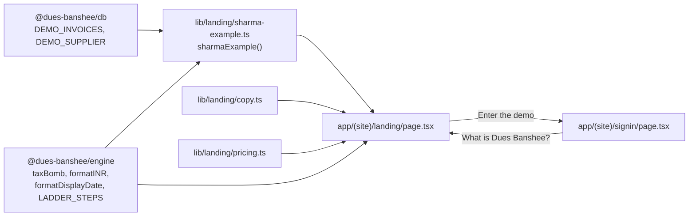

# Design Document: landing-3d

## Overview

landing-3d adds the public page `/landing` (roadmap section 8, Lite only). It is one server component with a CSS Module, fed by two small `lib/landing` modules. The only computed values on the page are the Sharma Traders tax-bomb figures, which come from the Engine's `taxBomb` on the demo seed at a fixed date.

New units:
- `apps/web/lib/landing/sharma-example.ts`: builds the Sharma_Invoice from `DEMO_INVOICES` and `DEMO_SUPPLIER` and returns the Engine's `taxBomb` result plus its display text.
- `apps/web/lib/landing/copy.ts`: hero, ladder (keyed by `LadderStep`), tax-bomb, CA-firm, roadmap and Crew copy. No `₹` character.
- `apps/web/lib/landing/pricing.ts`: the Pricing_File. Plan names, features and prices in integer paise, plus the Problem_Size figure and its source.
- `apps/web/app/(site)/landing/page.tsx` and `landing.module.css`: the page and its styles.

Small edits: one link on the Signin_Page, a landing scan in `money-lint.test.ts`, one test in `signin.test.tsx`.

Design decisions:
- **Engine call, not `buildGraveyard`.** `buildGraveyard` needs a bank rate, which lives in the database. `taxBomb(invoice, today)` needs only the invoice, so the page stays free of database reads (Requirement 1.7). The interest line states the MSMED-16 rule with no amount.
- **The example fails loudly.** `sharmaExample()` throws if the `DEMO_INVOICES` entry is missing or `taxBomb` does not return `status: "armed"`. A seed change then breaks the render test and `next build` instead of quietly showing a "not applicable" example.
- **Copy outside the page.** Keeping text in `lib/landing/copy.ts` and prices in `pricing.ts` keeps `page.tsx` to markup, so the money lint has little to scan and the copy can be tested without rendering.
- **The Disclaimer comes from `AppShell`.** Every page renders inside `AppShell`, whose footer shows `FOOTER_TEXT` (the Disclaimer, pinned by `app-shell.test.tsx`). The landing Footer shows only "Built for Kiroween 2026." and does not import `FOOTER_TEXT`, so the Disclaimer appears once. Signed-out visitors see the brand header and no nav. Requirement 1.7 ("no database, env var, cookie or search parameter") applies to the page module and `lib/landing`; the shared layout's `auth()` call is unchanged and outside this spec.
- **No three.js, GSAP or client JavaScript.** The page has no `"use client"` module. Motion is CSS keyframes only (fog drift, candle flicker, ember fuse from `design/Landing.dc.html`).

## Architecture



`/landing` is absent from the Proxy_Matcher, so the auth proxy never runs for it and signed-out requests get 200. `proxy.ts` is not edited.

## Components and Interfaces

### Files

| File | Change |
|---|---|
| `apps/web/app/(site)/landing/page.tsx` | New. `export const metadata`, default export `LandingPage()` (synchronous, no props). |
| `apps/web/app/(site)/landing/landing.module.css` | New. Layout, theme, keyframes and the reduced-motion block. |
| `apps/web/lib/landing/sharma-example.ts` | New. `EXAMPLE_DATE`, `sharmaExample()`. |
| `apps/web/lib/landing/copy.ts` | New. Text constants, `LADDER_COPY`, the Crew External_Link URL and the Talk to us mailto URL. |
| `apps/web/lib/landing/pricing.ts` | New. `PLANS`, `PRICING_HEADING`, `PRICING_LABEL`, `PROBLEM_SIZE`. |
| `apps/web/app/(site)/signin/page.tsx` | Add `<Link href="/landing" className={styles.about}>What is Dues Banshee?</Link>` below the form. |
| `apps/web/app/(site)/signin/signin.module.css` | Add `.about` (secondary text colour, 44 px min height). |
| `apps/web/test/landing-page.test.tsx` | New render test. |
| `apps/web/test/signin.test.tsx` | Add one test for the link. |
| `apps/web/test/money-lint.test.ts` | Add `LANDING_DIRS`, `findRupeeSigns`, the exception and its tests. |
| `apps/web/e2e/landing-smoke.spec.ts` | New Playwright test. |

### Sharma example

```ts
// apps/web/lib/landing/sharma-example.ts
import { DEMO_INVOICES, DEMO_SUPPLIER } from "@dues-banshee/db";
import { formatDisplayDate, formatINR, taxBomb, type CalendarDate, type Invoice } from "@dues-banshee/engine";

export const EXAMPLE_DATE: CalendarDate = "2026-11-12";
const SHARMA_INVOICE_NUMBER = "LPC/26-27/0412";

export interface SharmaExample {
  buyerName: string;          // "Sharma Traders"
  status: "armed";
  daysLeft: number;           // 139
  deductionAtRiskPaise: number; // 41200000
  deductionAtRiskText: string;  // formatINR(…, "full") → "₹4,12,000"
  exampleDateText: string;      // formatDisplayDate(EXAMPLE_DATE) → "12 Nov 2026"
}

export function sharmaInvoice(): Invoice { /* find by invoiceNumber; throw if missing; copy amountPaise,
  acceptedOn, agreedTermDays, paidOn; supplierCategory, supplierActivity, udyamRegisteredOn from DEMO_SUPPLIER;
  id = invoiceNumber */ }

export function sharmaExample(): SharmaExample {
  const bomb = taxBomb(sharmaInvoice(), EXAMPLE_DATE);
  if (bomb.status !== "armed") throw new Error("landing: Sharma example is no longer armed");
  return { buyerName: "Sharma Traders", status: bomb.status, daysLeft: bomb.daysLeft,
    deductionAtRiskPaise: bomb.deductionAtRiskPaise,
    deductionAtRiskText: formatINR(bomb.deductionAtRiskPaise, "full"),
    exampleDateText: formatDisplayDate(EXAMPLE_DATE) };
}
```

`buyerName` is read from the seed entry, not typed. The error message names no data, so nothing leaks if it is ever rendered by the error boundary.

### Copy

```ts
// apps/web/lib/landing/copy.ts
export const HERO = { title: "They forgot your invoice. The taxman won't.", subline: "…", cta: { label: "Enter the demo", href: "/signin" } };
export const LADDER_COPY = {
  whatsapp_nudge:   { name: "WhatsApp nudge",    line: "…" },
  whatsapp_paylink: { name: "WhatsApp pay link", line: "…" },
  voice_call:       { name: "Voice call",        line: "An AI call over the internet, in Hinglish. Phone (PSTN) calls are on the roadmap." },
  legal_notice:     { name: "Legal notice",      line: "…" },
  odr_pack:         { name: "Samadhaan pack",    line: "…" },
} as const satisfies Record<LadderStep, { name: string; line: string }>;
export const LADDER_APPROVAL = "The owner approves every step before anything is sent.";
export const TAX_BOMB_COPY = { rule: "…s.15 time limit… 31 March… grace period does not apply.", ruleId: "IT-43BH",
  ruleSource: "Income-tax Act 1961 s.43B(h); Income-tax Act 2025 s.37(2)(g)",
  interest: "Late payment also carries compound interest with monthly rests at 3× the RBI bank rate.", interestRuleId: "MSMED-16" };
export const CA_COPY = "…";
export const ROADMAP_ITEMS = ["Phone (PSTN) calls", "Tally sync", "Auto-send WhatsApp after Meta verification", "An AI sales agent on calls"] as const;
export const CREW_COPY = { text: "A Kiro Crew app runs the ladder every morning at 9. It only drafts; the owner approves.", href: "https://github.com/rohhitrz/dues-banshee-crew" };
export const TALK_TO_US_URL = "mailto:rohhit.rz@gmail.com?subject=Dues%20Banshee%3A%20Custom%20plan";
export const KIROWEEN_LINE = "Built for Kiroween 2026.";
```

`satisfies Record<LadderStep, …>` gives Requirement 2.3's type check: a missing or extra key fails `tsc`. The page renders `LADDER_STEPS.map((s) => LADDER_COPY[s])`, so order comes from the Engine. Rule IDs are typed as the Engine's `RuleId` union.

### Pricing

```ts
// apps/web/lib/landing/pricing.ts
// The one money-lint exception in the landing dirs: product constants and a cited statistic, not legal money.
export interface PlanPrice { paise: number; suffix: string }          // rendered as formatINR(paise, "full") + suffix
export interface Plan { id: "free" | "banshee" | "ca" | "custom"; name: string; prices: readonly PlanPrice[];
  note: string | null; features: readonly string[]; cta: { label: string; href: string } | null }
export const PRICING_HEADING = "Cheaper than one legal notice.";
export const PRICING_LABEL = "Launch pricing (planned). The demo is free.";
export const PLANS: readonly Plan[] = [
  { id: "free",    name: "Free",     prices: [{ paise: 0, suffix: "" }], note: null, features: [/* 3 lines */], cta: null },
  { id: "banshee", name: "Banshee",  prices: [{ paise: 99_900, suffix: "/mo" }, { paise: 69_900, suffix: "/mo billed yearly" }], note: null, features: [/* 6 lines */], cta: null },
  { id: "ca",      name: "CA firms", prices: [{ paise: 49_900, suffix: " per client/mo" }], note: "Minimum 10 clients", features: [/* 1 line */], cta: null },
  { id: "custom",  name: "Custom",   prices: [], note: null, features: [/* 4 lines */], cta: { label: "Talk to us", href: TALK_TO_US_URL } },
];
export const PROBLEM_SIZE = { figure: "about ₹8.1 lakh crore",
  source: "Economic Survey figure, as reported in Recordent's Indian SME Receivables Report 2026" };
```

`pricing.ts` imports `TALK_TO_US_URL` from `copy.ts`; `copy.ts` imports nothing from `pricing.ts`, so there is no cycle.

### Page

```tsx
// apps/web/app/(site)/landing/page.tsx
export const metadata: Metadata = {
  title: "Dues Banshee — They forgot your invoice. The taxman won't.",
  description: "AI collections for Udyam micro and small suppliers: reminders, legal notices and tax-bomb countdowns.",
};
export default function LandingPage() {
  const sharma = sharmaExample();
  return (
    <main className={styles.page}>
      <section aria-label="Hero">…<h1>{HERO.title}</h1>… <a href="/signin">Enter the demo</a></section>
      <section aria-label="Ladder"><ol>{LADDER_STEPS.map(…)}</ol>…</section>
      <section aria-label="Tax bomb">…{sharma.deductionAtRiskText}… {sharma.daysLeft} days left … as of {sharma.exampleDateText} … IT-43BH … MSMED-16</section>
      <section aria-label="Problem size">…</section>
      <section aria-label="CA firms">…</section>
      <section aria-label="Pricing">… {PLANS.map(…formatINR(price.paise, "full")…)}</section>
      <section aria-label="Roadmap">…</section>
      <section aria-label="Built with Kiro">… <a href={CREW_COPY.href} target="_blank" rel="noopener noreferrer">…</a></section>
      <footer aria-label="Footer"><p>{KIROWEEN_LINE}</p></footer>
    </main>
  );
}
```

- Links are plain `<a>`: `/signin` is a full navigation anyway (it sets cookies on sign-in), and plain anchors render the same in `renderToStaticMarkup`.
- Rule IDs are shown as small mono labels next to the claims they support, as on the dashboard.
- The root layout's `title` is a plain string with no template, so the page `title` replaces it as written.

### Styles

`landing.module.css` uses the theme variables from `globals.css` (`--font-heading`, `--font-signage`, `--font-figures`, the bone, secondary, green and ember colours from `ui-theme.md`) and the backgrounds of `design/Landing.dc.html`.
- **Responsive:** sections use `padding-inline: clamp(20px, 5vw, 48px)` and `max-width: 1180px`. Pricing cards use `grid-template-columns: repeat(auto-fit, minmax(min(100%, 240px), 1fr))`, which gives one column at 375 px. Headings use `clamp()` sizes. No fixed widths over 320 px.
- **Targets:** every link has `min-height: 44px; display: inline-flex; align-items: center`.
- **Motion:** keyframes `fog`, `flicker` and `fuse`, applied to decorative `aria-hidden` elements only, never over numbers. One block at the end: `@media (prefers-reduced-motion: reduce) { .page *, .page *::before, .page *::after { animation: none !important; transition: none !important; } }`.

### Money lint additions

```ts
// apps/web/test/money-lint.test.ts
const LANDING_DIRS = ["app/(site)/landing", "lib/landing"].map((d) => join(WEB_ROOT, d));
// Feature: landing-3d, Req 5.2: the Pricing_File is the one landing file allowed a ₹ sign. It holds
// product prices and a cited statistic, not legal money; Sharma values must come from formatINR.
const RUPEE_EXCEPTION = "lib/landing/pricing.ts";
function findRupeeSigns(relPath: string, source: string): number[] { /* [] when relPath === RUPEE_EXCEPTION, else 1-based lines containing "₹" */ }
```

The landing scan reuses `findOffences` and `findDivisions` over the same files and asserts it found `app/(site)/landing/page.tsx` and `lib/landing/pricing.ts`. `findRupeeSigns` runs on raw source (comments included), so a `₹` in a comment also fails; that is stricter than needed and keeps the detector simple. The CSS Module is not a `.ts`/`.tsx` file and is not scanned.

## Data Models

No database, API or persisted data. The types are `SharmaExample`, `Plan` and `PlanPrice` above, all module-level constants or values computed at render.

Expected values at Example_Date 2026-11-12 (pinned by tests):

| Value | Source | Expected |
|---|---|---|
| Deduction at risk | `formatINR(taxBomb(…).deductionAtRiskPaise, "full")` | ₹4,12,000 (41200000 paise) |
| Days left | `taxBomb(…).daysLeft` | 139 |
| Status | `taxBomb(…).status` | armed |
| Example date text | `formatDisplayDate("2026-11-12")` | 12 Nov 2026 |
| Plan prices | `formatINR(paise, "full")` | ₹0, ₹999, ₹699, ₹499 |

## Correctness Properties

No property tests. The page has no input: no search parameter, no session-dependent content and one fixed example date. Each behaviour has exactly one value, and the example tests below pin it. The Engine functions the page calls (`taxBomb`, `formatINR`, `formatDisplayDate`) already have their own fast-check properties in `packages/engine`.

## Error Handling

| Case | Behaviour |
|---|---|
| Sharma entry missing from `DEMO_INVOICES` | `sharmaInvoice()` throws; `next build` and the render test fail. |
| `taxBomb` no longer returns `armed` at Example_Date (seed or Engine change) | `sharmaExample()` throws; same failure. The render test's direct Engine check (Requirement 6.2) names the drifted value. |
| `taxBomb` throws a `ValidationError` | Propagates; same failure. |
| Visitor signed in | The page renders the same; `AppShell` shows its nav. No redirect. |

No runtime error path reaches a visitor in normal operation, because every input is a compile-time constant and the build renders the page.

## Testing Strategy

Vitest via `pnpm --filter web test`; Playwright via `pnpm --filter web e2e` (needs the demo-seeded database, as for `debtor-smoke.spec.ts`).

**`apps/web/test/landing-page.test.tsx`** renders `LandingPage()` inside `<>…</>` with `renderToStaticMarkup`. The page has no `auth`, `next/navigation` or database imports, so it needs no mocks. Checks (Requirement 6.1):
- `metadata.title` equals the exact title. `metadata.openGraph?.images` and `metadata.twitter?.images` are undefined.
- Section order: the index of each `aria-label="<name>"` in the markup is strictly increasing for the nine names.
- Within each section's slice of markup: the Hero `<h1>` and the `/signin` CTA; the five step names in `LADDER_STEPS` order and the full "Voice call" line text; "₹4,12,000", "139", "12 Nov 2026", `IT-43BH`, `MSMED-16`; the Problem_Size figure and source; the pricing heading, label, card names in order and the four price texts; the Talk to us mailto `href` with no `target` or `rel`, and the Crew External_Link `href` with `target="_blank"` and `rel="noopener noreferrer"`; "Built for Kiroween 2026." in the footer, and the Disclaimer text absent from the page markup (it belongs to `AppShell`).
- No `<form` in the markup and no `href` containing "razorpay" (case-insensitive).
- Requirement 6.2: `taxBomb(sharmaInvoice(), "2026-11-12")` has `status` "armed", `daysLeft` 139 and `deductionAtRiskPaise` 41_200_000. The test calls the Engine itself; it does not read these values from `sharmaExample()`.

HTML entities: `renderToStaticMarkup` escapes `'` as `&#x27;`. The test compares against escaped strings, as `not-found.test.tsx` does.

**`apps/web/test/signin.test.tsx`**: one new `it` rendering `SignInPage` with no error and matching `<a [^>]*href="/landing"[^>]*>What is Dues Banshee\?</a>`. Existing tests stay unedited.

**`apps/web/test/money-lint.test.ts`**: the landing scan (banned tokens, division, `₹` outside the Pricing_File, non-vacuous file list) and a detector test: `findRupeeSigns("lib/landing/copy.ts", "const a = \"₹1\";")` returns `[1]`, and the same source with `"lib/landing/pricing.ts"` returns `[]`.

**`apps/web/e2e/landing-smoke.spec.ts`**: a fresh context with no cookies; `page.goto("/landing")` response status is 200; the `<h1>` "They forgot your invoice. The taxman won't." is visible; click the "Enter the demo" link; `expect(page).toHaveURL(/\/signin$/)`.

**Unchanged and must pass:** `proxy.test.ts`, the existing `signin.test.tsx` cases, `graveyard-page.test.tsx` (no change to `/`), and `tsc --noEmit` (catches a `LADDER_COPY` key mismatch).

**Manual check before the video:** the page at 375 px with no horizontal scroll, and with reduced motion turned on in the OS, no moving elements. Neither has an automated test in this spec.
