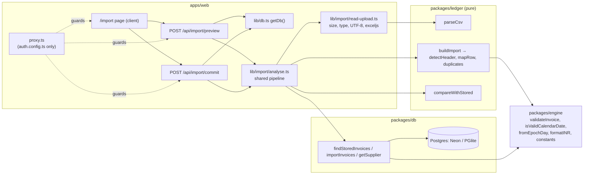
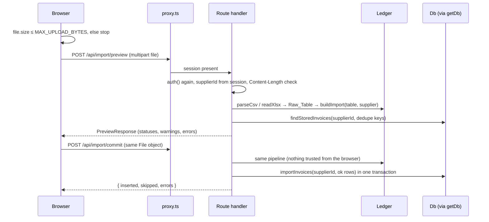

# Design Document: ledger-import

## Overview

Ledger import turns a supplier's CSV or XLSX file into stored invoices in four steps:

1. **Read.** The Web_App turns the upload into a Raw_Table of text cells. CSV goes through the Ledger's own parser. XLSX goes through exceljs with explicit cell conversion.
2. **Map.** The Ledger finds the header row, parses each data row leniently, builds an Engine `Invoice`, validates it with the Engine's `validateInvoice`, and computes the Dedupe_Key.
3. **Preview.** The Db reports which Dedupe_Keys are already stored. The Web_App labels each row `new`, `already_imported` or `error`.
4. **Commit.** The commit route repeats steps 1–3 on the server, then the Db inserts the new rows in one transaction with `ON CONFLICT DO NOTHING`.

| Part | Role | Runtime dependencies |
|---|---|---|
| `packages/engine` | Existing legal logic. Adds five exports (Requirement 2) and no logic | none |
| `packages/ledger` | Pure parsing and mapping | `@dues-banshee/engine` |
| `packages/db` | Schema, migrations, queries, seed, demo reset | engine, ledger, `drizzle-orm`, `@neondatabase/serverless` (PGlite in dev only) |
| `apps/web` | Demo sign-in, import page, API routes | engine, ledger, db, `next`, `react`, `next-auth`, `exceljs` |

### Research notes

- **Versions (npm, 12 Nov 2026):** `next` 16.4.6, `react` 19.3.1, `next-auth` 5.0.0-beta.32 (v5 is still published on the beta tag), `drizzle-orm` 0.45.4, `drizzle-kit` 0.31.11, `@electric-sql/pglite` 0.5.16, `@neondatabase/serverless` 1.2.0, `exceljs` 4.4.0, `tsx` 4.23.15. Node is 22.23.1. Exact pins go into `package.json` during the tasks phase.
- **Next.js 16 proxy.** The `middleware.ts` file convention is now called `proxy.ts`, and the exported function is `proxy` ([Next.js: Renaming Middleware to Proxy](https://nextjs.org/docs/messages/middleware-to-proxy)).
- **PGlite `clone()`.** This copies a database instance, so a migrated template can be cloned for each test or property run without being rebuilt ([PGlite API](https://pglite.dev/docs/api)).
- **Neon transactions.** The import needs an interactive transaction: insert buyers, read their ids, insert invoices. Drizzle's `neon-serverless` driver (a WebSocket `Pool`) supports this. Node 22 has a global `WebSocket`, so the `ws` package isn't needed.
- **Vercel body limit.** Vercel Functions reject request bodies over 4.5 MB with `FUNCTION_PAYLOAD_TOO_LARGE` ([Vercel KB](https://vercel.com/kb/guide/how-to-bypass-vercel-body-size-limit-serverless-functions)). The 4 MB upload limit (Requirement 13.2) leaves room for multipart overhead.
- **exceljs types.** exceljs returns JS `Date` objects for date cells, `{ formula, result }` objects for formulas, and `{ richText }` or `{ text, hyperlink }` for formatted text. When it reads CSV it guesses types, which is why CSV is not read with exceljs.

## Architecture



Dependencies point one way: web → db → ledger → engine. The Ledger and the Engine never import the Db or the Web_App. `proxy.ts` imports no Db code (see Web_App, Auth).

### Request flow



## Components and Interfaces

### Engine additions (Requirement 2)

The changes go in `validate.ts` and `index.ts`. No function changes behaviour.

```ts
// validate.ts: these replace the private arrays and are used by validateInvoice
export const SUPPLIER_CATEGORIES = Object.freeze(
  ["micro", "small", "medium", "unregistered"] as const satisfies readonly SupplierCategory[],
);
export const SUPPLIER_ACTIVITIES = Object.freeze(
  ["manufacturing", "services", "trading"] as const satisfies readonly SupplierActivity[],
);

// index.ts: new exports
export { validateInvoice, SUPPLIER_CATEGORIES, SUPPLIER_ACTIVITIES } from "./validate";
export { isValidCalendarDate, fromEpochDay } from "./calendar-date";
```

Both constants are readonly tuples, so the Db can pass them to `pgEnum` (Requirement 8.4).

### Ledger module layout (`packages/ledger/src`)

| File | Exports | Requirement |
|---|---|---|
| `types.ts` | `ImportField`, `RawRow`, `RawTable`, `SupplierFacts`, `ColumnRef`, `HeaderMapping`, `RowError`, `DedupeKey`, `OkRow`, `ErrorRow`, `RowResult`, `FileError`, `ImportParse`, `StoredInvoiceFacts` | — |
| `keys.ts` | `headerKey`, `textKey`, `dedupeKey` | 5.4, 7 |
| `amount.ts` | `parseAmountLenient` | 3 |
| `date.ts` | `parseDateLenient`, `EXCEL_SERIAL_MIN`, `EXCEL_SERIAL_MAX` | 4 |
| `credit-days.ts` | `parseCreditDays` | 6.2 |
| `csv.ts` | `parseCsv` | 5.1 |
| `headers.ts` | `HEADER_ALIASES`, `REQUIRED_FIELDS`, `detectHeader` | 5.4–5.12 |
| `map-row.ts` | `mapRow` | 6 |
| `build-import.ts` | `buildImport` | 5.11, 6.9, 7.3 |
| `compare.ts` | `compareWithStored` | 10.6 |
| `index.ts` | public API | — |

### Types

```ts
import type { CalendarDate, Invoice, Paise, SupplierActivity, SupplierCategory } from "@dues-banshee/engine";

export type ImportField = "invoiceNumber" | "buyerName" | "amount" | "invoiceDate" | "acceptanceDate" | "creditDays";

export interface RawRow { rowNumber: number; cells: readonly string[] }   // rowNumber is 1-based
export type RawTable = readonly RawRow[];

export interface SupplierFacts {
  id: string;
  supplierCategory: SupplierCategory;
  supplierActivity: SupplierActivity;
  udyamRegisteredOn?: CalendarDate;
}

export interface ColumnRef { index: number; header: string }             // header trimmed, as written
export interface HeaderMapping {
  headerRowNumber: number;
  columns: { [F in ImportField]?: ColumnRef };                            // required fields always present
  unused: ColumnRef[];
}

export interface RowError { column: string; reason: string }              // column = header as written
export interface DedupeKey { supplierId: string; buyerKey: string; invoiceNumberKey: string; value: string }

export interface OkRow {
  ok: true;
  rowNumber: number;
  invoice: Invoice;
  buyerName: string;
  invoiceNumber: string;
  invoiceDate: CalendarDate;
  acceptanceDateDefaulted: boolean;
  dedupeKey: DedupeKey;
  warnings: string[];
}
export interface ErrorRow { ok: false; rowNumber: number; errors: RowError[] }
export type RowResult = OkRow | ErrorRow;

export type FileErrorCode = "csv_syntax" | "missing_headers" | "duplicate_header" | "invalid_supplier";
export interface FileError { code: FileErrorCode; message: string }

export type ImportParse =
  | { ok: false; fileErrors: FileError[] }
  | { ok: true; mapping: HeaderMapping; rows: RowResult[] };

export interface StoredInvoiceFacts { amountPaise: Paise; invoiceDate: CalendarDate; acceptedOn: CalendarDate }
```

### keys.ts

```ts
export const headerKey = (s: string) => s.normalize("NFKC").toLowerCase().replace(/[^a-z0-9]/g, "");
export const textKey   = (s: string) => s.normalize("NFKC").trim().replace(/\s+/g, " ").toLowerCase();
export function dedupeKey(supplierId: string, buyerName: string, invoiceNumber: string): DedupeKey {
  const buyerKey = textKey(buyerName);
  const invoiceNumberKey = textKey(invoiceNumber);
  return { supplierId, buyerKey, invoiceNumberKey, value: JSON.stringify([supplierId, buyerKey, invoiceNumberKey]) };
}
```

`value` is JSON, so no delimiter in a buyer name can make two different keys collide. `mapRow` also uses `value` as the Engine `Invoice.id` (Requirement 6.4).

### amount.ts (Requirement 3)

`parseAmountLenient(raw)` trims the input, rejects it if it is longer than 64 characters, collapses every whitespace run (including non-breaking spaces) to one space, and matches the result against one anchored, case-insensitive regex. Every optional space is written as ` ?` inside the optional group it introduces, so no two optional whitespace groups are adjacent and a long run of spaces cannot make the match backtrack:

```
^(?:(₹|rs\.?|inr) ?)?                                    prefix
 (\d+|[1-9]\d?(?:,\d{2})*,\d{3}|[1-9]\d{0,2}(?:,\d{3})+)   plain | Indian | western
 (?:\.(\d+))?                                            fraction
 (?: ?(lakhs|lakh|lacs|lac|l|crores|crore))?             unit (longest first)
 (?: ?(\/-))?                                            "rupees only" mark
 (?: ?(dr|cr))?$                                         Balance_Suffix
```

| Unit | Multiplier in paise |
|---|---|
| none | 100n |
| Lakh_Unit | 10_000_000n |
| Crore_Unit | 1_000_000_000n |

Steps:

1. Blank after trimming → `is empty: <quoted raw>`.
2. Longer than 64 characters after trimming → `not a recognised amount: <quoted raw>`, before any regex runs. No match → the same reason. This covers negatives, malformed grouping (including a grouped number whose first group starts with 0, such as `012,000` or `0,12,000`), `500.`, `.50`, `Rs`, repeated parts and other letters. `Cr` can't be read as a unit, because the unit alternatives contain only `crore`/`crores`. A trailing `Cr` therefore reaches the suffix group.
3. Suffix `cr` → `Credit balance (Cr) is not a receivable: <quoted raw>`.
4. Integer arithmetic: `digits = int (commas removed) + frac`, `scaled = BigInt(digits) × multiplier`, `den = 10n ** BigInt(frac.length)`. A non-zero `scaled % den` → `more precise than one paisa: <quoted raw>`.
5. `scaled / den > BigInt(Number.MAX_SAFE_INTEGER)` → `above the largest supported amount (9007199254740991 paise): <quoted raw>`.
6. Return `Number(scaled / den)`.

`<quoted raw>` is `JSON.stringify(raw)`, the untrimmed input. Every error is `new ValidationError("amount", reason, raw)`, returned and never thrown. The whitespace collapse uses `\s`, which also matches the non-breaking spaces that Excel sometimes writes.

### date.ts (Requirement 4)

The input is trimmed. Blank gives `is empty`. Text longer than 64 characters gives `not a recognised date: <quoted raw>` before any pattern runs, so a 100,000-character cell cannot slow the parser. Otherwise the patterns are tested in this order:

| Pattern | Reading |
|---|---|
| `^\d+$` | Excel_Serial. 36526 ≤ n ≤ 73050 → `fromEpochDay(n − 25569)`. Otherwise `Excel serial outside 36526–73050 (2000–2099): <quoted raw>` (covers `2026`, `60`, `0`, `36525`, `73051`) |
| `^(\d{4})-(\d{1,2})-(\d{1,2})$` | ISO, year-month-day |
| `^(\d{1,2})([/.-])(\d{1,2})\2(\d{4})$` | Day, month, year. The back-reference `\2` rejects mixed separators |
| `^(\d{1,2})([/.-])(\d{1,2})\2(\d{2})$` | Rejected: `two-digit year; write the year in full or use a month name (02-Sep-26): <quoted raw>` |
| `^(\d{1,2})-([a-z]{3})-(\d{4}\|\d{2})$` (case-insensitive) | Day-Mon-year. Two-digit year → `20YY`. A name outside `jan`…`dec` → `unknown month: <quoted raw>` |
| anything else | `not a recognised date: <quoted raw>` |

Matched parts are zero-padded into `YYYY-MM-DD` and checked with the Engine's `isValidCalendarDate`. A failure gives `not a real calendar day: <quoted raw>`. Errors use field `date`. The serial offset 25569 is the number of days from Excel's day 0 (1899-12-30) to 1970-01-01, and is exact for every serial above 60. Example: 46267 − 25569 = 20698, and `fromEpochDay(20698)` is 2026-09-02.

### credit-days.ts

```ts
// ^(?:net ?)?(\d{1,6})(?: ?days?)?$  case-insensitive, run on the trimmed text with every whitespace run collapsed to one space.
// Blank → undefined (no agreed term). Over 64 characters after trimming → the same error as no match.
export function parseCreditDays(raw: string): number | undefined | ValidationError
```

The cap of six digits keeps `Number()` exact. `0` parses to 0, and the Engine's `validateInvoice` then rejects it (Requirement 6.6). Error: `ValidationError("creditDays", "not a number of days: <quoted raw>")`.

### csv.ts (Requirement 5.1)

`parseCsv(text): { ok: true; table: RawTable } | { ok: false; error: FileError }` is a small RFC 4180 state machine with these rules:

- Strip a leading `U+FEFF`.
- The delimiter is a comma.
- A field starting with `"` is quoted: `""` inside means `"`, and commas and line breaks inside are kept.
- Records end at CRLF, LF or a lone CR.
- A final line break doesn't create an empty record.
- An unterminated quote → `csv_syntax` error naming the record number.
- No type inference.

`rowNumber` is the 1-based record number. It is the spreadsheet row the owner sees when the file is opened in Excel, even when a quoted cell spans two text lines.

### headers.ts (Requirement 5.4–5.12)

```ts
export const HEADER_ALIASES = {
  invoiceNumber: ["Invoice No", "Invoice No.", "Invoice Number", "Invoice #", "Bill No", "Bill Number",
                  "Voucher No", "Voucher No.", "Voucher Number", "Ref. No.", "Reference No"],
  buyerName:     ["Party Name", "Party's Name", "Buyer", "Buyer Name", "Customer", "Customer Name", "Particulars"],
  amount:        ["Amount", "Invoice Value", "Invoice Amount", "Bill Amount", "Total", "Gross Total", "Pending Amount"],
  invoiceDate:   ["Invoice Date", "Bill Date", "Voucher Date", "Date"],
  acceptanceDate:["Acceptance Date", "Accepted On", "Date of Acceptance",          // Acceptance_Group
                  "Delivery Date", "Date of Delivery", "Delivered On"],            // Delivery_Group
  creditDays:    ["Credit Days", "Credit Period", "Terms", "Payment Terms"],
} as const satisfies Record<ImportField, readonly string[]>;
export const REQUIRED_FIELDS = ["invoiceNumber", "buyerName", "amount", "invoiceDate"] as const;
```

At module load the aliases are turned into a `Map<headerKey, ImportField>` and two key sets, one per `acceptanceDate` group. A unit test asserts that no Header_Key appears under two fields. One example: `Invoice #` and `Invoice` both normalise to `invoice`, so a bare `Invoice` header maps to `invoiceNumber`.

`detectHeader(table): { ok: true; mapping } | { ok: false; errors: FileError[] }`:

1. For each of the first 20 rows, map every non-blank cell's Header_Key to a field. Remember the row with the most required fields matched (the first such row on a tie).
2. At the first row where all four required fields match, resolve conflicts and stop:
   - A field with one column is mapped.
   - For `acceptanceDate` with exactly one Acceptance_Group column and exactly one Delivery_Group column, map the acceptance column and add the delivery column to `unused` (5.6).
   - Any other field with two or more columns → `duplicate_header`, naming every column: `Columns "Amount" and "Total" both map to amount. Rename or delete one.` (5.7)
3. If no row qualifies → `missing_headers` against the best row: `Missing columns: amount (accepted: Amount, Invoice Value, …)` (5.9).
4. `unused` = every other non-blank header cell in the header row (5.10).

### map-row.ts (Requirement 6)

`mapRow(row, mapping, supplier): RowResult`. A cell missing from a short row reads as `""`.

1. **Parse each mapped field and collect every error:**
   - `invoiceNumber`, `buyerName`, `amount` and `invoiceDate` must be non-blank after trimming. Otherwise the reason is `is required`.
   - `amount` uses `parseAmountLenient`. Dates use `parseDateLenient`. `creditDays` uses `parseCreditDays`.
   - Each error is `{ column: <header as written>, reason }`, where `reason` is the `ValidationError.reason`.
2. If any errors were found, return `{ ok: false, rowNumber, errors }`.
3. **Build the `Invoice`.** Fields: `id: dedupeKey.value`, `amountPaise`, and `acceptedOn` (acceptance date, or the invoice date with `acceptanceDateDefaulted = true`). Add `agreedTermDays` only when present, as `exactOptionalPropertyTypes` requires. Category, activity and `udyamRegisteredOn` come from `supplier` only. No `paidOn`.
4. **Call the Engine's `validateInvoice`.** If it throws a `ValidationError`, map `error.field` to a column:

   | Engine field | Column |
   |---|---|
   | `amountPaise` | amount |
   | `acceptedOn` | acceptance, or invoice date when defaulted |
   | `agreedTermDays` | credit days |

   Any other field, or any other exception, is rethrown as a bug. The supplier was checked in `buildImport`.
5. **Warnings.** For `agreedTermDays > 45`: `Credit term of N days is above the 45-day limit; the due date uses 45 days (MSMED-15)`.

### build-import.ts

`buildImport(table, supplier): ImportParse`:

1. **Check the supplier.** `SUPPLIER_CATEGORIES.includes(category)`, `SUPPLIER_ACTIVITIES.includes(activity)`, and `isValidCalendarDate` for `udyamRegisteredOn` when present. These use the Engine's own constants and check, so no rule is copied. A failure gives `invalid_supplier` (6.9).
2. Run `detectHeader`.
3. For every row after the header row: skip it if all mapped cells are blank (5.11), otherwise run `mapRow`.
4. **Within-file duplicates.** Walk the `ok` rows in order with a `Map<dedupeKey.value, rowNumber>`. A later `ok` row with a seen key becomes `{ ok: false, errors: [{ column: <invoice number header>, reason: "Duplicate of row N" }] }` (7.3).

### compare.ts

```ts
// Returns null when equal, otherwise "Differs from stored invoice: amount, invoice date, accepted date" (subset, this order)
export function compareWithStored(row: OkRow, stored: StoredInvoiceFacts): string | null
```

### Db (`packages/db`)

| File | Exports |
|---|---|
| `src/schema.ts` | tables and enums (Data Models) |
| `src/client.ts` | `createDb(url) → { db, close }` (Drizzle `neon-serverless` Pool); `type Db` = Drizzle `PgDatabase` over the schema, satisfied by both the Neon and PGlite drivers |
| `src/suppliers.ts` | `getSupplier(db, id): Promise<SupplierFacts & { name; udyamNumber }>`, `findSupplierIdByUdyam(db, udyamNumber)` |
| `src/bank-rate.ts` | `getBankRate(db, today): Promise<BankRate>`, `BANK_RATE_KEY = "rbi_bank_rate_bps"` |
| `src/invoices.ts` | `findStoredInvoices`, `importInvoices`, `toEngineInvoice`; private `insertInvoiceRows` |
| `src/seed.ts` | `DEMO_SUPPLIER`, `DEMO_INVOICES`, `seed(db)` |
| `src/reset.ts` | `RESET_TABLES`, `resetDemo(db)` |
| `src/testing.ts` (subpath `@dues-banshee/db/testing`) | `createTestDb()`: in-memory PGlite, migrations applied; `cloneTestDb(template)` |
| `scripts/seed.ts` | `db:seed` entry (reads `DATABASE_URL`, runs `seed`) |
| `scripts/reset-demo.ts` | `db:reset-demo` entry |
| `drizzle/` | committed SQL migrations from `drizzle-kit generate` |

```ts
export async function findStoredInvoices(db: Db, supplierId: string, keys: readonly DedupeKey[])
  : Promise<Map<string /* DedupeKey.value */, StoredInvoiceFacts>>;
export async function importInvoices(db: Db, supplierId: string, rows: readonly OkRow[])
  : Promise<{ inserted: number; skipped: number }>;
export function toEngineInvoice(invoice: InvoiceRow, supplier: SupplierRow): Invoice;
```

**`findStoredInvoices`** runs one query: `invoices ⋈ buyers WHERE supplier_id = $1 AND (b.name_key, i.invoice_number_key) IN (SELECT * FROM unnest($2::text[], $3::text[]))`.

**`importInvoices`** runs in one `db.transaction`:

1. Assert every `row.dedupeKey.supplierId === supplierId`. Throw otherwise, because a mismatch is a bug.
2. `SELECT` the supplier row. This gives the Supplier_Snapshot values.
3. Insert the distinct buyers by `buyerKey` (first-seen name) with `ON CONFLICT (supplier_id, name_key) DO NOTHING`, then `SELECT id, name_key` for those keys.
4. Call `insertInvoiceRows` in chunks of 500 with `ON CONFLICT (supplier_id, buyer_id, invoice_number_key) DO NOTHING RETURNING id`. `inserted` is the number of rows returned and `skipped` is `rows.length − inserted`. Postgres allows repeated keys within one `DO NOTHING` statement, so repeated rows in the input are skipped and don't fail.
5. Any other error rolls back the whole transaction (10.4).

**`insertInvoiceRows(tx, supplierRow, rows)`** is the only code that writes `invoices`, and both import and seed use it. Its row type has no category or activity fields. It copies both from `supplierRow`, which is how Requirement 8.7's "no way to set them" holds. Seed rows may also carry `paidOn`.

**`toEngineInvoice`** returns:

| Engine field | Source |
|---|---|
| `id` | `invoice.id` |
| `amountPaise` | `invoice.amount_paise` |
| `acceptedOn` | `invoice.accepted_on` |
| `agreedTermDays` | `invoice.agreed_term_days`, omitted when null |
| `supplierCategory`, `supplierActivity` | the invoice's Supplier_Snapshot |
| `udyamRegisteredOn` | `supplier.udyam_registered_on`, omitted when null |
| `paidOn` | `invoice.paid_on`, omitted when null |

It computes nothing.

**`getBankRate`** checks `today` with `isValidCalendarDate`, then runs `SELECT value_int, effective_from FROM config WHERE key = $1 AND effective_from <= $2 ORDER BY effective_from DESC LIMIT 1`. It returns `{ annualBps: value_int, asOf: effective_from }`, or throws `Error('config "rbi_bank_rate_bps": no row effective on or before 2026-10-06')`.

**Seed.** `seed(db)` runs in `db.transaction` (a savepoint when `db` is already a transaction):

1. Insert the supplier with `ON CONFLICT (udyam_number) DO NOTHING`, then read it back.
2. Insert the config row with `ON CONFLICT (key, effective_from) DO NOTHING`.
3. Insert the buyers and invoices through the same buyer upsert and `insertInvoiceRows`.

Running it again inserts nothing. The data is in Requirement 11. `DEMO_SUPPLIER.udyamNumber` (`UDYAM-MH-00-0000000`) is how sign-in finds the demo supplier.

**Demo reset.**

```ts
// src/reset.ts
export const RESET_TABLES = [
  "agent_runs", "payment_links", "approvals", "calls", "messages",
  "promises", "escalation_events", "invoices", "buyers", "suppliers",
] as const;   // every table except config

export async function resetDemo(db: Db): Promise<void> {
  await db.transaction(async (tx) => {
    await tx.execute(sql.raw(`TRUNCATE ${RESET_TABLES.join(", ")} RESTART IDENTITY CASCADE`));
    await seed(tx);
  });
}
```

- `config` is kept, so bank-rate history set by hand survives a reset. `seed` re-adds the 575 bps row only if it's missing.
- `TRUNCATE … CASCADE` would also empty any table with a foreign key into the listed tables. `config` has no foreign keys, so it is untouched.
- `RESET_TABLES` is a literal list. A test asserts it equals every table in `schema.ts` except `config`, so a table added by a later spec fails the test until the list is updated.
- `RESTART IDENTITY` has no effect on the current uuid keys. It is kept so that a later serial column is reset too.

`scripts/reset-demo.ts` (`pnpm --filter @dues-banshee/db db:reset-demo -- --yes`):

1. Without `--yes` in `process.argv`, it prints `Refusing to reset: this deletes every supplier, buyer and invoice. Re-run with --yes.` and exits with code 1 before connecting.
2. With `--yes`, it prints the target host from `DATABASE_URL` (no user or password), runs `resetDemo`, prints `Demo data reset.`, and closes the client.
3. If `DATABASE_URL` is unset, it exits with code 1.

**Drivers.** `createDb` uses `drizzle-orm/neon-serverless` with `new Pool({ connectionString })`. Tests use `drizzle-orm/pglite` with `migrate()` from `drizzle-orm/pglite/migrator` on the same `drizzle/` folder (8.9). Production migrations run with `drizzle-kit migrate`.

### Web_App (`apps/web`)

```
apps/web/
  next.config.ts          transpilePackages: engine, ledger, db (they export TS source)
  auth.config.ts          NextAuthConfig: jwt session, pages.signIn, callbacks, providers: [] (no Db imports)
  auth.ts                 NextAuth({ ...authConfig, providers: [demo Credentials] }), uses getDb()
  proxy.ts                NextAuth(authConfig) only; never imports auth.ts
  app/layout.tsx
  app/(site)/signin/page.tsx       one <form action={signInDemo}><button>Enter the graveyard (demo)</button></form>
  app/(app)/layout.tsx             server-side auth() check, redirect("/signin")
  app/(app)/import/page.tsx        client component + import.module.css
  app/api/auth/[...nextauth]/route.ts
  app/api/import/preview/route.ts
  app/api/import/commit/route.ts
  lib/db.ts                        getDb(): { db, close }
  lib/import/limits.ts             MAX_UPLOAD_BYTES = 4 * 1024 * 1024, MAX_DATA_ROWS = 5000
  lib/import/read-upload.ts        File → Raw_Table or { status, message }
  lib/import/read-xlsx.ts          exceljs → Raw_Table
  lib/import/analyse.ts            shared pipeline for preview and commit
  types/next-auth.d.ts             Session and JWT carry supplierId
  .env.example                     DATABASE_URL=, AUTH_SECRET=
```

**lib/db.ts.**

```ts
import { createDb, type Db } from "@dues-banshee/db";

export function getDb(): { db: Db; close: () => Promise<void> } {
  const url = process.env.DATABASE_URL;
  if (!url) throw new Error("DATABASE_URL is not set");
  return createDb(url);
}
```

`getDb()` is the only way route handlers, server actions and `auth.ts` reach the database. Each caller closes the client in `finally`:

```ts
const { db, close } = getDb();
try { /* … */ } finally { await close(); }
```

**Auth.** The configuration is split so that `proxy.ts` never bundles Db code.

```ts
// auth.config.ts: no Db imports
export const authConfig = {
  session: { strategy: "jwt" },
  pages: { signIn: "/signin" },
  providers: [],                                   // added in auth.ts
  callbacks: {
    jwt({ token, user }) { if (user?.supplierId) token.supplierId = user.supplierId; return token; },
    session({ session, token }) { session.supplierId = token.supplierId; return session; },
  },
} satisfies NextAuthConfig;
```

```ts
// auth.ts: full config, used by route handlers, layouts and server actions
export const { auth, handlers, signIn, signOut } = NextAuth({
  ...authConfig,
  providers: [Credentials({ id: "demo", credentials: {}, authorize: authorizeDemo })],
});
```

`authorizeDemo` calls `getDb()` and `findSupplierIdByUdyam(DEMO_SUPPLIER.udyamNumber)`. It returns `{ id: "demo-user", name: "Demo owner", supplierId }`, or null when the demo supplier is missing. On null, the sign-in page shows "Demo data is not seeded". `signInDemo` is a server action calling `signIn("demo", { redirectTo: "/import" })`. The form has a button and no fields (12.2).

**Proxy.** It builds its own `auth` from `authConfig` and doesn't import `auth.ts`:

```ts
// proxy.ts
import NextAuth from "next-auth";
import { authConfig } from "./auth.config";

const { auth } = NextAuth(authConfig);

export const proxy = auth((req) => {
  if (req.auth?.supplierId) return;
  if (req.nextUrl.pathname.startsWith("/api/")) {
    return Response.json({ error: "Unauthorized" }, { status: 401 });
  }
  return Response.redirect(new URL("/signin", req.nextUrl));
});

export const config = {
  matcher: ["/import/:path*", "/graveyard/:path*", "/debtor/:path*", "/api/import/:path*"],
};
```

The proxy only decodes the JWT cookie with `AUTH_SECRET`. It needs no provider and no database.

An ESLint `no-restricted-imports` rule on `apps/web/proxy.ts` and `apps/web/auth.config.ts` bans `./auth`, `@/auth`, `@/lib/db` and `@dues-banshee/db`, so the separation can't regress silently. Route handlers and the `(app)` layout call `auth()` from `auth.ts` again (12.5), so a proxy misconfiguration can't expose them. Auth.js sets the session cookie `SameSite=Lax`, so a cross-site POST arrives without a session and gets a 401.

**Upload limit (13.2).** `MAX_UPLOAD_BYTES` in `lib/import/limits.ts` is the single source, and that file imports nothing else, so it is safe in client code.

- **Browser.** The import page imports `MAX_UPLOAD_BYTES` and checks `file.size` when a file is chosen. A larger file shows `File is larger than 4 MB` and is never uploaded.
- **Server, before reading the body.** The route checks `Content-Length` against `MAX_UPLOAD_BYTES + 64 KiB` (multipart overhead), returning 413 without reading the body.
- **Server, after reading.** `read-upload.ts` checks `file.size > MAX_UPLOAD_BYTES` (413).
- **Message.** Both checks show `File is larger than ${MAX_UPLOAD_BYTES / 1024 / 1024} MB`.

**read-upload.ts.**

| Check | Result |
|---|---|
| No file, or `file.size > MAX_UPLOAD_BYTES` | 413 `File is larger than 4 MB` |
| Name ends `.csv` | `TextDecoder("utf-8", { fatal: true })`. Failure → 422 `File is not UTF-8 text`. Otherwise `parseCsv`, and `csv_syntax` → 422 |
| Name ends `.xlsx` | First four bytes must be `PK\x03\x04`. Then `readXlsx`. A load failure → 422 `Not a valid XLSX file` |
| Other | 415 `Upload a .csv or .xlsx file` |
| Raw_Table longer than `MAX_DATA_ROWS + 20` | 422 before mapping, so a huge file isn't mapped row by row. The exact count of data rows is checked again after `buildImport` |

**read-xlsx.ts** (Requirement 5.2). Reads `workbook.worksheets[0]` and calls `eachRow({ includeEmpty: false }, (row, rowNumber) => …)`. Each cell becomes `cellText(cell.value)`:

| `cell.value` | Text |
|---|---|
| `number` | `String(value)` (never `cell.text`, so `#,##0` can't drop paise) |
| `Date` | `YYYY-MM-DD` from `getUTCFullYear/Month/Date` |
| `string` / `boolean` | `String(value)` |
| `{ formula, result }` / `{ sharedFormula, result }` | `cellText(result)`, recursively |
| `{ richText }` | joined `text` parts |
| `{ text, hyperlink }` | `text` |
| `{ error }` | the error code, e.g. `#N/A` |
| `null` / `undefined` | `""` |

The worksheet's row numbers are kept, so error messages match the row numbers Excel shows.

**analyse.ts.**

```ts
export async function analyseUpload(db: Db, supplierId: string, file: File | null)
  : Promise<{ ok: false; status: number; message: string; fileErrors?: FileError[] }
          | { ok: true; preview: PreviewResponse; okRows: OkRow[] }>;
```

1. `readUpload(file)`.
2. `getSupplier(db, supplierId)`.
3. `buildImport(table, supplier)`. File errors → 422 with `fileErrors`.
4. More than 5,000 data rows → 422 (13.2).
5. `findStoredInvoices` for the `ok` rows.
6. Classify each row:
   - an `ok` row with no stored match → `new`;
   - an `ok` row with a stored match → `already_imported`, plus the `compareWithStored` warning if one applies;
   - every other row → `error`.
7. Amounts are formatted with `formatINR(amountPaise, "full")` on the server.

```ts
interface PreviewResponse {
  headerRowNumber: number;
  unusedColumns: string[];
  counts: { new: number; already_imported: number; error: number };
  rows: PreviewRow[];
}
interface PreviewRow {
  rowNumber: number;
  status: "new" | "already_imported" | "error";
  invoiceNumber?: string; buyerName?: string; amountText?: string;
  invoiceDate?: string; acceptedOn?: string; acceptanceDateDefaulted?: boolean;
  warnings: string[];
  errors: RowError[];
}
```

**Routes.** Both are `POST` with `multipart/form-data` field `file`. Each one:

1. calls `auth()` from `auth.ts` and takes `supplierId` only from the session (13.7);
2. checks `Content-Length`;
3. gets the database with `getDb()` and closes it in `finally`.

- **Preview** returns `analyseUpload`'s preview.
- **Commit** reruns `analyseUpload`, then calls `importInvoices(db, supplierId, okRows)` and returns `{ inserted, skipped, errors: counts.error }`.

  `okRows` includes the `already_imported` rows. The database skips them, and that keeps the count correct if another import lands between preview and commit.

**Import page.** The page is a client component with these elements:

- a file input (`accept=".csv,.xlsx"`) with the browser size check;
- a **Preview** button;
- a summary line with the counts and unused columns;
- a plain table with the 13.4 columns, where the acceptance-defaulted marker reads "defaulted to invoice date";
- an **Import N new invoices** button, disabled when N is 0, which posts the same `File` object to commit;
- a result line.

Styling is a small CSS module with no theme work (that is out of scope).

## Data Models

### Enums (from Engine constants)

```ts
const tuple = <T extends string>(v: readonly T[]): [T, ...T[]] => {
  if (v.length === 0) throw new Error("enum needs at least one value");
  return [...v] as [T, ...T[]];
};
export const ladderStep       = pgEnum("ladder_step",       tuple(LADDER_STEPS));
export const approvalStep     = pgEnum("approval_step",     tuple(APPROVAL_STEP_LIST));
export const supplierCategory = pgEnum("supplier_category", tuple(SUPPLIER_CATEGORIES));
export const supplierActivity = pgEnum("supplier_activity", tuple(SUPPLIER_ACTIVITIES));
export const approvalStatus   = pgEnum("approval_status",   ["pending", "approved", "rejected"]);
```

`approval_status` is not an Engine concept, so it is defined here. Message, payment-link and channel statuses are `text` for now. The specs that own them (`whatsapp-channel`, payments) will constrain them.

### Tables

Every table has `id uuid primary key default gen_random_uuid()` and `created_at timestamptz not null default now()`. Money columns are `bigint("…", { mode: "number" })`. Calendar dates are `date("…", { mode: "string" })`. Instants are `timestamp("…", { withTimezone: true })`. Foreign keys use `on delete restrict`.

| Table | Columns (beyond id, created_at) | Constraints |
|---|---|---|
| `suppliers` | `name text`, `udyam_number text`, `supplier_category`, `supplier_activity`, `udyam_registered_on date null` | `unique(udyam_number)`; `check udyam_number ~ '^UDYAM-[A-Z]{2}-[0-9]{2}-[0-9]{7}$'` |
| `buyers` | `supplier_id → suppliers`, `name text`, `name_key text` | `unique(supplier_id, name_key)`; `unique(id, supplier_id)` (target of the composite FK below) |
| `invoices` | `supplier_id`, `buyer_id`, `invoice_number text`, `invoice_number_key text`, `invoice_date date`, `accepted_on date`, `acceptance_date_defaulted boolean default false`, `agreed_term_days integer null`, `amount_paise bigint`, `paid_on date null`, `supplier_category`, `supplier_activity` | `unique(supplier_id, buyer_id, invoice_number_key)`; FK `(buyer_id, supplier_id) → buyers(id, supplier_id)`, so an invoice can't point at another supplier's buyer; `check amount_paise between 1 and MAX_PAISE` (value interpolated from the Engine constant); `check agreed_term_days is null or agreed_term_days > 0` |
| `escalation_events` | `invoice_id`, `step ladder_step`, `occurred_on date` | — |
| `promises` | `invoice_id`, `promised_date date`, `amount_paise bigint`, `recorded_on date` | `check amount_paise between 1 and MAX_PAISE` (`promises_amount_range`) |
| `messages` | `invoice_id`, `channel text`, `direction text`, `body text`, `status text` | — |
| `calls` | `invoice_id`, `started_at timestamptz`, `ended_at timestamptz null`, `transcript text null` | — |
| `approvals` | `invoice_id`, `step approval_step`, `status approval_status default 'pending'`, `decided_at timestamptz null` | — |
| `payment_links` | `invoice_id`, `provider_link_id text`, `url text`, `amount_paise bigint`, `status text` | `check amount_paise between 1 and MAX_PAISE` (`payment_links_amount_range`) |
| `agent_runs` | `tool text`, `input jsonb`, `output jsonb null`, `invoice_id null` | — |
| `config` | `key text`, `value_int integer`, `effective_from date` | `unique(key, effective_from)` |

`escalation_events` and `promises` map onto the Engine's `StepEvent` (`occurred_on` → `on`) and `PromiseEvent`. The `escalation-ladder` spec will add the loader. All non-null columns not marked `null` are `not null`.

Excerpt for the import-critical table:

```ts
export const invoices = pgTable("invoices", {
  id: uuid().primaryKey().defaultRandom(),
  supplierId: uuid("supplier_id").notNull().references(() => suppliers.id, { onDelete: "restrict" }),
  buyerId: uuid("buyer_id").notNull(),
  invoiceNumber: text("invoice_number").notNull(),
  invoiceNumberKey: text("invoice_number_key").notNull(),
  invoiceDate: date("invoice_date", { mode: "string" }).notNull(),
  acceptedOn: date("accepted_on", { mode: "string" }).notNull(),
  acceptanceDateDefaulted: boolean("acceptance_date_defaulted").notNull().default(false),
  agreedTermDays: integer("agreed_term_days"),
  amountPaise: bigint("amount_paise", { mode: "number" }).notNull(),
  paidOn: date("paid_on", { mode: "string" }),
  supplierCategory: supplierCategory("supplier_category").notNull(),
  supplierActivity: supplierActivity("supplier_activity").notNull(),
  createdAt: timestamp("created_at", { withTimezone: true }).notNull().defaultNow(),
}, (t) => [
  unique("invoices_dedupe_key").on(t.supplierId, t.buyerId, t.invoiceNumberKey),
  foreignKey({ columns: [t.buyerId, t.supplierId], foreignColumns: [buyers.id, buyers.supplierId] }).onDelete("restrict"),
  check("invoices_amount_range", sql`${t.amountPaise} between 1 and ${sql.raw(String(MAX_PAISE))}`),
  check("invoices_term_positive", sql`${t.agreedTermDays} is null or ${t.agreedTermDays} > 0`),
]);
```

`bigint` in number mode is safe because check constraints cap `amount_paise` at MAX_PAISE (10¹³), which is below 2⁵³, on all three tables that have such a column: `invoices` (`invoices_amount_range`), `promises` (`promises_amount_range`) and `payment_links` (`payment_links_amount_range`).

### Hand-check: Bansal Hardware (Requirement 11.5)

Facts: 5,500,000 paise, accepted 2024-03-01, term 30, unpaid, supplier `micro`/`manufacturing`, `udyamRegisteredOn` 2024-04-15, `today` 2026-11-12, 575 bps.

**Which engine code runs.** `compoundInterestPaise` in `packages/engine/src/statutory-interest.ts` has two branches:

- **Lines 26–37, whole-month rests.** Taken when `days % 30 === 0`. Exact BigInt arithmetic, no floating point.
- **Lines 38–40, partial months.** Taken for every other day count. **This branch uses floating point.** It computes with IEEE-754 doubles through `Math.expm1` and `Math.log1p` (not `Math.pow`):

  ```ts
  const monthlyRate = (3 * annualBps) / MONTHLY_RATE_DENOMINATOR;                         // line 38
  const exact = amountPaise * Math.expm1((days / DAYS_PER_REST) * Math.log1p(monthlyRate)); // line 39
  const interest = Math.floor(exact + 0.5);                                               // line 40
  ```

Bansal has 956 accrual days. 956 % 30 = 26, so the floating-point branch runs. The Ledger and the Db do no interest arithmetic. The Engine is unchanged by this spec.

| Value | Working | Result |
|---|---|---|
| Coverage | Micro and manufacturing, so covered. Registration 2024-04-15 is after acceptance 2024-03-01, so the Registered_After_Supply_Caveat applies and `ruleIds` is `["MSMED-SCOPE"]` | `{ applicable: true, caveat: "registered_after_supply", ruleIds: ["MSMED-SCOPE"] }` |
| Due date | 2024-03-01 + 30 days. March has 31 days, so day 30 after 1 March is 31 March | 2024-03-31 |
| Accrual days | 2024-03-31 → 2025-03-31: 365 (29 Feb 2024 falls before the start, and 2025 is not a leap year). → 2026-03-31: 365. → 2026-11-12: Apr 30 + May 31 + Jun 30 + Jul 31 + Aug 31 + Sep 30 + Oct 31 = 214, + 12 = 226 | 365 + 365 + 226 = **956** |
| Monthly rate | 3 × 575 / 120,000 (line 38) | 0.014375 |
| Exponent | ln(1.014375) by series: 0.014375 − 0.00010332031 + 0.00000099015 − 0.00000001068 + 0.00000000012 = 0.0142726593. Times 956/30 = 31.866667 (line 39) | 0.4548220759 |
| Growth | e^0.4548220759 = e^0.45 × e^0.0048220759 = 1.5683121855 × 1.0048337208 | 1.5758929688 |
| Interest | 5,500,000 × 0.5758929688 = 3,167,411.33, rounded half-up (line 40) | **3,167,411 paise** (₹31,674.11) |
| Tax bomb | Acceptance is in FY 2023-24, so Tax_Bomb_Date is 2024-03-31. Deduction_Deadline is the later of 2024-03-31 and the due date 2024-03-31. The invoice is unpaid and `today` is after the deadline | `exploded` |

**Why the float result is safe here.** Python `Decimal` at 50 significant digits gives 3,167,411.3284455… paise. A double carries about 16 significant digits, so the float error on a value near 3.2 × 10⁶ is about 10⁻⁹ paise. The fraction 0.33 is 0.17 away from the 0.5 rounding boundary, so the floating-point branch can't round to a different integer. The engine returned exactly 956 and 3167411 in a scratch run on 12 Nov 2026. The seed test pins both values (11.5), so any change in the engine's float path that moved the result would fail the test.

## Correctness Properties

*A property is a characteristic or behavior that should hold true across all valid executions of a system: a formal statement about what the system should do. Properties serve as the bridge between human-readable specifications and machine-verifiable correctness guarantees.*

### Property 1: Every accepted amount style parses back to the same paise

*For any* Paise value `p` from 0 to MAX_SAFE, and any rendering of `p` from the generator below, `parseAmountLenient(rendering) === p` exactly. The rendering is plain, Indian-grouped, western-grouped, lakh or crore exact decimal. It has an optional prefix `₹`, `Rs`, `Rs.` or `INR` (with or without a space), units in random case, and an optional `/-` and ` Dr`.

**Validates: Requirements 3.2, 3.4, 3.8**

### Property 2: Re-importing never adds invoices

*For any* list of `ok` Row_Results built by `mapRow` from rows drawn from small pools of buyer names and invoice numbers (with case and spacing variants, so keys repeat), and any N from 1 to 5, importing the list N times into a fresh PGlite database leaves exactly `distinct(rows.map(r => r.dedupeKey.value)).length` invoices. Every import after the first reports `inserted === 0`.

**Validates: Requirements 7.1, 7.2, 8.5, 10.1, 10.2, 10.8**

### Generators

- **`arbPaise` (ledger `test/arbitraries.ts`):** `fc.oneof(fc.integer({ min: 0, max: 10_000_000 }), fc.maxSafeNat())`, biased to 0, 1, 99, 100, multiples of 10⁷ and 10⁹, and MAX_SAFE.
- **`arbAmountText(p)`:** chooses a style and renders `p` with code written separately from the parser:
  - Plain: `rupees` and `paise` come from BigInt division by 100n, written as `${rupees}.${pp}`, or just `${rupees}` (optionally `.00`) when `paise` is 0.
  - Indian: `formatINR(p, "full")` with the `₹` removed, plus optional `.00` when `paise` is 0. This uses the Engine's formatter as an independent, already-tested oracle.
  - Western: rupee digits grouped by `/\B(?=(\d{3})+(?!\d))/g`.
  - Lakh: `p.toString().padStart(8, "0")` split before the last 7 digits, with trailing zeros and a trailing point removed.
  - Crore: the same with 9 digits.
  - Then optional prefix, random-case unit spelling from the Lakh_Unit and Crore_Unit lists, optional spaces between parts, optional `/-`, and optional ` Dr`/` dr`/` DR`.
- **`arbImportRows` (db `test/arbitraries.ts`):** 0–30 rows. Buyer drawn from 3 names × variants (`Sharma Traders`, `  SHARMA traders`, `sharma  Traders `). Invoice number drawn from 5 values × case variants. Amount 1–10⁹ paise rendered as rupees. Date from 2025–2026 in `DD/MM/YYYY`. Credit days optional 1–60. Each row goes through `mapRow` with the demo supplier. `N` comes from `fc.integer({ min: 1, max: 5 })`.
- **Fresh database per run:** `beforeAll` builds a template with `createTestDb()` (migrations applied, demo supplier inserted). Each property run calls `template.clone()` and closes the clone afterwards.

## Error Handling

**Ledger.** Parse and validation failures are values, never exceptions:

- Field parsers return an Engine `ValidationError`.
- `mapRow` returns `{ ok: false, errors }`.
- `buildImport` and `parseCsv` return `FileError`s.

Every reason quotes the raw input with `JSON.stringify`. Exceptions escape the Ledger only for bugs, for example an unexpected Engine field during error mapping or a non-`ValidationError` from the Engine. Those reach the route handler as a 500.

**Reason strings** (exact, tested):

| Source | Reason |
|---|---|
| amount | `is empty: "…"`, `not a recognised amount: "…"`, `Credit balance (Cr) is not a receivable: "…"`, `more precise than one paisa: "…"`, `above the largest supported amount (9007199254740991 paise): "…"` |
| date | `is empty: "…"`, `not a recognised date: "…"`, `two-digit year; write the year in full or use a month name (02-Sep-26): "…"`, `unknown month: "…"`, `not a real calendar day: "…"`, `Excel serial outside 36526–73050 (2000–2099): "…"` |
| credit days | `not a number of days: "…"` |
| required cell | `is required` |
| duplicate row | `Duplicate of row N` |
| Engine | the Engine's own `reason`, unchanged (e.g. `must be an integer between 1 and 10000000000000 paise`) |

The credit-balance reason starts with the exact text required by 3.3 and ends with the quoted input required by 3.1.

**HTTP.**

| Case | Status | Body |
|---|---|---|
| No session | 401 | `{ error: "Unauthorized" }` |
| `Content-Length` or file over the limit | 413 | `{ error: "File is larger than 4 MB" }` |
| Not CSV/XLSX | 415 | `{ error }` |
| Not UTF-8, bad XLSX, CSV syntax, missing or duplicate headers, invalid supplier, too many rows | 422 | `{ error, fileErrors? }` |
| Preview or commit success (row errors included) | 200 | `PreviewResponse` / `{ inserted, skipped, errors }` |
| Database or unexpected error | 500 | `{ error: "Import failed. Nothing was saved." }`. The server logs the error and row numbers, never cell contents |

**Db.** `importInvoices` and `resetDemo` each run in one transaction, so any failure leaves the database unchanged (10.4). `getBankRate` throws when no rate is in force. Callers (later specs) must stop rather than compute interest without a rate.

## Testing Strategy

**Tools.** Vitest (`vitest run`) in every package, and fast-check for properties.

- Ledger: `test/setup.ts` sets `fc.configureGlobal({ numRuns: 200 })`.
- Db: Property 2 sets `numRuns: 50` on its own assertion, because each run clones a database.
- Property tests carry the tag `// Feature: ledger-import, Property N: <title>`.

**Ledger unit tests.**

| Test | Expected | Requirement |
|---|---|---|
| Every row of the 3.6 table | exact paise | 3.6 |
| Every input in 3.7 | `ValidationError`, field `amount`, exact reason | 3.3, 3.7 |
| Every row of the 4.5 table | exact Calendar_Date | 4.5 |
| Every input in 4.6 | `ValidationError`, field `date`, exact reason | 4.6 |
| `parseCreditDays`: `45`, `45 days`, `Net 30`, `1 day`, blank, `abc`, `1234567` | 45, 45, 30, 1, undefined, error, error | 6.2 |
| CSV: quoted comma (`"4,12,000"`), `""` escape, CRLF, LF, lone CR, BOM, newline in quotes, trailing newline, unterminated quote | cells and row numbers exact; `csv_syntax` | 5.1 |
| Alias table | no Header_Key under two fields | 5.4 |
| Tally bills-receivable fixture with 3 title rows | header row 4; four mapped; three unused | 5.8, 5.12 |
| Each Delivery_Group header alone | mapped to `acceptanceDate` | 5.5 |
| `Acceptance Date` + `Delivery Date` | acceptance mapped, delivery unused | 5.6 |
| `Delivery Date` + `Delivered On`; `Acceptance Date` + `Accepted On`; `Amount` + `Total` | `duplicate_header` naming both | 5.7 |
| No qualifying row in the first 20 | `missing_headers` listing fields and aliases | 5.9 |
| All-blank data row | skipped | 5.11 |
| Sharma row (6.10) | exact `OkRow` fields | 6.10 |
| Row with blank buyer and bad amount | two errors, one per column | 6.3 |
| Amount `0`; amount `₹1,000.01 crore`; credit days `0` | Engine reason on the amount / credit-days column | 6.6 |
| Bad date with no acceptance column | error on the invoice-date column | 6.6 |
| Credit days `60` | `ok: true` with the MSMED-15 warning | 6.8 |
| Supplier with category `large` | `invalid_supplier` | 6.9 |
| `Sharma Traders` vs `  SHARMA   traders ` | equal `dedupeKey.value` | 7.2 |
| Same key twice in one file | second row `Duplicate of row N` | 7.3 |
| `compareWithStored` with each subset of differences | exact warning text and field order | 10.6 |

**Db tests (PGlite).**

| Test | Expected | Requirement |
|---|---|---|
| Enum values via `pg_enum` ordered by `enumsortorder` | equal to `LADDER_STEPS`, `APPROVAL_STEP_LIST`, `SUPPLIER_CATEGORIES`, `SUPPLIER_ACTIVITIES` | 8.4 |
| Insert `UDYAM-mh-00-0000000`, `UDYAM-MH-0-0000000` | check violation; `UDYAM-MH-00-0000000` accepted | 8.6 |
| Raw duplicate insert of a Dedupe_Key | unique violation | 8.5 |
| Raw insert with another supplier's buyer | FK violation | 8.5 |
| Supplier_Snapshot after seed and after import | equals the supplier's values | 8.7 |
| `getBankRate` at 2026-10-06 / 2026-10-07 / 2026-11-12 | throws / 575 / 575, `asOf` 2026-10-07 | 9.4 |
| Seed twice | identical table contents | 11.1 |
| Seed rows through `toEngineInvoice` | every value in the 11.4 table, Sharma 512794, Bansal values in 11.5 | 11.4, 11.5 |
| Import, then a forced failure mid-transaction | nothing written | 10.4 |
| Same rows imported twice | second call `{ inserted: 0, skipped: n }` | 10.3, 10.9 |
| Property 2 | — | 10.8 |
| `RESET_TABLES` | equals every `schema.ts` table except `config` | demo reset |
| Seed, import 3 extra rows, add a second `config` row, `resetDemo` | contents equal a fresh seeded clone; the extra `config` row survives | demo reset |
| `resetDemo` with `seed` forced to throw | transaction rolls back; the 3 extra rows are still present | demo reset |
| `reset-demo` script without `--yes` | exit code 1, refusal message, no database call | demo reset |

"Contents equal" compares each table's rows projected onto their natural columns, so it ignores `id`, foreign-key uuids and `created_at`, which differ between runs. Buyers are compared by `name_key`, and invoices by `(buyer name_key, invoice_number_key)` plus their data columns, sorted.

**Web tests (Vitest, node environment).** All of these run against PGlite:

- `vi.mock("@/lib/db")` makes `getDb()` return `{ db: clone, close: async () => {} }`, where `clone` is a fresh `template.clone()` from `@dues-banshee/db/testing`, seeded in `beforeEach`.
- `vi.mock("@/auth")` makes `auth()` return either `null` or `{ supplierId: <seeded demo supplier id> }`.

| Test | Expected | Requirement |
|---|---|---|
| Workbook built with exceljs: amount cell 412000.6, `numFmt "#,##0"`; date cell; formula cell with numeric result | `"412000.6"` → 41_200_060 paise; `YYYY-MM-DD`; result text | 5.2, 5.3 |
| Preview route with the Sharma CSV after seed | `already_imported`, no warning | 10.5 |
| Sharma with `₹4,15,000`: preview route, then commit route | warning `Differs from stored invoice: amount`; stored `amount_paise` still 41_200_000 | 10.6, 10.7 |
| File of 4 MB + 1 byte; `Content-Length` over the limit; `.txt`; invalid UTF-8; 5,001 data rows | 413; 413 without reading the body; 415; 422; 422 | 13.2 |
| Preview route, then commit route, with `auth` mocked to `null` | 401; invoice count in the PGlite clone unchanged | 12.5 |
| Commit body with an extra `supplierId` field naming a second supplier inserted in the clone | rows written under the session's supplier only; second supplier has 0 invoices | 13.7 |
| `MAX_UPLOAD_BYTES` | equals 4 × 1024 × 1024, and the page and `read-upload.ts` import the same constant | 13.2 |

**Engine.** The existing suite passes unchanged (2.3).

**Static checks.** `pnpm typecheck` and `pnpm lint` cover the Ledger bans (1.3, 1.4) and the proxy import ban. A lint fixture test runs ESLint on:

- a snippet containing `parseFloat`, `0.5`, `1e3` and `x.toFixed(2)` in a `packages/ledger/src` path, expecting four errors;
- a `proxy.ts` snippet importing `./auth`, expecting one error.

**Manual check.** `pnpm --filter web dev`, sign in, upload the Sharma CSV and a Tally XLSX, confirm, and re-upload. Then try a 5 MB file and confirm the browser blocks it before any request. This covers 12.2, 13.1–13.6 and the browser half of 13.2. The import page's UI has no automated test in this spec.

## Decisions

1. **CSV parser.** I wrote it in the Ledger instead of using a library, so the Ledger keeps a single dependency and the lint bans apply to it.
2. **Credit-balance reason.** It is `Credit balance (Cr) is not a receivable: "<raw>"`, which satisfies both 3.1 (quotes the input) and 3.3 (exact text).
3. **All-digit date strings are read as Excel serials.** So `2026` and `60` get the serial-range reason instead of a generic one.
4. **Supplier check** uses membership in the Engine's exported constants plus `isValidCalendarDate`. No validation rule is copied.
5. **Row numbers** are CSV record numbers and XLSX worksheet row numbers, matching what the owner sees in Excel.
6. **Commit passes `already_imported` rows** to `importInvoices` too. `ON CONFLICT DO NOTHING` skips them, which keeps the counts right if the data changed between preview and commit.
7. **Engine reasons are shown unchanged** in row errors. A friendlier wording would need a copy of the Engine's limits, which the spec forbids.
8. **Neon `Pool` over WebSocket** for interactive transactions. Clients come only from `getDb()` and are closed in `finally`.
9. **`proxy.ts` builds its own `auth`** from `auth.config.ts` with `NextAuth(authConfig)` and never imports `auth.ts`. This keeps the Credentials provider and all Db code out of the proxy bundle. A lint rule enforces it.
10. **Upload limit is 4 MB** (`MAX_UPLOAD_BYTES`), below Vercel's 4.5 MB request cap. It is checked in the browser before upload and twice on the server (`Content-Length`, then file size).
11. **Demo reset keeps `config`.** `db:reset-demo --yes` truncates every other table and reseeds in one transaction, so a failed reset leaves the old data in place.
12. **Nightly reset is a deploy concern.** A scheduled nightly run of `db:reset-demo`, so judges always see clean demo data, is wired up in the deploy step, not in this spec.
