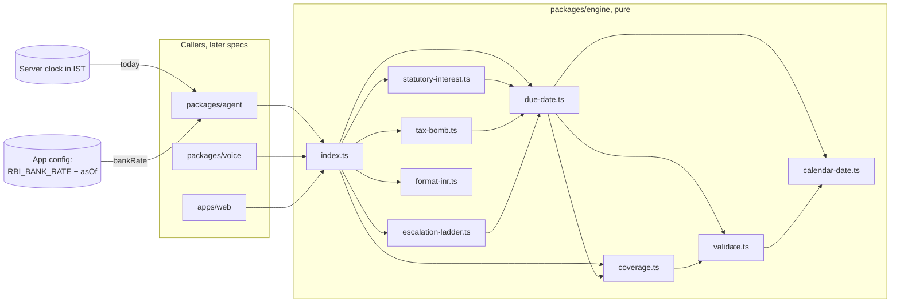

# Design Document: legal-engine

## Overview

`packages/engine` is a pure TypeScript library. It takes invoice facts plus caller-injected `today` and RBI bank rate and returns the legal numbers the agent and UI use:

| Function | Rule IDs | Output |
|---|---|---|
| `dueDate(invoice)` | MSMED-15 | Statutory last date for payment |
| `statutoryInterest(invoice, today, bankRate)` | MSMED-16 | Interest in paise, accrual days, rate and its `asOf` date |
| `taxBomb(invoice, today)` | IT-43BH | Tax_Bomb_Date, Deduction_Deadline, status, Days_Left, deduction at risk |
| `nextEscalationStep(invoice, history, today, config?)` | MSMED-15, MSMED-18, MSMED-ODR | `advance` to the next ladder step, or `wait` with a reason |
| `coverage(invoice)` | MSMED-SCOPE | Whether the invoice is covered, the non-coverage reason, and the caveat |
| `formatINR(paise, style)` / `parseINR(text)` | none | Indian rupee text (₹4,12,000 / ₹4.12L) and its inverse |

The engine has no I/O, never reads the clock, and has no runtime dependencies. Dates are `YYYY-MM-DD` strings converted to integer epoch days for arithmetic. Money is integer paise. Every result that states a legal consequence lists the Rule_IDs it relies on, and every result for a non-covered invoice cites only `MSMED-SCOPE`.

The spec also sets up the pnpm monorepo (workspace file, root scripts, shared strict tsconfig, ESLint, Vitest, fast-check).

### Research notes

- **Date arithmetic without time zones.** JavaScript `Date` parses `YYYY-MM-DD` as UTC midnight while other forms parse as local time, which makes off-by-one drift easy in IST (UTC+05:30). The engine avoids `Date` entirely and uses Howard Hinnant's `days_from_civil` / `civil_from_days` integer algorithms ([chrono-Compatible Low-Level Date Algorithms](https://howardhinnant.github.io/date_algorithms.html)). They are exact for the proleptic Gregorian calendar and use only integer division, so the results do not depend on the host time zone.
- **Interest precision.** `Math.pow(1 + r, t) - 1` loses digits when `r` is small (cancellation in the subtraction). `Math.expm1(t * Math.log1p(r))` computes the same value without the cancellation ([MDN: Math.expm1](https://developer.mozilla.org/en-US/docs/Web/JavaScript/Reference/Global_Objects/Math/expm1), [MDN: Math.log1p](https://developer.mozilla.org/en-US/docs/Web/JavaScript/Reference/Global_Objects/Math/log1p)). On Node 22 both forms give 512794.0878 paise for the Sharma Traders invoice, which rounds to 512794 as required.
- **Whole-month rests exactly.** At Accrual_Days = 30·m the formula reduces to `(1 + r)^m` with `r = 3·bps / 120000`, a rational number. BigInt arithmetic gives the exact result, so Requirement 4.11 holds with no float error even for amounts near ₹1,000 crore.
- **Legal facts** come from `.kiro/steering/legal-rules.md` (MSMED s.15, s.16, s.18; Income-tax s.43B(h) and Income-tax Act 2025 s.37(2)(g); MSMED-SCOPE; MSMED-ODR). The bank rate (575 bps as of 2026-10-07) stays in app config and is passed in.

## Architecture



Dependency direction is one-way: `calendar-date` and `validation-error` depend on nothing; `validate` uses `calendar-date`; `coverage` uses `validate`; `due-date` uses `coverage`; `statutory-interest`, `tax-bomb` and `escalation-ladder` use `due-date`. `format-inr` stands alone. No module imports `node:*`, reads `process.env`, or calls `Date`.

### Monorepo setup

Created only where the files do not exist yet (Requirement 1.1).

```
/
├── package.json            private; packageManager pnpm@<installed>; engines node >=20
├── pnpm-workspace.yaml     packages: ["apps/*", "packages/*"]
├── tsconfig.base.json      shared strict compiler options
├── eslint.config.js        flat config, typescript-eslint, engine purity rules
└── packages/engine/
    ├── package.json        @dues-banshee/engine, type: module, no dependencies
    ├── tsconfig.json       extends ../../tsconfig.base.json
    ├── vitest.config.ts
    ├── src/…
    └── test/…
```

Root `package.json` scripts (Requirement 1.2, 1.7):

```json
{
  "scripts": {
    "test": "pnpm -r --if-present run test",
    "typecheck": "pnpm -r --if-present run typecheck",
    "lint": "pnpm -r --if-present run lint"
  }
}
```

Root dev dependencies: `typescript`, `vitest`, `fast-check`, `eslint`, `typescript-eslint`, `@types/node` (latest stable at install time). The engine's `package.json` has an empty `dependencies` field (Requirement 1.5). Its scripts:

```json
{
  "scripts": {
    "test": "vitest run",
    "typecheck": "tsc --noEmit",
    "lint": "eslint src test"
  }
}
```

`vitest run` runs once and exits non-zero on failure, so `pnpm test` from a clean checkout runs the unit and property tests once (Requirement 1.7).

`tsconfig.base.json`:

```json
{
  "compilerOptions": {
    "target": "ES2022",
    "lib": ["ES2022"],
    "module": "ESNext",
    "moduleResolution": "Bundler",
    "strict": true,
    "noUncheckedIndexedAccess": true,
    "exactOptionalPropertyTypes": true,
    "noImplicitOverride": true,
    "isolatedModules": true,
    "verbatimModuleSyntax": true,
    "skipLibCheck": true
  }
}
```

The engine's `tsconfig.json` sets `"lib": ["ES2022"]` with no `DOM`, `"types": []` for `src` (so Node globals such as `process` do not type-check in engine source) and includes `src` and `test`. A separate `tsconfig.test.json` is not needed: test files import `vitest` and `fast-check` explicitly.

`vitest.config.ts`:

```ts
import { defineConfig } from "vitest/config";
export default defineConfig({
  test: {
    include: ["test/**/*.test.ts"],
    setupFiles: ["test/setup.ts"],   // fc.configureGlobal({ numRuns: 200 })
    environment: "node",
  },
});
```

`eslint.config.js` adds these rules for `packages/engine/src/**` to enforce purity (Requirements 1.5, 1.6):

- `no-restricted-globals`: `Date`, `process`, `fetch`, `setTimeout`, `setInterval`, `performance`.
- `no-restricted-imports`: patterns `node:*`, `fs`, `path`, `http`, `https`, `net`, `child_process`.
- `no-restricted-properties`: `Math.random`.

The engine is consumed from source (`"exports": { ".": "./src/index.ts" }`). Next.js consumes it through `transpilePackages` in a later spec, so no build step is needed now.

## Components and Interfaces

### Module layout (`packages/engine/src`)

| File | Exports |
|---|---|
| `index.ts` | Public API re-exports only |
| `types.ts` | `CalendarDate`, `Paise`, `Invoice`, `BankRate`, enums, all result types |
| `rule-ids.ts` | `RULE_IDS` (readonly tuple), `RuleId` |
| `validation-error.ts` | `ValidationError` class |
| `validate.ts` | `validateInvoice`, `validateBankRate`, `validateHistory`, `validateLadderConfig`, `assertCalendarDate`, `assertPaise`, `assertOneOf` |
| `calendar-date.ts` | `toEpochDay`, `fromEpochDay`, `addDays`, `dayDifference`, `compareDates`, `isValidCalendarDate`, `financialYearEnd` |
| `coverage.ts` | `coverage`, `nonCoverageResult` |
| `due-date.ts` | `dueDate` |
| `statutory-interest.ts` | `statutoryInterest`, `MAX_PAISE` |
| `tax-bomb.ts` | `taxBomb` |
| `escalation-ladder.ts` | `LADDER_STEPS`, `stepRank`, `APPROVAL_STEP_LIST`, `isApprovalStep`, `nextEscalationStep`, `DEFAULT_STEP_GAP_DAYS` |
| `format-inr.ts` | `formatINR`, `parseINR` |

Tests live in `packages/engine/test/`, one unit file and one property file per module (`due-date.test.ts`, `due-date.property.test.ts`, …), with shared generators in `test/arbitraries.ts` and fixtures in `test/fixtures.ts` (the Sharma Traders invoice).

### Public API

```ts
export function coverage(invoice: Invoice): CoverageResult;
export function dueDate(invoice: Invoice): DueDateResult;
export function statutoryInterest(invoice: Invoice, today: CalendarDate, bankRate: BankRate): InterestResult;
export function taxBomb(invoice: Invoice, today: CalendarDate): TaxBombResult;
export function nextEscalationStep(
  invoice: Invoice,
  history: EscalationHistory,
  today: CalendarDate,
  config?: LadderConfig,          // default { stepGapDays: 7 }
): EscalationDecision;
export function formatINR(paise: Paise, style: "full" | "short"): string;
export function parseINR(text: string): Paise;
```

Every public function validates all its inputs first (see Error Handling) and then computes. Internal helpers trust already-validated input.

### calendar-date.ts

A Calendar_Date is a `YYYY-MM-DD` string read as an IST calendar day. The engine never attaches a time or zone to it. All arithmetic goes through an integer epoch-day number (days since 1970-01-01).

```ts
// Hinnant days_from_civil, integer-only.
function toEpochDay(d: CalendarDate): number {
  const [y0, m, day] = parse(d);            // numbers from the validated string
  const y = m <= 2 ? y0 - 1 : y0;
  const era = Math.floor(y / 400);
  const yoe = y - era * 400;                                  // [0, 399]
  const mp = (m + 9) % 12;                                    // Mar = 0
  const doy = Math.floor((153 * mp + 2) / 5) + day - 1;       // [0, 365]
  const doe = yoe * 365 + Math.floor(yoe / 4) - Math.floor(yoe / 100) + doy;
  return era * 146097 + doe - 719468;
}
// fromEpochDay is Hinnant civil_from_days, zero-padded back to YYYY-MM-DD.
const addDays = (d, n) => fromEpochDay(toEpochDay(d) + n);
const dayDifference = (a, b) => toEpochDay(b) - toEpochDay(a);
const compareDates = (a, b) => Math.sign(toEpochDay(a) - toEpochDay(b)); // -1, 0, 1
```

- `isValidCalendarDate(s)`: matches `^\d{4}-\d{2}-\d{2}$`, month 1–12, day 1–`daysInMonth(y, m)` with the Gregorian leap rule. Years 1900–9999 are accepted; anything else is rejected.
- Because the format is fixed-width, lexical string comparison equals chronological comparison. The engine still compares epoch days to keep one code path.
- `financialYearEnd(d)`: for month ≥ 4 returns `${y + 1}-03-31`, otherwise `${y}-03-31`.

### coverage.ts (MSMED-SCOPE)

```ts
function coverage(inv: Invoice): CoverageResult {
  if (inv.supplierCategory === "medium" || inv.supplierCategory === "unregistered")
    return nonCoverageResult("medium_or_unregistered");
  if (inv.supplierActivity === "trading") return nonCoverageResult("trader");
  const late = inv.udyamRegisteredOn !== undefined
    && dayDifference(inv.acceptedOn, inv.udyamRegisteredOn) > 0;
  return late
    ? { applicable: true, caveat: "registered_after_supply", ruleIds: ["MSMED-SCOPE"] }
    : { applicable: true, ruleIds: [] };
}
const nonCoverageResult = (reason) => ({ applicable: false, reason, ruleIds: ["MSMED-SCOPE"] });
```

The category check runs first, so a medium trader gets `medium_or_unregistered` (Requirement 8.4). Every covered-path function calls a shared `withCaveat(result, cov)` helper that copies `caveat` and appends `MSMED-SCOPE` to `ruleIds` when the caveat is present (Requirements 8.5, 8.6). `ruleIds` arrays are de-duplicated and kept in `RULE_IDS` order so results are deterministic.

### due-date.ts (MSMED-15)

```ts
function dueDate(inv: Invoice): DueDateResult {
  validateInvoice(inv);
  const cov = coverage(inv);
  if (!cov.applicable) return cov;                       // no dueDate field
  const term = inv.agreedTermDays === undefined ? 15 : Math.min(inv.agreedTermDays, 45);
  return withCaveat({ applicable: true, dueDate: addDays(inv.acceptedOn, term), ruleIds: ["MSMED-15"] }, cov);
}
```

Sharma Traders: `addDays("2026-09-02", 45)` = 2026-10-17 (Requirement 3.5). `agreedTermDays` is validated as a positive integer, so the term is always 1–45.

### statutory-interest.ts (MSMED-16)

Inputs: covered invoice, `today`, `bankRate = { annualBps, asOf }`.

1. `due = dueDate(inv).dueDate`.
2. `end = paidOn !== undefined && compareDates(paidOn, today) < 0 ? paidOn : today` (earlier of the two, Requirement 4.5).
3. `d = max(0, dayDifference(due, end))`. Interest accrues from the day after the due date, so `today = due + 1` gives `d = 1` (Requirement 4.4) and `today ≤ due` gives `d = 0` and interest 0 (Requirement 4.3).
4. Compute `interestPaise`:
   - `d = 0` or `annualBps = 0`: return 0.
   - `d % 30 === 0` (whole-month rests, `m = d / 30`): exact BigInt path.
     `N = 120000n + 3n·bps`, `D = 120000n`, `num = A·(N^m − D^m)`, `den = D^m`, and `interest = (2·num + den) / (2·den)` (BigInt floor division, which is half-up for non-negative values).
   - otherwise: float path.
     `r = (3 · bps) / 120000`, `x = A · Math.expm1((d / 30) · Math.log1p(r))`, `interest = Math.floor(x + 0.5)`.
5. If `interest > Number.MAX_SAFE_INTEGER`, raise `ValidationError("today", "interest exceeds the safe integer range")` (see Error Handling).
6. Return `{ applicable: true, interestPaise, accrualDays: d, statutoryRateBps: 3·bps, rateAsOf: bankRate.asOf, ruleIds: ["MSMED-16"] }` plus caveat.

`Monthly_Rate = 3·bps / 10000 / 12 = 3·bps / 120000`; 575 bps gives 0.014375 (1.4375 %).

**Sharma Traders check (Requirement 4.7).** A = 4,12,00,000 paise, due 2026-10-17, today 2026-11-12, so d = 14 + 12 = 26 (not a whole month, float path). `x = 41,200,000 · expm1((26/30) · log1p(0.014375)) = 512794.0878`, and `floor(x + 0.5) = 512794` (₹5,127.94). The fractional part (0.088) is far from 0.5, so float error cannot change the result.

**Float precision.** `expm1`/`log1p` avoid the cancellation in `(1 + r)^t − 1` for small `r`. The relative error of the float path is a few ULP, about 1e-15 of the interest. Interest is capped at `MAX_SAFE_INTEGER` (≈ 9.0e15), so the absolute error stays below about 4 paise in the worst case and far below 0.01 paise for any invoice under ₹1 crore. The only values that could round differently from exact arithmetic are those within that error of a `.5` boundary. At whole-month rests the BigInt path removes the error entirely, which is what Requirement 4.11 checks exactly.

**Why monotonicity survives rounding (Requirement 4.9).**
- The exact function `I(d) = A·((1 + r)^(d/30) − 1)` is strictly increasing in `d` for `r > 0` and constant 0 for `r = 0`.
- Within the float path, every step is a monotone non-decreasing function of `d`: `d/30`, multiplication by the positive constant `log1p(r)`, `expm1`, multiplication by `A > 0`, adding 0.5, and `floor`. IEEE-754 round-to-nearest is monotone, so the composed float function cannot decrease as `d` grows (assuming `expm1` is monotone, which V8's fdlibm-derived implementation is in practice; the property test checks it).
- Across the switch between paths (`d = 30m − 1` float, `d = 30m` exact), the daily increase is `I(d) − I(d−1) ≥ I(d−1) · ln(1 + r)/30`. With the smallest non-zero rate (`bps = 1`, `ln(1 + r) ≈ 2.5e-5`) the increase is at least 8e-7 × the interest, which is about 10⁸ times larger than the float error (≈ 1e-15 × the interest). The float value at `d − 1` therefore stays below the exact value at `d`, and rounding both half-up keeps the order.
- `accrualDays` itself is non-decreasing in `today` (it is `max(0, min(today, paidOn) − due)`), so interest is non-decreasing in `today`.

### tax-bomb.ts (IT-43BH)

```ts
function taxBomb(inv: Invoice, today: CalendarDate): TaxBombResult {
  validateInvoice(inv); assertCalendarDate("today", today);
  const cov = coverage(inv);
  if (!cov.applicable) return { ...cov, status: "not_applicable", deductionAtRiskPaise: 0 };
  const due = dueDate(inv).dueDate;
  const taxBombDate = financialYearEnd(inv.acceptedOn);
  const deadline = compareDates(taxBombDate, due) >= 0 ? taxBombDate : due;   // later of the two
  const paid = inv.paidOn !== undefined && compareDates(inv.paidOn, today) <= 0;   // not Unpaid
  let status, daysLeft, atRisk;
  if (paid && compareDates(inv.paidOn, deadline) <= 0) { status = "defused";  daysLeft = 0; atRisk = 0; }
  else if (paid)                           { status = "exploded"; daysLeft = 0; atRisk = A; }   // 5.11
  else if (compareDates(today, deadline) <= 0) { status = "armed"; daysLeft = dayDifference(today, deadline); atRisk = A; }
  else                                     { status = "exploded"; daysLeft = 0; atRisk = A; }
  return withCaveat({ applicable: true, status, taxBombDate, deductionDeadline: deadline,
                      daysLeft, deductionAtRiskPaise: atRisk, ruleIds: ["IT-43BH"] }, cov);
}
```

- **Design clarification:** `taxBomb` uses the statutory Due_Date only for Covered_Invoices. A non-covered result has no `taxBombDate`, `deductionDeadline` or `daysLeft` fields, only `applicable: false`, `reason`, `ruleIds: ["MSMED-SCOPE"]`, `status: "not_applicable"` and `deductionAtRiskPaise: 0`. This matches Requirement 5.9, which defines the Tax_Bomb_Date only for Covered_Invoices.
- When the Due_Date is after the Tax_Bomb_Date (acceptance in the last 45 days of the year), the deadline becomes the Due_Date, which yields Requirement 5.5's Days_Left.
- `defused` returns `daysLeft: 0` so the field has the same type in every covered status.
- Sharma Traders, today 2026-11-12: Tax_Bomb_Date 2027-03-31, due 2026-10-17, deadline 2027-03-31, `armed`, Days_Left 18 + 31 + 31 + 28 + 31 = 139, at risk 4,12,00,000 (Requirement 5.8).

### escalation-ladder.ts

```ts
export const LADDER_STEPS = Object.freeze(["whatsapp_nudge", "whatsapp_paylink", "voice_call", "legal_notice", "odr_pack"] as const);
export const stepRank = (s: LadderStep) => LADDER_STEPS.indexOf(s) + 1;     // 1..5
const APPROVAL_STEP_SET = new Set(["voice_call", "legal_notice", "odr_pack"]);  // module-private, used by the engine
export const APPROVAL_STEP_LIST: readonly LadderStep[] = Object.freeze(LADDER_STEPS.filter((s) => APPROVAL_STEP_SET.has(s)));
export const isApprovalStep = (s: LadderStep): boolean => APPROVAL_STEP_SET.has(s);
```

`LADDER_STEPS` and `APPROVAL_STEP_LIST` are frozen. The approval Set is not exported, so a caller cannot change `requiresApproval` by mutating an export.

`nextEscalationStep(inv, history, today, config = { stepGapDays: 7 })` checks wait reasons in the fixed order of Requirement 6.15 and returns the first one that applies:

| # | Check | Result |
|---|---|---|
| 1 | Invoice not Unpaid (`compareDates(paidOn, today) <= 0`) | `wait`, reason `paid`, `ruleIds: []` |
| 2 | Not a Covered_Invoice | Non_Coverage_Result with `action: "wait"`, reason `medium_or_unregistered` or `trader`, `ruleIds: ["MSMED-SCOPE"]` |
| 3 | `compareDates(today, dueDate) <= 0` | `wait`, reason `not_overdue`, `ruleIds: []` |
| 4 | Some promise in history has `compareDates(promisedDate, today) > 0` | `wait`, reason `promise_active`, `ruleIds: []` |
| 5 | Highest step rank in history = 5 | `wait`, reason `ladder_complete`, `ruleIds: []` |
| 6 | Step events exist and `dayDifference(latestStepOn, today) < stepGapDays` | `wait`, reason `cooldown`, `ruleIds: []` |
| 7 | Otherwise | `advance` to rank `maxRank + 1` (rank 1 if no step events) |

- **Design clarification:** `wait` decisions with reasons `paid`, `not_overdue`, `promise_active`, `cooldown` and `ladder_complete` carry `ruleIds: []`, plus `MSMED-SCOPE` and the caveat when the Registered_After_Supply_Caveat applies. A wait states no legal consequence, so it cites no rule.
- **Design clarification:** the WHILE criteria in 6.3 (`not_overdue`), 6.4 (`promise_active`) and 6.7 (`cooldown`) are subject to the precedence order in 6.15. For example, a paid invoice with an active promise returns `paid`, and an invoice whose ladder is complete returns `ladder_complete` even inside the cooldown window.
- **`paid` before coverage.** Because `paid` is checked first, a paid non-covered invoice returns reason `paid` with `applicable: false` and `ruleIds: []`. It cites none of the forbidden Rule_IDs, which satisfies the "none of" part of Requirement 8.3. See Open Questions.
- `latestStepOn` is the latest `on` date among step events (not the last array element), so the order of the caller's history array does not matter.
- `maxRank` is the highest rank in history, so a history with gaps (e.g. only rank 3) advances to rank 4. The ladder never skips past `maxRank + 1` and never goes backwards (Requirement 6.12).
- After a promise's `promisedDate` passes, check 4 no longer applies, so the ladder resumes from `maxRank`, still subject to cooldown measured from the latest step event (Requirement 6.9). The promise date does not reset the cooldown.
- History events dated after `today` (`compareDates(on, today) > 0` or `compareDates(recordedOn, today) > 0`) are ignored, because they have not happened yet from the engine's point of view.
- `advance` result: `{ action: "advance", applicable: true, step, rank, requiresApproval: APPROVAL_STEP_SET.has(step), ruleIds }`. `ruleIds` is `["MSMED-15"]` (the advance is justified by the invoice being past its MSMED-15 due date); for `odr_pack` it is `["MSMED-15", "MSMED-18", "MSMED-ODR"]` (Requirement 6.11). The caveat adds `MSMED-SCOPE`.

### format-inr.ts

`formatINR(paise, style)` validates `paise` as a non-negative safe integer (Requirement 7.5), then validates `style` as `"full"` or `"short"` (a `ValidationError` on `style` otherwise), then:

**Full_Format** (`style: "full"`):
- `paisePart = p % 100`, `rupees = (p - paisePart) / 100`.
- Group `rupees` Indian-style: the last three digits, then pairs from the right: `groupIndian(412000) = "4,12,000"`, `groupIndian(12500000) = "1,25,00,000"`, `groupIndian(0) = "0"`.
- Result: `"₹" + groupIndian(rupees)` plus `"." + two-digit paisePart` only if `paisePart ≠ 0`. 0 → `₹0` (Requirement 7.4); 41,20,00,050 → `₹4,12,000.50`.

**Short_Format** (`style: "short"`), integer arithmetic only. 1 lakh = 1,00,00,000 paise (1e7); 1 crore = 1e9 paise.

Rounding helper `roundedDiv(p, unit)` (half-up): `r = p % unit`, `q = (p - r) / unit`; the result is `q + 1` when `2 * r >= unit`, otherwise `q`. This avoids forming `p + unit / 2` and avoids a float quotient `p / unit` that can round up to the next integer near `Number.MAX_SAFE_INTEGER`. The `unit` is 1e7 paise for hundredths of a crore, 1e5 paise for hundredths of a lakh, and 100 paise for whole rupees.

- `p ≥ 1e9`: `h = roundedDiv(p, 1e7)` (hundredths of a crore, half-up); render `h / 100` with trailing zeros and trailing point removed, integer part Indian-grouped, suffix `Cr`. ₹1.25Cr, ₹1,234.5Cr.
- `1e7 ≤ p < 1e9`: `h = roundedDiv(p, 1e5)` (hundredths of a lakh, half-up). If `h ≥ 10000` the value rounded to 100L, so render `₹1Cr`. Otherwise suffix `L`: ₹4.12L, ₹4L, ₹4.1L.
- `p < 1e7`: `r = roundedDiv(p, 100)` (whole rupees, half-up). If `r ≥ 100000`, render `₹1L`. Otherwise `"₹" + groupIndian(r)`.

The two bump rules (`₹1Cr` instead of `₹100L`, `₹1L` instead of `₹1,00,000`) keep the unit consistent with the rounded value. See Open Questions.

**parseINR(text)** accepts only canonical Full_Format, the exact output set of `formatINR(·, "full")`:

```
^₹(0|[1-9]\d{0,2}|[1-9]\d?(?:,\d{2})*,\d{3})(?:\.(\d{2}))?$
```

with the extra rule that the paise group must not be `00`. It strips commas, computes `rupees · 100 + paise`, and checks the result is a safe integer. Any mismatch (missing `₹`, wrong grouping such as `₹412,000`, leading zeros, `.5`, `.00`, `L`/`Cr` suffixes, spaces) raises `ValidationError("text", "not in Full_Format: \"<input>\"")` (Requirement 7.7). Because the parser accepts exactly the formatter's image, both round trips hold (Requirements 7.9, 7.10).

`formatINR` is the only rupee formatter in the Workspace (Requirement 7.8). Other packages import it; the ESLint config for the other packages bans `Intl.NumberFormat` with `currency: "INR"` and `toLocaleString("en-IN")` in a later spec.

## Data Models

```ts
// types.ts
export type CalendarDate = string;    // "YYYY-MM-DD", IST calendar day, validated at runtime
export type Paise = number;           // non-negative safe integer

export type SupplierCategory = "micro" | "small" | "medium" | "unregistered";
export type SupplierActivity = "manufacturing" | "services" | "trading";

export interface Invoice {
  id: string;                         // non-empty
  amountPaise: Paise;                 // 1 .. 1_00_000_00_00_000 (₹1,000 crore)
  acceptedOn: CalendarDate;
  agreedTermDays?: number;            // positive integer
  supplierCategory: SupplierCategory;
  supplierActivity: SupplierActivity;
  udyamRegisteredOn?: CalendarDate;
  paidOn?: CalendarDate;              // >= acceptedOn
}

export interface BankRate {
  annualBps: number;                  // integer 0..5000
  asOf: CalendarDate;
}

// rule-ids.ts
export const RULE_IDS = ["MSMED-15", "MSMED-16", "MSMED-18", "IT-43BH", "MSMED-SCOPE", "MSMED-ODR"] as const;
export type RuleId = (typeof RULE_IDS)[number];

export type NonCoverageReason = "medium_or_unregistered" | "trader";
export type Caveat = "registered_after_supply";

export interface NonCoverageResult {
  applicable: false;
  reason: NonCoverageReason;
  ruleIds: ["MSMED-SCOPE"];
}

interface Covered {
  applicable: true;
  ruleIds: RuleId[];
  caveat?: Caveat;                    // present only when registered after supply
}

export type CoverageResult = NonCoverageResult | Covered;

export type DueDateResult = (Covered & { dueDate: CalendarDate }) | NonCoverageResult;

export type InterestResult =
  | (Covered & {
      interestPaise: Paise;
      accrualDays: number;
      statutoryRateBps: number;       // 3 × annualBps
      rateAsOf: CalendarDate;
    })
  | (NonCoverageResult & { interestPaise: 0 });

export type TaxBombStatus = "armed" | "exploded" | "defused";
export type TaxBombResult =
  | (Covered & {
      status: TaxBombStatus;
      taxBombDate: CalendarDate;
      deductionDeadline: CalendarDate;
      daysLeft: number;
      deductionAtRiskPaise: Paise;
    })
  | (NonCoverageResult & { status: "not_applicable"; deductionAtRiskPaise: 0 });

// Escalation
export type LadderStep = "whatsapp_nudge" | "whatsapp_paylink" | "voice_call" | "legal_notice" | "odr_pack";
export interface StepEvent { kind: "step"; step: LadderStep; on: CalendarDate }
export interface PromiseEvent { kind: "promise"; promisedDate: CalendarDate; amountPaise: Paise; recordedOn: CalendarDate }
export type EscalationEvent = StepEvent | PromiseEvent;
export type EscalationHistory = readonly EscalationEvent[];
export interface LadderConfig { stepGapDays: number }     // positive integer, default 7

export type CoveredWaitReason = "paid" | "not_overdue" | "promise_active" | "ladder_complete" | "cooldown";
export type WaitReason = CoveredWaitReason | NonCoverageReason;

export type EscalationDecision =
  | { action: "advance"; applicable: true; step: LadderStep; rank: 1 | 2 | 3 | 4 | 5;
      requiresApproval: boolean; ruleIds: RuleId[]; caveat?: Caveat }
  | { action: "wait"; applicable: boolean; reason: CoveredWaitReason; ruleIds: RuleId[]; caveat?: Caveat }
  | (NonCoverageResult & { action: "wait" });

export type InrStyle = "full" | "short";
```

Design decisions:
- **Plain aliases instead of branded types** for `CalendarDate` and `Paise`. Callers pass JSON from the database and the LLM tool layer, and every public function validates at runtime anyway. Brands would add casts at every call site without adding safety.
- **`kind` discriminant on history events.** The requirements describe step events and promise events by shape. An explicit `kind` makes the union safe to narrow and to validate.
- **Results are plain JSON** (no class instances, no `undefined` values with `exactOptionalPropertyTypes`), so they can be logged as agent tool outputs and stored as eval fixtures unchanged.
- `MAX_PAISE = 1_00_000_00_00_000` (1e13) bounds `amountPaise`. Interest and formatter inputs are bounded by `Number.MAX_SAFE_INTEGER`.

## Correctness Properties

*A property is a characteristic or behavior that should hold true across all valid executions of a system-essentially, a formal statement about what the system should do. Properties serve as the bridge between human-readable specifications and machine-verifiable correctness guarantees.*

Each property below is implemented as one fast-check property test in `packages/engine/test/*.property.test.ts`. Prework reflection merged overlapping criteria: the due-date term rules (3.1–3.4, 3.6, 3.7) into one oracle; the non-coverage criteria from every function (3.8, 4.6, 5.6, 6.2, 8.3, 8.4, 8.7) into one property; the wait reasons (6.1–6.8) into the precedence oracle of 6.15; and 4.3 with 4.10. Setup criteria (1.x), the single-formatter rule (7.8) and the delivery rules (9.x) are smoke checks or process rules, not properties.

### Property 1: Calendar arithmetic round trip

*For any* valid Calendar_Date `d` between 1900-01-01 and 9999-12-31 and any integer `n` that keeps `addDays(d, n)` in that range, `fromEpochDay(toEpochDay(d)) === d` and `dayDifference(d, addDays(d, n)) === n`.

**Validates: Requirements 2.1, 3.1, 4.4, 5.10**

### Property 2: Invalid input is rejected with the field name

*For any* otherwise valid input in which exactly one field is made invalid (a malformed or impossible date in `acceptedOn`, `paidOn`, `udyamRegisteredOn`, `today` or `asOf`; `amountPaise` outside 1..1e13 or non-integer; `agreedTermDays` ≤ 0 or non-integer; `paidOn` before `acceptedOn`; `annualBps` outside 0..5000 or non-integer; `stepGapDays` ≤ 0 or non-integer; `supplierActivity` not in the enum), every public function that takes that field throws a `ValidationError` whose `field` equals the name of the corrupted field.

**Validates: Requirements 2.1, 2.2, 2.3, 2.4, 2.5, 2.6, 2.7, 2.8**

### Property 3: Due date follows MSMED-15

*For any* valid Covered_Invoice, `dueDate` returns `dayDifference(acceptedOn, dueDate)` equal to `min(agreedTermDays, 45)` when a term is present and 15 when it is absent; that difference is between 1 and 45; and `ruleIds` contains `MSMED-15`.

**Validates: Requirements 3.1, 3.2, 3.3, 3.4, 3.6, 3.7, 8.2**

### Property 4: Non-covered invoices get only MSMED-SCOPE

*For any* valid Invoice that is not a Covered_Invoice (including every trader), any Bank_Rate, Escalation_History and `today`: `dueDate` returns `applicable: false` with no `dueDate` field; `statutoryInterest` returns `interestPaise: 0`; `taxBomb` returns `status: "not_applicable"`, `deductionAtRiskPaise: 0` and no `taxBombDate`; `nextEscalationStep` never returns `advance`; every one of these results whose `reason` is a Non_Coverage_Reason has `ruleIds` exactly `["MSMED-SCOPE"]`; and `reason` is `medium_or_unregistered` when the category is `medium` or `unregistered`, otherwise `trader`.

**Validates: Requirements 3.8, 4.6, 5.6, 6.2, 8.3, 8.4, 8.7**

### Property 5: Registered-after-supply caveat

*For any* valid Covered_Invoice and any `today`, Bank_Rate and history, the results of `dueDate`, `statutoryInterest`, `taxBomb` and `nextEscalationStep` stay `applicable: true` (or a covered wait/advance) and carry `caveat: "registered_after_supply"` with `MSMED-SCOPE` in `ruleIds` if and only if `udyamRegisteredOn` is later than `acceptedOn`.

**Validates: Requirements 8.5, 8.6**

### Property 6: Interest matches the Interest_Convention

*For any* valid Covered_Invoice, Bank_Rate and `today`, `statutoryInterest` returns a non-negative safe integer `interestPaise` with `|interestPaise − A·((1 + r)^(d/30) − 1)| ≤ 0.5 + 1e-9·interestPaise` where `r = 3·bps/120000` and `d = max(0, dayDifference(dueDate, min(today, paidOn)))`; returns `accrualDays === d`, `statutoryRateBps === 3·annualBps`, `rateAsOf === bankRate.asOf`; and `ruleIds` contains `MSMED-16`.

**Validates: Requirements 4.1, 4.2, 4.5, 4.8, 8.2**

### Property 7: No interest on or before the due date

*For any* valid Covered_Invoice, Bank_Rate and `today` on or before the Due_Date, `statutoryInterest` returns `interestPaise === 0` and `accrualDays === 0`.

**Validates: Requirements 4.3, 4.10**

### Property 8: Interest never decreases as time passes

*For any* valid Covered_Invoice, Bank_Rate and dates `today1 < today2`, `statutoryInterest(inv, today2, rate).interestPaise ≥ statutoryInterest(inv, today1, rate).interestPaise`.

**Validates: Requirements 4.9**

### Property 9: Whole-month rests are exact

*For any* valid Covered_Invoice with no `paidOn`, Bank_Rate, and integer `m ≥ 1`, with `today = addDays(dueDate, 30·m)`, `interestPaise` equals `A·((1 + r)^m − 1)` rounded half-up, computed in the test by an independent BigInt rational reference.

**Validates: Requirements 4.11**

### Property 10: Tax_Bomb_Date and Deduction_Deadline

*For any* valid Covered_Invoice and `today`, `taxBomb` returns a `taxBombDate` that ends in `-03-31`, lies 0 to 365 days after `acceptedOn`, has `financialYearEnd(acceptedOn) === taxBombDate`, and a `deductionDeadline` equal to the later of `taxBombDate` and the Due_Date.

**Validates: Requirements 5.1, 5.9**

### Property 11: Tax bomb status oracle

*For any* valid Covered_Invoice and `today`, `taxBomb` returns the status, `daysLeft` and `deductionAtRiskPaise` given by this oracle, and `ruleIds` containing `IT-43BH`: paid (`paidOn ≤ today`) and `paidOn ≤ deadline` → `defused`, 0, 0; paid and `paidOn > deadline` → `exploded`, 0, `A`; unpaid and `today ≤ deadline` → `armed`, `dayDifference(today, deadline)`, `A`; unpaid and `today > deadline` → `exploded`, 0, `A`. When `today ≥ acceptedOn` and status is `armed`, `daysLeft` is between 0 and 365.

**Validates: Requirements 5.2, 5.3, 5.4, 5.5, 5.7, 5.10, 5.11, 8.2**

### Property 12: Escalation precedence oracle

*For any* valid Invoice, Escalation_History, `today` and LadderConfig, `nextEscalationStep` returns the same `action` and `reason` (or `step`) as an independent oracle that checks, in order: paid, non-coverage reason, `today ≤ dueDate`, any promise with `promisedDate > today`, max rank = 5, `dayDifference(latestStepOn, today) < stepGapDays`, else advance to max rank + 1. Covered wait decisions carry `ruleIds` equal to `[]`, or `["MSMED-SCOPE"]` when the caveat applies.

**Validates: Requirements 6.1, 6.2, 6.3, 6.4, 6.5, 6.6, 6.7, 6.8, 6.15**

### Property 13: Advances never skip, go backwards, or miss approval

*For any* valid Invoice, Escalation_History and `today` for which `nextEscalationStep` returns `advance`, the step's rank is exactly one more than the highest rank in the history (1 if there are no step events); `requiresApproval` is true exactly when the step is `voice_call`, `legal_notice` or `odr_pack`; and when the step is `odr_pack`, `ruleIds` contains `MSMED-18` and `MSMED-ODR`.

**Validates: Requirements 6.10, 6.11, 6.12**

### Property 14: An active promise blocks advancing

*For any* valid Invoice, Escalation_History containing a promise with `promisedDate > today`, and `today`, `nextEscalationStep` returns `action: "wait"`.

**Validates: Requirements 6.4, 6.13**

### Property 15: Expired promises do not affect the decision

*For any* valid Invoice, Escalation_History and `today`, adding promise events whose `promisedDate ≤ today` and `recordedOn ≤ today` to the history does not change the result of `nextEscalationStep`.

**Validates: Requirements 6.9**

### Property 16: Day-by-day simulation climbs one rung at a time

*For any* valid Covered_Invoice, LadderConfig, starting history and start date, stepping `today` forward one day at a time for up to 400 days, and appending each `advance` result as a step event on that `today`, produces a sequence of advanced ranks that increases by exactly 1 each time, has consecutive advances at least `stepGapDays` apart, and never exceeds 5.

**Validates: Requirements 6.14, 6.7, 6.12**

### Property 17: Full format round trip from paise

*For any* non-negative safe integer `x`, `parseINR(formatINR(x, "full")) === x`, and the formatted text matches the canonical Full_Format pattern.

**Validates: Requirements 7.1, 7.6, 7.9**

### Property 18: Full format round trip from text

*For any* string `s` produced by `formatINR(x, "full")` for a non-negative safe integer `x`, `formatINR(parseINR(s), "full") === s`.

**Validates: Requirements 7.10**

### Property 19: Short format tier and accuracy

*For any* non-negative safe integer `p`, `formatINR(p, "short")` ends in `Cr` when `p` rounds to at least ₹1 crore, ends in `L` when it rounds to at least ₹1 lakh and below ₹1 crore, and otherwise has no suffix; it has at most two decimals and no trailing zero after the point; and its numeric value differs from `p` by at most half of one display unit (₹0.005 crore, ₹0.005 lakh or ₹0.50).

**Validates: Requirements 7.2**

### Property 20: Formatter and parser reject bad input

*For any* value that is not a non-negative safe integer (negative, fractional, NaN, ±Infinity, above `MAX_SAFE_INTEGER`), `formatINR` throws `ValidationError`; and *for any* string that is not canonical Full_Format (generated by mutating valid output: dropping `₹`, western grouping, leading zeros, `.00`, one paise digit, `L`/`Cr` suffix, spaces, or arbitrary unicode), `parseINR` throws `ValidationError` whose message contains the input.

**Validates: Requirements 7.5, 7.7**

### Generators (`test/arbitraries.ts`)

- `arbCalendarDate(min, max)`: `fc.integer` over epoch days mapped through `fromEpochDay`. Default window 2020-01-01 to 2035-12-31, biased with `fc.oneof` to month ends, 28/29 Feb, 31 Mar and 1 Apr.
- `arbInvalidDateString`: `fc.oneof` of random strings, wrong widths (`2026-1-5`), month 00/13, day 00/32, 29 Feb in non-leap years, 31 Apr/Jun/Sep/Nov.
- `arbCoveredInvoice`: category `micro | small`, activity `manufacturing | services`, amount `fc.integer({ min: 1, max: 1e13 })` biased to small values and the max, `agreedTermDays` optional `fc.integer({ min: 1, max: 120 })` (crossing 45), `udyamRegisteredOn` optional within ±400 days of `acceptedOn`, `paidOn` optional at `acceptedOn + 0..800` days.
- `arbNonCoveredInvoice`: category `medium | unregistered` with any activity, or `micro | small` with `trading`.
- `arbInvoice`: `fc.oneof(arbCoveredInvoice, arbNonCoveredInvoice)`.
- `arbBankRate`: `annualBps` `fc.integer({ min: 0, max: 1000 })` biased to 0, 1, 575; `asOf` any date. Interest properties cap Accrual_Days at 3,650 so results stay below `MAX_SAFE_INTEGER` (worst case 1e13 × 1.025^122 ≈ 2e14). The overflow error path has its own unit test.
- `arbToday(inv)`: `acceptedOn − 30 .. acceptedOn + 900` days, biased to `due`, `due + 1`, `due + 30·m`, the Tax_Bomb_Date and the day after it.
- `arbHistory(inv)`: up to 8 events; steps drawn from `LADDER_STEPS` with dates from `acceptedOn` onward; promises with `recordedOn ≤ promisedDate` and amounts 1..A.
- `arbLadderConfig`: `stepGapDays` `fc.integer({ min: 1, max: 30 })`.
- For Property 5, the generator pairs each covered invoice with a copy whose `udyamRegisteredOn` is set strictly after `acceptedOn`.
- For Property 11, a branch of the generator sets `acceptedOn` between 15 Feb and 31 Mar so the Due_Date falls after the Tax_Bomb_Date (Requirement 5.5).

## Error Handling

```ts
// validation-error.ts
export class ValidationError extends Error {
  override readonly name = "ValidationError";
  constructor(readonly field: string, readonly reason: string, readonly value?: unknown) {
    super(`${field}: ${reason}`);
  }
}
```

- Every public function validates all its inputs before computing and throws the first `ValidationError` it finds. Fields are checked in a fixed order (invoice fields in declaration order, then `today`, then `bankRate`, then `history`, then `config`) so the reported field is deterministic.
- Field names match the Invoice and argument property names: `amountPaise`, `acceptedOn`, `agreedTermDays`, `paidOn`, `supplierCategory`, `supplierActivity`, `udyamRegisteredOn`, `today`, `annualBps`, `asOf`, `stepGapDays`. History entries use an indexed path such as `history[2].promisedDate`.
- Validation rules, in addition to Requirement 2: `id` must be a non-empty string; `supplierCategory` must be in its enum; history steps must be valid `LadderStep` values; promise `amountPaise` must be a positive safe integer; `recordedOn ≤ promisedDate` is not enforced (a buyer can promise a past date by mistake; it simply is not an Active_Promise).
- `parseINR` errors quote the input in the message: `text: not in Full_Format: "₹412,000"` (Requirement 7.7).
- **Interest overflow.** If the computed interest exceeds `Number.MAX_SAFE_INTEGER` (possible only with extreme combinations, e.g. ₹1,000 crore at 150 % p.a. for 5+ years), `statutoryInterest` throws `ValidationError("today", "interest exceeds the safe integer range")` instead of returning an imprecise number.
- The engine throws only `ValidationError`. Any other exception is a bug. Callers in `packages/agent` catch `ValidationError`, log it with the tool call inputs, and never send a message built from a failed calculation.
- Non-coverage is not an error. It is a normal result with `applicable: false`, so the agent can explain why no legal claim applies.

## Testing Strategy

**Tools.** Vitest (`vitest run`) for all tests and fast-check for properties. `test/setup.ts` calls `fc.configureGlobal({ numRuns: 200 })`, above the 100-run minimum. Failing seeds are printed by fast-check and can be replayed with `{ seed, path }`.

**Property tests.** One fast-check property per design property (Properties 1–20), each a single `it` block tagged with a comment in this form:

```ts
// Feature: legal-engine, Property 8: Interest never decreases as time passes
it("interest is monotone in today", () => {
  fc.assert(fc.property(arbCoveredInvoice, arbBankRate, arbDatePair, (inv, rate, [t1, t2]) => { … }));
});
```

Oracles in the tests (the due-date term rule, the tax-bomb status table, the escalation precedence table, the BigInt whole-month reference) are written separately from the implementation and kept short so they can be checked by reading.

**Unit tests (examples and edge cases).**

| Test | Expected | Requirement |
|---|---|---|
| Sharma `dueDate` | 2026-10-17, `ruleIds` `["MSMED-15"]` | 3.5 |
| Sharma `statutoryInterest`, today 2026-11-12, 575 bps | `accrualDays` 26, `interestPaise` 512794, `statutoryRateBps` 1725, `rateAsOf` 2026-10-07 | 4.7 |
| Sharma interest, today 2026-10-18 | `accrualDays` 1 | 4.4 |
| Sharma interest, today 2026-10-17 | 0 | 4.3 |
| Sharma interest, today 2026-11-16 (30 days) | 592250 (= 41,200,000 × 0.014375) | 4.11 |
| Sharma `taxBomb`, today 2026-11-12 | 2027-03-31, 2027-03-31, `armed`, 139, 41200000 | 5.8 |
| Accepted 2027-03-10, term 45, today 2027-03-20 | Tax_Bomb_Date 2027-03-31, Due_Date and deadline 2027-04-24, `armed`, Days_Left 35 | 5.5 |
| Paid 2027-04-05 after deadline 2027-03-31, today 2027-04-10 | `exploded`, 0, A | 5.11 |
| Non-covered `taxBomb` | `not_applicable`, no `taxBombDate` | 5.6 |
| Medium trader | reason `medium_or_unregistered` | 8.4 |
| Micro trader | reason `trader`, `ruleIds` `["MSMED-SCOPE"]` | 8.4 |
| `udyamRegisteredOn` after `acceptedOn` | caveat on all four functions, `MSMED-SCOPE` in `ruleIds` | 8.5, 8.6 |
| First advance after due date | `whatsapp_nudge`, `requiresApproval` false | 6.5 |
| History up to `legal_notice`, 7+ days later | `odr_pack`, approval true, `MSMED-18` + `MSMED-ODR` | 6.10, 6.11 |
| Paid invoice with active promise | `paid` | 6.15 |
| Ladder complete inside cooldown | `ladder_complete` | 6.15 |
| `formatINR(41200000)` | `₹4,12,000` / `₹4.12L` | 7.3 |
| `formatINR(0, "full")`, `formatINR(1250000000, "short")`, `formatINR(41200050, "full")` | `₹0`, `₹1.25Cr`, `₹4,12,000.50` | 7.1, 7.2, 7.4 |
| `formatINR(999950000, "short")`, `formatINR(9999950, "short")` | `₹1Cr`, `₹1L` (bump rules) | 7.2 |
| `parseINR("₹412,000")` | `ValidationError` quoting the input | 7.7 |
| `RULE_IDS` | exactly the six IDs, in order | 8.1 |
| Interest overflow input | `ValidationError` on `today` | Error Handling |
| `vi.setSystemTime` at two instants | identical results | 1.6 |
| Engine `package.json` | `dependencies` empty or absent | 1.5 |

**Smoke checks.** `pnpm install && pnpm test && pnpm typecheck && pnpm lint` from a clean checkout covers Requirements 1.1–1.7. The ESLint purity rules cover 1.5 and 1.6 statically.

**Not tested by code.** Requirement 9 (commit rules) is followed during the tasks phase. Requirement 7.8 (single formatter across the Workspace) is enforced by lint rules added when other packages exist.

## Decisions

1. **Paid non-covered invoices in `nextEscalationStep`.** Requirement 6.15 checks `paid` before coverage, while 8.3 says non-covered invoices return a Non_Coverage_Result. **Decision:** keep paid-first. A paid non-covered invoice returns `wait` with reason `paid`, `applicable: false` and `ruleIds: []`.
2. **Short-format rounding across tiers.** The requirements' literal rule gives `₹100L` for 9,99,95,000 paise and `₹1,00,000` for 99,999.50 rupees. **Decision:** keep the bump rules. These values round up to the next unit and render as `₹1Cr` and `₹1L`.
3. **Interest overflow.** Interest can exceed `MAX_SAFE_INTEGER` only for extreme inputs. **Decision:** keep throwing `ValidationError` on `today` when that happens, instead of capping accrual or returning a BigInt.
4. **Future-dated history events** (`on` or `recordedOn` after `today`). **Decision:** keep ignoring them, instead of rejecting them with a `ValidationError`.
5. **`ruleIds` on step 1–4 advances.** The requirements only mandate rule IDs for `odr_pack`. **Decision:** keep citing `MSMED-15` on advances to steps 1–4, because the invoice is past its statutory due date.
