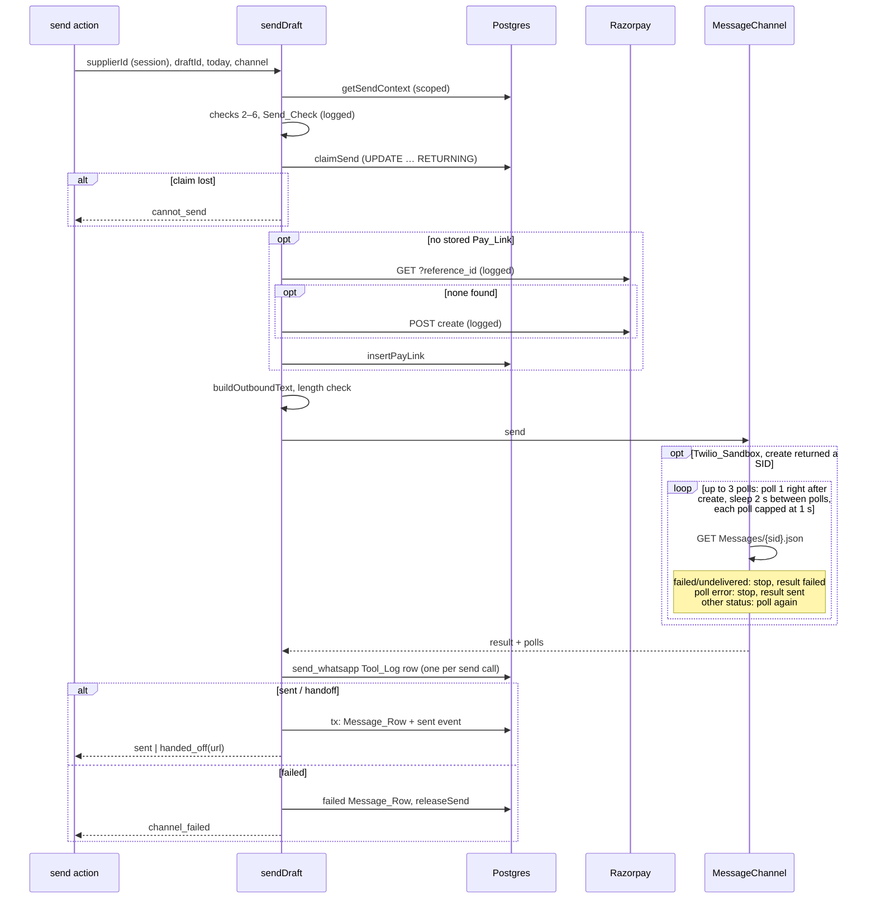

# Design Document: whatsapp-channel

## Overview

whatsapp-channel adds the send path for an approved WhatsApp Draft and the payment webhook that resurrects the tombstone. The pieces:

- `packages/agent/src/channel/`: the Message_Channel interface, its two implementations (Twilio_Sandbox, WaMe_Link), a small Razorpay client, the pure Outbound_Text builder, and `sendDraft`, which runs every check of Requirements 2–5 in a fixed order.
- `packages/agent/src/webhooks/`: `handleRazorpayWebhook` and `handleTwilioInbound`. These are pure handlers over a `Db` and an env snapshot. The `apps/web` route files only adapt `Request` to them.
- `packages/db`: migration `0003_*` (Buyer_Number, Message_Row columns, Pay_Link columns, the send claim column, the `sent` action, `webhook_events`) and the scoped queries for these tables.
- `apps/web`: two server actions (`sendPayLink`, `openInWhatsApp`), a `SendControls` client component that replaces the "Send pay link" placeholder, and two webhook routes.

Nothing in this spec computes money or legal values. The amount is `invoices.amount_paise`, formatted with the Engine `formatINR(paise, "full")`. The send-time check is the Engine `nextEscalationStep`. The text is the Draft's stored `body_text` plus the existing escalation-ladder `buildFinalText` (Basis_Line and Disclaimer).

Key decisions:

| Decision | Choice | Why |
|---|---|---|
| Twilio send transport | Plain `fetch` POST to `https://api.twilio.com/2010-04-01/Accounts/{SID}/Messages.json` (form-encoded `From`, `To`, `Body`, HTTP Basic `SID:token`, 10 s timeout), then, only after a 2xx with a SID, up to 3 status polls `GET …/Messages/{MessageSid}.json`, 2 s apart, each capped at 1 s | One create request and no SDK retry layer to switch off (Req 1.2). The polls catch 63015/63016, which Twilio usually reports after accepting the message (Req 1.3, 1.7). Both providers share one injected `fetch` boundary, so tests mock the HTTP client in one place (Req 9.1). The 2 s delay and the request timeouts are injected, so tests never wait. Worst case is about 17 s (see Twilio_Sandbox). |
| `twilio` package | Added to `packages/agent` only for `validateRequest` (inbound webhook) and, in tests, `getExpectedTwilioSignature` | Req 7.2 and 9.7 name these functions. Neither makes a network call. |
| Razorpay transport | Plain `fetch` to `https://api.razorpay.com/v1/payment_links` (create, and `GET ?reference_id=`), HTTP Basic `key_id:key_secret`, 10 s timeout | Only two endpoints are needed. `notify: { sms: false, email: false }` means Razorpay sends nothing itself. |
| Exactly one Twilio send (create) call per Draft | A **send claim** on the Draft row (`drafts.send_claimed_at`), taken by one conditional `UPDATE … RETURNING` before any Razorpay or Twilio call | The unique indexes reject a second *row*, but only after a second provider call has already happened. The claim stops the second request before it calls anything (Req 2.8). See "Send claim". |
| Shared logic | `sendDraft` lives in `packages/agent`; the two server actions differ only in `channel` | Twilio send and "Open in WhatsApp" run the same checks (Req 4.2), and both are testable on PGlite without Next.js. |
| Result delivery | The server actions return a `SendOutcome` to `useActionState` and do not redirect (except for no session or a Stale_Session) | The result message belongs to one Invoice_Panel (Req 4.6), and the WaMe_Link URL has to reach the browser. |
| Webhook dedupe | `INSERT INTO webhook_events … ON CONFLICT DO NOTHING RETURNING id` as the first statement of the webhook transaction | A second delivery of the same event id waits on the unique key and then inserts nothing, so it is a duplicate even when both arrive at once (Req 6.4, 7.5). |
| Env | One pure `readChannelEnv(env)` returns typed values with unset, empty and malformed values all mapped to `undefined` | One place implements Req 8.4. It is read per request (Req 8.1). |

New dependencies: `twilio` in `packages/agent`. No Razorpay SDK.

### Research notes

- Razorpay Payment Links: `POST /v1/payment_links` takes `amount` in paise, `currency`, `accept_partial`, `reference_id`, `notes`, `notify`, and returns `id` (`plink_…`), `short_url`, `amount`, `amount_paid` and `status`. Test mode allows up to 30 Payment Links per business ([Razorpay: Create a Standard Payment Link](https://razorpay.com/docs/api/payments/payment-links/create-standard/)). `GET /v1/payment_links?reference_id=…` lists links with that reference id in a `payment_links` array ([Payment Links APIs](https://razorpay.com/docs/payments/payment-links/apis/)). Razorpay rejects a reused `reference_id` with HTTP 400 `BAD_REQUEST_ERROR`. The design recognises that error by HTTP 400 plus a `error.description` matching `/reference[ _]?id/i` and `/already/i`, so the exact wording does not matter.
- Razorpay webhooks: `X-Razorpay-Signature` is the hex HMAC-SHA256 of the raw body keyed with the webhook secret. `x-razorpay-event-id` identifies the event across retries. `payment_link.paid` carries `payload.payment_link.entity` (`id`, `amount`, `amount_paid`, `status`, `reference_id`) and `payload.payment.entity` (`id`, `amount`, `created_at` in Unix seconds).
- Twilio webhooks: the signature is an HMAC-SHA1 over the full URL plus the sorted POST parameters, keyed with the auth token, so the URL must be exactly the one configured in the console ([Twilio: Webhook security](https://www.twilio.com/docs/usage/webhooks/webhooks-security)). `getExpectedTwilioSignature(authToken, url, params)` produces a matching header for tests ([Twilio: programmatic testing](https://www.twilio.com/docs/serverless/twiml-bins/testing/programmatic)).
- Twilio errors 63015 (sandbox recipient has not joined) and 63016 (outside the 24-hour window) are usually reported **after** the API accepted the message (HTTP 201, status `queued`). Status callbacks stay a non-goal. Instead the Twilio_Sandbox fetches the Message resource (`GET /2010-04-01/Accounts/{AccountSid}/Messages/{MessageSid}.json`, same Basic auth), whose `status` becomes `failed` or `undelivered` with an integer `error_code` when delivery fails ([Twilio: Message resource](https://www.twilio.com/docs/messaging/api/message-resource)). A failure Twilio reports after the last poll is still not tracked, and "Queued with Twilio. Delivery is not tracked." covers that case.

## Architecture

```mermaid
flowchart TB
  OWNER[Owner browser<br/>Debtor_Page] -->|sendPayLink / openInWhatsApp<br/>draftId, today| ACT["apps/web<br/>app/(debtor)/debtors/[id]/send-actions.ts"]
  ACT --> SD[packages/agent<br/>sendDraft]
  SD --> DB[(packages/db<br/>drafts · payment_links · messages ·<br/>escalation_events · agent_runs)]
  SD --> EN[packages/engine<br/>nextEscalationStep · formatINR]
  SD --> OT[channel/outbound-text<br/>buildOutboundText → buildFinalText]
  SD --> RZ[channel/razorpay<br/>findLink · createLink]
  SD --> MC{{MessageChannel}}
  MC --> TW[TwilioSandbox]
  MC --> WA[WaMeLink]
  RZ -->|fetch| RAPI[(Razorpay API)]
  TW -->|fetch: create + ≤3 status polls| TAPI[(Twilio Messages API)]
  RAPI -.payment_link.paid.-> RWH[apps/web<br/>api/webhooks/razorpay/route.ts]
  TAPI -.inbound WhatsApp.-> TWH[apps/web<br/>api/webhooks/twilio/route.ts]
  RWH --> HR[packages/agent<br/>handleRazorpayWebhook]
  TWH --> HT[packages/agent<br/>handleTwilioInbound]
  HR --> DB
  HT --> DB
  HR -->|changed buyerId| RV[revalidatePath / and /debtors/id]
```

### File map

```
packages/db/
  src/schema.ts            buyers.whatsappNumber; messages.draftId/providerMessageId/errorCode;
                           paymentLinks.draftId/createdOn; drafts.sendClaimedAt; escalation_action + 'sent';
                           webhookEvents; EscalationDetail + { channel, messageRowId }
  src/send.ts              getSendContext, claimSend, releaseSend, insertPayLink, recordSent,
                           insertFailedMessage, listSendState
  src/webhooks.ts          recordWebhookEvent, findPayLinkByProviderId, markPayLinkPaid, setPaidOnIfNull
  src/ladder.ts            LadderRecord.steps gains draftId (additive)
  src/seed.ts              seed(db, { demoBuyerWhatsapp? }); scripts pass process.env.DEMO_BUYER_WHATSAPP
  src/reset.ts             RESET_TABLES + "webhook_events"
  drizzle/0003_*.sql       generated, then hand-checked
packages/agent/src/
  channel/env.ts           readChannelEnv (pure)
  channel/message-channel.ts   MessageChannel, ChannelResult, BuyerNumber, E164
  channel/twilio-sandbox.ts    createTwilioSandbox({ fetch, sleep, timeoutSignal, accountSid, authToken, from })
  channel/wa-me.ts             createWaMeLink(), waMeUrl (pure)
  channel/razorpay.ts          createRazorpayClient({ fetch, keyId, keySecret })
  channel/outbound-text.ts     buildOutboundText, payLinkLine (pure)
  channel/mask.ts              maskNumber (pure)
  channel/send-check.ts        sendCheckHistory (pure)
  channel/send-draft.ts        sendDraft
  webhooks/razorpay-signature.ts   razorpaySignatureValid (pure, node:crypto)
  webhooks/razorpay-event.ts       Zod schema, classifyRazorpayEvent, paymentDay (pure)
  webhooks/razorpay.ts             handleRazorpayWebhook
  webhooks/twilio.ts               handleTwilioInbound
  testing/fake-http.ts             fakeHttp() for tests (subpath export "./testing")
packages/agent/scripts/whatsapp-live-check.ts   manual live check (Req 9.9), not in CI
apps/web/
  app/(debtor)/debtors/[id]/send-actions.ts   "use server": sendPayLink, openInWhatsApp
  app/(debtor)/debtors/[id]/page.tsx          loads send state, passes it to InvoicePanel
  app/api/webhooks/razorpay/route.ts          runtime nodejs
  app/api/webhooks/twilio/route.ts            runtime nodejs
  components/debtor/send-controls.tsx (+ .module.css)   client component
  components/debtor/placeholder-actions.tsx   keeps only "Start call"
  lib/send/messages.ts                         outcomeMessage (pure)
  lib/send/control-state.ts                    pickSendableDraft, sendControlState (pure)
  lib/debtor/candle-timeline.ts                ACTION_TEXT + sent: "sent"
  lib/debtor/load.ts                           + listSendState and channel flags
  .env.example                                 + Channel_Env names, empty values
```

`proxy.ts` is not changed. Its matcher lists only explicit prefixes, and `/api/webhooks/:path*` is not one of them (Req 8.7). A test pins this.

## Components and Interfaces

### Message_Channel (`channel/message-channel.ts`)

```ts
/** E.164, `^\+[1-9][0-9]{7,14}$`. Branded so only a validated string reaches a channel. */
export type E164 = string & { readonly __e164: unique symbol };
export function parseE164(raw: string | null | undefined): E164 | null;

export interface SendRequest {
  to: E164 | null;          // null only for WaMe_Link (owner picks the contact, Req 4.4)
  text: string;             // the Outbound_Text, sent unchanged
  idempotencyKey: string;   // the Draft id
}
export type ChannelResult =
  | { kind: "sent"; providerMessageId: string; polls: readonly PollRecord[] }
  | { kind: "handoff"; url: string }
  | { kind: "failed"; errorKind: ChannelErrorKind; errorCode: string;   // errorCode "" when none
      providerMessageId: string | null;   // the SID when the create call returned one (polled failure)
      polls: readonly PollRecord[] };     // [] when no poll ran
export type ChannelErrorKind =
  | "sandbox_window"   // Twilio 63015 or 63016, from the create response or a poll
  | "provider_error"   // any other Twilio error response or polled failed/undelivered code
  | "timeout" | "network" | "no_recipient";
/** One status poll, as logged in the send_whatsapp Tool_Log row. Holds no secret and no number. */
export type PollRecord =
  | { status: string; errorCode: string }                              // Twilio `status`, `error_code` ("" when null)
  | { error: "timeout" | "network" | "provider_error"; httpStatus: number | null };
export interface MessageChannel {
  readonly name: "twilio_sandbox" | "wa_me";   // also the messages.channel value
  send(req: SendRequest): Promise<ChannelResult>;   // never throws
}
```

The Twilio Messages API has no idempotency header. `idempotencyKey` is logged, and the send claim provides the actual guarantee.

**TwilioSandbox** (`createTwilioSandbox({ fetch, sleep, timeoutSignal, accountSid, authToken, from })`):

`sleep(ms): Promise<void>` defaults to a `setTimeout` promise. `timeoutSignal(ms): AbortSignal` defaults to `AbortSignal.timeout`. Tests inject a fake pair from `fakeClock()`: `sleep` records `ms`, advances the fake clock and resolves at once, and `timeoutSignal` returns a signal that aborts with a `TimeoutError` when the fake clock passes `ms`. No wall clock (`now`) is injected, because no rule depends on elapsed time beyond the per-request caps.

Timing constants (all in `twilio-sandbox.ts`):

| Constant | Value | Use |
|---|---|---|
| `CREATE_TIMEOUT_MS` | 10,000 | cap for the create request (Req 1.7) |
| `POLL_TIMEOUT_MS` | 1,000 | cap for one poll request |
| `POLL_INTERVAL_MS` | 2,000 | the injected `sleep` between two polls (not before poll 1) |
| `MAX_POLLS` | 3 | |

Every request uses `signal: timeoutSignal(cap)`. Poll 1 runs right after the create returns. The worst case is a 10 s create, then 3 polls of 1 s each with two 2 s sleeps between them: 10 + 3 × 1 + 2 × 2 = about 17 s. That is well under the Debtor_Page `maxDuration` of 300 s and the 360 s send-claim lease.

1. `to === null` returns `failed/no_recipient` without making a call.
2. **Create.** One `fetch` POST with body `URLSearchParams({ From: "whatsapp:" + from, To: "whatsapp:" + to, Body: text })` and `signal: timeoutSignal(CREATE_TIMEOUT_MS)`.
   - An error response returns `failed` with `providerMessageId: null` and `polls: []`. The JSON body's `code` decides the kind: 63015 or 63016 gives `sandbox_window`, any other value gives `provider_error`, and the code is copied as a string.
   - An `AbortError` or `TimeoutError` returns `timeout`. Any other thrown error returns `network`. Both have `polls: []`: no poll runs.
   - An HTTP 2xx response with a string `sid` continues to the polls. Only this path polls.
3. **Polls.** Up to `MAX_POLLS` times: before poll 2 and poll 3 only, `await sleep(POLL_INTERVAL_MS)`; then one `fetch` GET (with `signal: timeoutSignal(POLL_TIMEOUT_MS)`) to `https://api.twilio.com/2010-04-01/Accounts/{SID}/Messages/{sid}.json` with the same Basic auth. The response is read with Zod (`status: string`, `error_code: number | null`).
   - `status` `failed` or `undelivered`: stop polling and return `failed` with `providerMessageId: sid`. `error_code` 63015 or 63016 gives `sandbox_window`, any other code (or null, giving `""`) gives `provider_error`.
   - Any other status (`queued`, `sending`, `sent`, `delivered`, `read`, …): record it and poll again.
   - A timeout (no response within 1 s), a network error, a non-2xx response or a body that fails the schema: record the poll error and stop polling.
   - So `sleep` runs exactly twice when all 3 polls run, and zero times when poll 1 ends polling.
4. When polling ends without a `failed`/`undelivered` status, return `sent` with the SID. The polls never turn a poll error into a failure (Req 1.7).
5. Every result carries the `polls` list, so `sendDraft` logs it in the one `send_whatsapp` row.
6. Everything sits inside `try`, so the channel never throws (Req 1.7).

**WaMeLink** (`createWaMeLink()`): returns `{ kind: "handoff", url: waMeUrl(to, text) }` and makes no I/O.

```ts
export function waMeUrl(to: E164 | null, text: string): string;
// to set:  `https://wa.me/${to.slice(1)}?text=${encodeURIComponent(text)}`
// to null: `https://wa.me/?text=${encodeURIComponent(text)}`
```

`encodeURIComponent` percent-encodes UTF-8, including `\n`, `₹` and Devanagari, so `decodeURIComponent` returns the original text (Req 1.4).

### Razorpay client (`channel/razorpay.ts`)

```ts
export interface PayLinkInfo { providerLinkId: string; url: string; amountPaise: Paise }
export type RazorpayResult<T> =
  | { ok: true; value: T }
  | { ok: false; errorKind: "already_attempted" | "provider_error" | "timeout" | "network"; httpStatus: number | null };
export interface RazorpayClient {
  findByReference(draftId: string): Promise<RazorpayResult<PayLinkInfo | null>>;   // GET /payment_links?reference_id=
  create(body: CreateLinkBody): Promise<RazorpayResult<PayLinkInfo>>;              // POST /payment_links
}
export interface CreateLinkBody {
  amount: Paise; currency: "INR"; accept_partial: false; reference_id: string;
  notes: { invoice_id: string }; notify: { sms: false; email: false };
}
```

- `findByReference` returns the first `payment_links[]` entry whose `reference_id` equals the Draft id, or `null` if there is none. `url` is the link's `short_url`.
- The client never throws. It reads responses with Zod, and an unexpected shape becomes `provider_error`.
- `already_attempted` means HTTP 400 with the reference-id description described under Research notes.

### Env (`channel/env.ts`)

```ts
export interface ChannelEnv {
  twilio: { accountSid: string; authToken: string; from: E164 } | null;   // all three valid, else null
  twilioAuthToken: string | undefined;          // the inbound webhook needs only this and publicBaseUrl
  razorpay: { keyId: string; keySecret: string } | null;   // both set and keyId starts with "rzp_test_"
  razorpayWebhookSecret: string | undefined;
  publicBaseUrl: string | undefined;            // trailing "/" stripped
  sandboxJoinCode: string | undefined;
}
export function readChannelEnv(env: Readonly<Record<string, string | undefined>>): ChannelEnv;
```

A value is unset when it is missing or when `trim()` is empty. `TWILIO_WHATSAPP_FROM` must pass `parseE164`, so a `whatsapp:+1…` value counts as unset (Req 8.4). `ChannelEnv` never reaches a client component. The page passes only booleans (`twilioReady`).

### Outbound_Text (`channel/outbound-text.ts`)

```ts
export function payLinkLine(amountPaise: Paise, url: string): string;
// `Pay ${formatINR(amountPaise, "full")} here: ${url}`
export type OutboundTextResult = { ok: true; text: string } | { ok: false; reason: "multiple_markers" };
export function buildOutboundText(input: {
  body: string; ruleIds: readonly RuleId[]; url: string; amountPaise: Paise;
}): OutboundTextResult;
```

1. `parts = body.split(PAY_LINK_TEXT)` (the escalation-ladder constant `"[payment link added on send]"`).
2. `parts.length === 2`: `withLink = parts[0] + url + parts[1]`. The URL replaces only the marker, so the sentence around it stays as written (Req 3.6, 9.14). `split`/join is used instead of `String.replace` because a replacement string treats `$&` and `$'` as patterns, and a URL may contain `$`.
3. `parts.length === 1`: `withLink = body + "\n\n" + payLinkLine(amountPaise, url)`.
4. `parts.length > 2`: `{ ok: false, reason: "multiple_markers" }`. The action shows "This draft can't be sent". Requirement 3.7 needs exactly one Pay_Link URL. A body with two markers (an LLM repeat or an owner edit) cannot meet that and still keep every marker's sentence, so the design refuses to send it.
5. `text = buildFinalText(withLink, ruleIds)`. This is the escalation-ladder builder, so the result ends `\n\n<Basis_Line>\n<Disclaimer>`.

The preview (Req 4.1) calls the same function with `url = "<link created on send>"`.

The length limit (Req 3.8) is `text.length <= 1600`, counted in UTF-16 code units. This count is never lower than a code-point count, so a text that passes here also fits Twilio's limit.

### Masking (`channel/mask.ts`)

```ts
export function maskNumber(n: string): string;   // every char except the last four digits → "*"
```

Tool_Log rows store `maskNumber(buyerNumber)`, never the number and never the WaMe_Link URL. The handoff row logs `{ kind: "handoff" }` without `url` (Req 5.6). A Twilio row logs the result kind, SID, error kind and code, and the `polls` list (status and error code, or poll error kind and HTTP status). Poll request URLs and headers are not logged, so the Account SID and auth token never reach the row. The inbound webhook masks `From` the same way after stripping its `whatsapp:` prefix (Req 7.3).

### Send_Check (`channel/send-check.ts`)

```ts
/** Engine_History without the Draft's own approved event; every non-approved action is already dropped. */
export function sendCheckHistory(r: Pick<LadderRecord, "steps" | "promises">, draftId: string): EscalationHistory;
// = engineHistory({ steps: r.steps.filter(s => s.draftId !== draftId), promises: r.promises })
```

`LadderRecord.steps` gains `draftId: string | null` (read from `escalation_events.draft_id`). `engineHistory` keeps only `approved` steps, so `sent` events never reach the Engine (Req 5.5). The Ladder_Runner and the Approval_Queue need no change for that. `sendDraft` calls `nextEscalationStep(record.invoice, sendCheckHistory(record, draftId), today)` with the default config. The check passes iff the result is `advance` with `step === draft.step`, the same `isSameStep` test `approveDraft` uses.

### sendDraft (`channel/send-draft.ts`)

```ts
export interface SendDeps {
  db: Db; env: ChannelEnv;
  razorpay: RazorpayClient | null;   // null iff env.razorpay is null
  twilio: MessageChannel | null;     // null iff env.twilio is null
  waMe: MessageChannel;
}
export interface SendInput { supplierId: string; draftId: string; today: CalendarDate; channel: "twilio_sandbox" | "wa_me" }
export type SendOutcome =
  | { kind: "sent" }                                    // "Queued with Twilio. Delivery is not tracked."
  | { kind: "handed_off"; url: string }                 // "Opened in WhatsApp. Tap Send on your phone."
  | { kind: "not_found" }
  | { kind: "cannot_send" }                             // "This draft can't be sent"
  | { kind: "approved_on"; approvalDay: CalendarDate }  // "This draft was approved on …"
  | { kind: "send_check_failed"; decision: EscalationDecision }   // "Not sent: <text>"
  | { kind: "payments_not_configured" }
  | { kind: "pay_link_failed" }
  | { kind: "no_buyer_number" } | { kind: "sender_not_configured" }
  | { kind: "too_long" }
  | { kind: "channel_failed"; errorKind: ChannelErrorKind; errorCode: string }
  | { kind: "record_failed" };
export function sendDraft(deps: SendDeps, input: SendInput): Promise<SendOutcome>;
```

`sendDraft` never throws for an expected failure. An unexpected database error propagates, and the action turns it into `record_failed` after logging with `console.error`. `apps/web/lib/send/messages.ts` maps each outcome to its fixed text and `role`. `send_check_failed` uses `WAIT_TEXT[reason]` or `STEP_TEXT[step]` from `lib/graveyard/labels.ts`. The sandbox text uses `env.sandboxJoinCode`, or the "send the join code from the Twilio sandbox page" wording when no code is set (Req 1.3).

### Send flow

The steps run in this order. The first failure ends the request.

| # | Step | Failure |
|---|---|---|
| 1 | `UUID` test on `draftId`; `getSendContext(db, supplierId, draftId)` (scoped through `invoices.supplier_id`) | `not_found`, the same result for all three cases (Req 2.2) |
| 2 | Draft `approved`, step `whatsapp_nudge`/`whatsapp_paylink`, no Sent_Message | `cannot_send` (Req 2.3) |
| 3 | `today === approvalDay` | `approved_on` (Req 2.6), no Send_Check |
| 4 | Send_Check, plus one `next_escalation_step` Tool_Log row | `send_check_failed` (Req 2.4–2.5) |
| 5 | `deps.razorpay !== null` | `payments_not_configured` (Req 3.4) |
| 6 | Twilio only: `buyerNumber !== null`, then `deps.twilio !== null` | `no_buyer_number` / `sender_not_configured` (backstop for a forged post; the UI already disables the button) |
| 7 | **`claimSend`** | `cannot_send` (Req 2.8) |
| 8 | Pay_Link: stored row, else `findByReference`, else `create`; on `already_attempted`, `findByReference` again; store with `insertPayLink` | `pay_link_failed` (Req 3.5); a `23505` on `payment_links_draft_id_key` gives `cannot_send` |
| 9 | `buildOutboundText` | `multiple_markers` gives `cannot_send` |
| 10 | Twilio only: `text.length <= 1600` | `too_long` (Req 3.8) |
| 11 | `channel.send(...)` (Twilio: create, then up to 3 status polls), plus one `send_whatsapp` Tool_Log row holding the `polls` list | Twilio failure, from the create response or a polled `failed`/`undelivered`: `insertFailedMessage` (with the SID when the create returned one), then `channel_failed` (Req 1.3, 1.7, 5.3) |
| 12 | `recordSent` in one transaction: Message_Row (`sent`/`handed_off`) and a `sent` Escalation_Event `{ channel, messageRowId }` | `record_failed`; a `23505` on `messages_one_sent_per_draft` gives `cannot_send` (Req 5.7–5.8) |

Every failure from step 8 onward calls `releaseSend` before returning, with one exception: a Twilio `sent` result followed by a failed step 12 (see below). Steps 8 and 11 write one Tool_Log row per provider call: `find_payment_link`, `create_payment_link` and `send_whatsapp` (Req 5.6). A stored Pay_Link skips both Razorpay calls and both of their log rows (Req 3.2).



### Send claim

Requirement 2.8 allows at most one Twilio call per Draft across overlapping requests. The design reads that as one Twilio create (send) call; the read-only status polls that follow it are part of the same send. That includes a retry whose Pay_Link is already stored, which reaches the Twilio call without any insert. The claim is one column and two statements:

```sql
-- claimSend: one statement, atomic under READ COMMITTED (the row lock serialises racers)
UPDATE drafts SET send_claimed_at = now()
FROM invoices
WHERE drafts.invoice_id = invoices.id AND invoices.supplier_id = $supplier
  AND drafts.id = $draft AND drafts.status = 'approved'
  AND drafts.step IN ('whatsapp_nudge', 'whatsapp_paylink')
  AND (drafts.send_claimed_at IS NULL OR drafts.send_claimed_at < now() - interval '360 seconds')
  AND NOT EXISTS (SELECT 1 FROM messages m WHERE m.draft_id = drafts.id AND m.status IN ('sent', 'handed_off'))
RETURNING drafts.id;

-- releaseSend
UPDATE drafts SET send_claimed_at = NULL WHERE id = $draft;
```

- **Racers.** Two `UPDATE`s on the same row serialise on its row lock. The second one re-evaluates its `WHERE` after the first commits, sees `send_claimed_at` set, and updates nothing, so it gets `cannot_send`. Only the claim holder runs steps 8–12. That gives at most one Razorpay create, one Twilio create call (plus its status polls) and one Sent_Message per overlapping group.
- **After success** the claim is not released. The Sent_Message now exists, so the `NOT EXISTS` clause rejects every later claim forever. This is the same rule as step 2.
- **After a failure** (Pay_Link failed, too long, Twilio failure from the create response or a polled `failed`/`undelivered` status, wa.me record failure) the claim is released, so the owner can retry or switch to "Open in WhatsApp". The Draft stays a Sendable_Draft (Req 4.6).
- **Twilio said `sent` but `recordSent` failed** (Req 5.7). The claim is kept, because releasing it would let a retry message the buyer a second time. It expires after the lease. The `send_whatsapp` Tool_Log row already holds the SID.
- **Lease.** 360 s is longer than the Debtor_Page's `maxDuration` of 300 s, and a Twilio send takes about 17 s at worst. That page's limit applies to its server actions. Once the lease passes, the function that held the claim has been stopped, so an expired claim cannot belong to a request that is still running. This covers a function killed mid-send.
- **How the claim relates to the unique indexes.** The claim prevents duplicate provider calls. The indexes are the database backstop for duplicate rows, which could only happen through a lease-expiry edge case or a bug. `payment_links_draft_id_key` keeps one Pay_Link per Draft. Razorpay also rejects a reused `reference_id`, so a second create cannot make a second link either (step 8 then looks the link up). `messages_one_sent_per_draft` keeps one Sent_Message per Draft. A rejected insert ends that request with "This draft can't be sent" (Req 2.8, 5.8). The claim column is not part of either index, so the index definitions stay exactly as Requirements 3.3 and 5.8 state.

### Server actions (`app/(debtor)/debtors/[id]/send-actions.ts`)

```ts
"use server";
export async function sendPayLink(prev: SendView | null, form: FormData): Promise<SendView>;
export async function openInWhatsApp(prev: SendView | null, form: FormData): Promise<SendView>;
export interface SendView { invoiceId: string; text: string; role: "status" | "alert"; url?: string }
```

- They read only `draftId` and `today` from the form (Req 2.1). The supplier id comes only from `auth()`. No `supplierId` means `redirect("/signin")` (Req 2.7). `getSupplier` throws `SupplierNotFoundError` for a Stale_Session, which means `redirect("/signin?error=SessionExpired")` outside any `try`. That is the same `withSupplier`/`STALE_URL` pattern as `approvals/actions.ts`, and the proxy clears the cookie on that request as it already does (Req 2.10).
- Today comes from `resolveSupplierToday(supplier, Date.now(), field(form, "today"))`, so only the demo supplier's override counts.
- Deps are built per request from `readChannelEnv(process.env)`, `globalThis.fetch` and the default `sleep`/`timeoutSignal` of the Twilio_Sandbox.
- After any outcome that wrote a row, the action calls `revalidatePath("/debtors/<buyerId>")`.
- The approve action in `approvals/actions.ts` is unchanged and sends nothing (Req 2.9).

### SendControls (`components/debtor/send-controls.tsx`, client)

`lib/send/control-state.ts` (pure):

```ts
export function pickSendableDraft(drafts: readonly SendableCandidate[]): SendableCandidate | null;
// max by (approvalDay, createdAt, id)
export type ControlState =
  | { kind: "no_draft" }                                  // Req 4.3, highest precedence
  | { kind: "no_number"; draftId: string; preview: string }        // Req 4.4
  | { kind: "sender_not_configured"; draftId: string; preview: string }   // Req 4.5
  | { kind: "ready"; draftId: string; preview: string };           // Req 4.1
export function sendControlState(input: {
  draft: SendableCandidate | null; buyerNumberSet: boolean; twilioReady: boolean; preview: string | null;
}): ControlState;
```

- In every state but `ready`, "Send pay link" is `disabled`. It has `aria-describedby` pointing to its reason text: "Approve a WhatsApp draft first", "No WhatsApp number for this buyer" or "WhatsApp sender not configured".
- "Open in WhatsApp" is absent for `no_draft` and enabled otherwise.
- The preview is a `<pre>` above the buttons.
- Each button is a `<form>` bound with `useActionState` and holds hidden `draftId` and (with an override) `today` fields. While either action is pending, both buttons are `disabled` (Req 4.8).
- The result shows as one `<p role={view.role}>` (Req 4.6).
- **Opening the tab.** A popup opened after an `await` is blocked by browsers. The click handler therefore opens `window.open("about:blank", "_blank")` synchronously and sets `opener = null`. When the action returns a `url`, it sets `tab.location.href = url`. Otherwise it closes the tab and shows the failure. If the browser blocked even the synchronous open, the result message offers the URL as a plain link.
- "Sent on <D MMM YYYY> via <Twilio sandbox | your WhatsApp>" (Req 4.7) comes from `listSendState`, using the latest Sent_Message and the `occurred_on` of its `sent` event.
- Buttons follow the existing `placeholder-actions.module.css` rules: 44 × 44 px targets, disabled text `#A9A497` without opacity (Req 4.10).
- `PlaceholderActions` keeps only "Start call" / "Arrives with voice call" (Req 4.9).

### Razorpay webhook (`webhooks/razorpay.ts`, route `api/webhooks/razorpay/route.ts`)

```ts
export type WebhookResponse = { status: 200 | 400 | 401 | 500 | 503; body: string; contentType: string;
  revalidateBuyerId: string | null };
export function handleRazorpayWebhook(deps: { db: Db; env: ChannelEnv; isDemoSupplier: (supplierId: string) => boolean },
  req: { rawBody: string; signature: string | null; eventId: string | null }): Promise<WebhookResponse>;
```

The route sets `export const runtime = "nodejs"`. It reads `await req.text()` first (Req 6.11), then the two headers, and calls the handler. If `revalidateBuyerId` is set, it calls `revalidatePath("/")` and `revalidatePath("/debtors/<id>")` before returning (Req 6.7).

1. No `razorpayWebhookSecret` returns 503 (Req 6.1).
2. `razorpaySignatureValid(raw, sig, secret)`: computes the HMAC-SHA256 hex, compares lengths first, then `timingSafeEqual`. A missing or wrong signature returns 401 with nothing written (Req 6.2).
3. Invalid JSON or a missing event id: one `razorpay_webhook` Tool_Log row with outcome `invalid_payload`, then 400, with no `webhook_events` row (Req 6.9).
4. One transaction:
   - `recordWebhookEvent("razorpay", eventId)` (`ON CONFLICT DO NOTHING RETURNING`). No row returned means the outcome is `duplicate`.
   - Otherwise parse with the Zod event schema and look up the Pay_Link by `payload.payment_link.entity.id`, joined to its invoice and supplier.
   - `classifyRazorpayEvent` (pure) returns `paid | already_paid | ignored_event_type | unknown_link | amount_mismatch | invalid_payload`. `invalid_payload` here means a `payment_link.paid` event whose fields fail the schema: the event id is recorded and the response is 200, because a retry would not fix it.
   - `paid` and `already_paid` both run `markPayLinkPaid`. `paid` also runs `setPaidOnIfNull(invoiceId, paymentDay(...))` (`UPDATE … WHERE paid_on IS NULL RETURNING`).
   - The Tool_Log row is written last, inside the same transaction (Req 6.8).
   - Commit, then 200.
5. A transaction error rolls everything back, including the event row, and returns 500 with body `{"error":"internal"}` (Req 6.10).

```ts
export function paymentDay(isDemo: boolean, linkCreatedOn: CalendarDate, paymentCreatedAtSec: number): CalendarDate;
// demo: linkCreatedOn; other: istDate(paymentCreatedAtSec * 1000), using the same IST rule as apps/web `istDate`
```

`istDate` moves into the Engine as `istCalendarDate(nowMs)` and `apps/web/lib/graveyard/today.ts` re-exports it. This is the same move `formatDisplayDate` made in escalation-ladder, and it lets `packages/agent` use the rule without importing `apps/web`.

### Twilio inbound webhook (`webhooks/twilio.ts`, route `api/webhooks/twilio/route.ts`)

The route sets `runtime = "nodejs"`, reads `await req.formData()` into a `Record<string, string>` (string entries only), and passes the `X-Twilio-Signature` header. The handler then runs:

1. No `twilioAuthToken` or no `publicBaseUrl`: 503 (Req 7.1).
2. Missing header, or `twilio.validateRequest(token, header, publicBaseUrl + "/api/webhooks/twilio", params)` is false: 401 (Req 7.2).
3. Empty or missing `MessageSid`: 400 (Req 7.6).
4. One transaction runs `recordWebhookEvent("twilio", MessageSid)`. If the row is new, it also writes a `whatsapp_inbound` Tool_Log row `{ messageSid, from: maskNumber(From without "whatsapp:"), body: Body.slice(0, 1600) }` with `invoiceId: null`. The body is stored under `input.untrusted.body` and is never read by any agent code. A duplicate writes nothing (Req 7.3, 7.5).
5. Success or duplicate: 200 with `text/xml` `<?xml version="1.0" encoding="UTF-8"?><Response/>`. A transaction error: 500 `{"error":"internal"}` (Req 7.7).

The handler makes no LLM call, no Twilio call, and writes no Draft, invoice, promise or event row (Req 7.4).

## Data Models

### Migration `0003_*` (generated with `pnpm --filter @dues-banshee/db db:generate`, then hand-checked)

```ts
// buyers
whatsappNumber: text("whatsapp_number"),          // nullable
check("buyers_whatsapp_number_e164", sql`${t.whatsappNumber} is null or ${t.whatsappNumber} ~ '^\\+[1-9][0-9]{7,14}$'`)

// drafts
sendClaimedAt: timestamp("send_claimed_at", { withTimezone: true }),   // the send claim; nullable

// messages
draftId: uuid("draft_id").references(() => drafts.id, { onDelete: "restrict" }),
providerMessageId: text("provider_message_id"),
errorCode: text("error_code"),
uniqueIndex("messages_one_sent_per_draft").on(t.draftId).where(sql`${t.status} in ('sent', 'handed_off')`)

// payment_links
draftId: uuid("draft_id").references(() => drafts.id, { onDelete: "restrict" }),   // nullable for old rows
createdOn: day("created_on"),                                                         // Today at send
uniqueIndex("payment_links_draft_id_key").on(t.draftId)

// escalation_action enum
["drafted", "edited", "approved", "rejected", "expired", "sent"]   // ALTER TYPE … ADD VALUE 'sent'

// new table
export const webhookEvents = pgTable("webhook_events", {
  id: id(), provider: text("provider").notNull(), eventId: text("event_id").notNull(),
  receivedAt: timestamp("received_at", { withTimezone: true }).notNull().defaultNow(),
}, (t) => [unique("webhook_events_provider_event_key").on(t.provider, t.eventId)]);

export type EscalationDetail =
  | { before: string; after: string } | { reason: string | null }
  | { channel: "twilio_sandbox" | "wa_me"; messageRowId: string };
```

- `ADD VALUE` keeps every existing value and row (Req 5.4). The migration does not use `'sent'` itself, so running it inside drizzle's migration transaction is safe on Postgres 12+ and on PGlite.
- Existing `buyers` rows get a null `whatsapp_number` (Req 1.5).
- `RESET_TABLES` gains `"webhook_events"`. The existing reset test, which compares the list with the schema, enforces this.
- `ACTION_TEXT` gains `sent: "sent"`. Its `satisfies Record<EscalationAction, string>` fails typecheck until it is added. The Candle_Timeline then shows "WhatsApp nudge sent" with no other change (Req 5.4).
- `seed(db, opts?: { demoBuyerWhatsapp?: string })`: a value that passes `parseE164` is stored on Sharma Traders. Anything else leaves every Buyer_Number null and calls `console.warn("DEMO_BUYER_WHATSAPP is unset or not E.164; demo buyer has no WhatsApp number")`, without printing the value (Req 1.6). `scripts/seed.ts` and `scripts/reset-demo.ts` pass `process.env.DEMO_BUYER_WHATSAPP`, and `resetDemo` forwards the option.

### db functions (`packages/db/src/send.ts`, `webhooks.ts`)

```ts
export interface SendContext extends DraftWithContext {
  approvalDay: CalendarDate | null;     // occurred_on of the Draft's approved event
  hasSentMessage: boolean;
  payLink: (PayLinkInfo & { createdOn: CalendarDate }) | null;
  buyerNumber: string | null;
  record: LadderRecord;                 // listLadderRecords(db, supplierId, invoiceId)[0]
}
export function getSendContext(db: Db, supplierId: string, draftId: string): Promise<SendContext | null>;
export function claimSend(db: Db, supplierId: string, draftId: string): Promise<boolean>;
export function releaseSend(db: Db, draftId: string): Promise<void>;
export function insertPayLink(db: Db, row: { invoiceId: string; draftId: string; link: PayLinkInfo; createdOn: CalendarDate }): Promise<"ok" | "duplicate">;
export function recordSent(db: Db, row: { invoiceId: string; draftId: string; step: LadderStep; today: CalendarDate;
  channel: "twilio_sandbox" | "wa_me"; text: string; providerMessageId: string | null }): Promise<"ok" | "duplicate">;
export function insertFailedMessage(db: Db, row: { invoiceId: string; draftId: string; text: string; errorCode: string;
  providerMessageId: string | null }): Promise<void>;   // SID kept for a polled failure
export function listSendState(db: Db, supplierId: string, buyerId: string): Promise<InvoiceSendState[]>;
// per invoice: approved WhatsApp Drafts without a Sent_Message (with approvalDay, createdAt, bodyText, ruleIds),
// the latest Sent_Message's channel and sent-event date; plus the buyer's number-set flag
export function recordWebhookEvent(tx: Db, provider: "razorpay" | "twilio", eventId: string): Promise<boolean>;
```

Every read and write is filtered by `invoices.supplier_id`, the same join pattern as `getDraftForSupplier`. `releaseSend` runs only after a successful scoped `claimSend` on the same id. `"duplicate"` comes from catching `23505` with the named constraint, using the existing cause-chain walk in `ladder.ts`, generalised to take a constraint name.

### Rows written per send

| Event | messages | escalation_events | payment_links | agent_runs (`tool`) |
|---|---|---|---|---|
| Send_Check | – | – | – | `next_escalation_step` |
| Lookup / create | – | – | 1 row on first success | `find_payment_link`, `create_payment_link` |
| Twilio sent | `twilio_sandbox`, `sent`, SID | `sent`, `{ channel, messageRowId }` | – | `send_whatsapp` |
| Twilio failed (create error) | `twilio_sandbox`, `failed`, `error_code`, SID null | – | kept | `send_whatsapp` |
| Twilio failed (polled `failed`/`undelivered`) | `twilio_sandbox`, `failed`, `error_code`, SID | – | kept | `send_whatsapp` with `polls` |
| wa.me handoff | `wa_me`, `handed_off` | `sent`, `{ channel, messageRowId }` | – | `send_whatsapp` |

Tool_Log payloads hold the invoice id, the masked number, the Draft id, the channel, the Outbound_Text and provider ids or error kinds. They never hold Channel_Env values, request headers or the WaMe_Link URL (Req 5.6, 8.2).

### Demo values (Demo_Seed, Today 2026-11-12)

| Item | Value |
|---|---|
| Send_Check Decision | `{ action: "advance", applicable: true, step: "whatsapp_nudge", rank: 1, requiresApproval: false, ruleIds: ["MSMED-15"] }` |
| Razorpay create body | `{ amount: 41200000, currency: "INR", accept_partial: false, reference_id: <draftId>, notes: { invoice_id: <invoiceId> }, notify: { sms: false, email: false } }` |
| Pay_Link_Line | `Pay ₹4,12,000 here: <mock URL>` (`formatINR(41200000, "full")`) |
| Basis_Line | `Basis: MSMED-15 (MSMED Act 2006, s.15); MSMED-16 (MSMED Act 2006, s.16)` |
| Twilio request | `From=whatsapp:<TWILIO_WHATSAPP_FROM>`, `To=whatsapp:<fictional +91 test number>`, `Body=<Outbound_Text>` |

## Correctness Properties

*A property is a characteristic or behavior that should hold true across all valid executions of a system-essentially, a formal statement about what the system should do. Properties serve as the bridge between human-readable specifications and machine-verifiable correctness guarantees.*

The properties cover the pure pieces only. Concurrency, migrations, webhook idempotence and rendering are covered by the PGlite and component tests below. Reflection merged these checks:
- the build-from-inputs check (Req 3.6) and the invariant (Req 3.7) into Property 1;
- the null-recipient wa.me case into Property 2;
- the three disabled states and draft selection into Property 4;
- the inbound and outbound masking into Property 5;
- the paid, ignored and already-paid outcomes and Payment_Day into Property 7.

### Property 1: Outbound_Text invariant

*For any* Body_Text with zero or one Pay_Link_Marker (including Hinglish, Devanagari, `{`, `$&` and line breaks, and not containing the link URL), any non-empty duplicate-free rule-ID list from `RULE_IDS`, any `https://` URL and any valid Pay_Amount, `buildOutboundText` returns `ok`. Its text must meet all of the following:
- It equals `buildFinalText(withLink, ruleIds)`. With one marker, `withLink` is the body with the marker replaced by the URL. With no marker, `withLink` is the unchanged body + `"\n\n"` + `payLinkLine(amount, url)`.
- It contains the URL exactly once and the marker zero times.
- It contains `basisLine(ruleIds)`.
- Its last line is the Disclaimer.

*For any* body with two or more markers, the result is `multiple_markers`.

**Validates: Requirements 3.6, 3.7, 9.5**

### Property 2: WaMe_Link URL round trip

*For any* E.164 number `n` (or `null`) and any Outbound_Text (including `\n`, `₹`, Devanagari and `&`, `?`, `#`, `+`, `%`), `waMeUrl(n, text)` starts with `https://wa.me/<n without "+">?text=` (or `https://wa.me/?text=` for `null`). Exactly one `text` query parameter follows, and `decodeURIComponent` of its value equals `text`.

**Validates: Requirements 1.4, 4.4**

### Property 3: Send_Check sees only other approved steps and promises

*For any* LadderRecord whose `steps` mix every action (including `sent`) with any draft ids, and *any* Draft id `d`, `sendCheckHistory(record, d)` equals `engineHistory` of the record with `d`'s step rows removed. Adding or removing rows with an action other than `approved` never changes `nextEscalationStep(invoice, sendCheckHistory(record, d), today)` or `nextEscalationStep(invoice, engineHistory(record), today)`.

**Validates: Requirements 2.4, 5.5**

### Property 4: Send control state and draft choice

*For any* list of Sendable_Draft candidates (any approval days, creation times, ids), any buyer-number flag and any Twilio-ready flag:
- `pickSendableDraft` returns the candidate that is maximal by `(approvalDay, createdAt, id)`, or `null` for an empty list.
- `sendControlState` is `no_draft` iff there is no candidate. Otherwise it is `no_number` iff the number is unset, then `sender_not_configured` iff Twilio is not ready, else `ready`.
- Every non-`no_draft` state carries the chosen Draft's id.

**Validates: Requirements 4.1, 4.3, 4.4, 4.5**

### Property 5: Phone numbers are masked in every log payload

*For any* E.164 number and any text that does not contain the number's digits, `maskNumber` keeps the length and the last four digits and turns every other character into `*`. The serialized `send_whatsapp` payload (for `sent`, `handoff` and `failed` results, with any `polls` list) and the `whatsapp_inbound` payload (with a `whatsapp:` prefixed sender and any `Body`) contain no run of the number's digits longer than four. The inbound `body` equals `Body.slice(0, 1600)`.

**Validates: Requirements 5.6, 7.3**

### Property 6: Razorpay signature check

*For any* raw body string (any Unicode) and non-empty secret, `razorpaySignatureValid(body, hmacSha256Hex(secret, body), secret)` is true. Changing one character of the body, one hex digit of the signature, the signature's length or the secret makes it false. A `null` signature is false.

**Validates: Requirements 6.2, 6.11**

### Property 7: Webhook outcome and Payment_Day

*For any* parsed event (any event type, link id, `amount_paid`, `payment.created_at`), any stored Pay_Link or none, and any invoice `paid_on` (null or a date), `classifyRazorpayEvent` returns exactly one outcome:
- `ignored_event_type` iff the type is not `payment_link.paid`;
- else `unknown_link` iff no Pay_Link matches;
- else `amount_mismatch` iff `amount_paid !== Pay_Amount`;
- else `already_paid` iff `paid_on` is set;
- else `paid`.

Only `paid` sets a `paid_on`, and only `paid`/`already_paid` mark the link paid. `paymentDay` is the link's `created_on` for the demo supplier and `istCalendarDate(created_at * 1000)` otherwise.

**Validates: Requirements 6.3, 6.5, 6.6**

### Property 8: Channel_Env reader

*For any* env map whose Channel_Env values are drawn from missing, `""`, whitespace, valid values and malformed values (`whatsapp:+…`, a key id without `rzp_test_`):
- `readChannelEnv(env).twilio` is non-null iff SID, token and an E.164 `from` are all set.
- `razorpay` is non-null iff both keys are set and the key id starts with `rzp_test_`.
- Every other field is `undefined` iff its value is unset or blank.
- `publicBaseUrl` has no trailing `/`.

**Validates: Requirements 3.4, 8.4**

## Error Handling

| Condition | Where | Result |
|---|---|---|
| No session `supplierId` | send action | `redirect("/signin")`, no call, no row (Req 2.7) |
| Stale_Session | `getSupplier` throws `SupplierNotFoundError` | `redirect("/signin?error=SessionExpired")` outside `try`; the proxy clears the cookie; never 500 (Req 2.10) |
| Non-uuid, unknown or other supplier's Draft | `getSendContext` returns `null` | "Draft not found" (`role="alert"`), the same for all three cases (Req 2.2) |
| Not approved, wrong step, already sent, lost claim, index `23505`, two markers | steps 2, 7, 8, 9, 12 | "This draft can't be sent" (Req 2.3, 2.8) |
| Today ≠ Approval_Day | step 3 | "This draft was approved on 12 Nov 2026. Approve a fresh draft to send today." (Req 2.6) |
| Send_Check fails | step 4 | "Not sent: <Wait_Text or Step_Text>" (Req 2.5) |
| Razorpay keys missing or not test mode | step 5 | "Payments are not configured" (Req 3.4) |
| Razorpay error, timeout or network, or lookup after 400 finds nothing | step 8 | "The payment link could not be created. Try again."; claim released (Req 3.5) |
| Outbound_Text > 1,600 | step 10 | "Message too long for WhatsApp (max 1,600 characters)"; Pay_Link kept; "Open in WhatsApp" still enabled (Req 3.8) |
| Twilio 63015 / 63016, from the create response or a polled `failed`/`undelivered` status | step 11 | the sandbox text of Req 1.3; `failed` row (SID when polled); no `sent` event; claim released; "Open in WhatsApp" still available |
| Other Twilio error on create, create timeout (no response within 10 s) or network error (no poll runs), or a polled `failed`/`undelivered` with another code or none | step 11 | "The message was not sent. Try again or use Open in WhatsApp."; `failed` row (SID when polled); no `sent` event; claim released (Req 1.7) |
| A status poll times out (over 1 s), fails at the network level, gets a non-2xx or an unexpected body, or the polls end with `queued`/`sending`/`sent`/`delivered`/`read` | step 11 | polling stops (on error) or ends; `sent` result; "Queued with Twilio. Delivery is not tracked." (Req 1.7) |
| `recordSent` fails after Twilio `sent` | step 12 | "The message was queued but could not be recorded."; rollback; `send_whatsapp` row kept; claim **kept** until the lease expires (Req 5.7) |
| `recordSent` fails after a wa.me handoff | step 12 | the same text; no URL returned; claim released |
| Unexpected DB error in a send action | action `catch` | `record_failed` text; `console.error` server-side only |
| Razorpay webhook: no secret, bad signature, bad JSON or missing event id, tx error | handler | 503 / 401 / 400 / 500; fixed bodies, no stack, SQL or secret (Req 6.1, 6.2, 6.9, 6.10) |
| Twilio webhook: no token or base URL, bad signature, no `MessageSid`, tx error | handler | 503 / 401 / 400 / 500 (Req 7.1, 7.2, 7.6, 7.7) |
| Every Channel_Env value unset | env reader | pages render, "Send pay link" disabled, webhooks 503, never 500 (Req 8.4, 8.5) |

Server actions return only fixed texts. A provider error message, a Twilio `more_info` URL or a Razorpay `description` never reaches the browser (Req 8.2).

## Testing Strategy

Every test task is required; none is optional (Req 9.10). The suite uses Vitest and fast-check. DB tests run on PGlite through `createTestDb`/`cloneTestDb`, as the existing tests do.

### HTTP boundary

- `@dues-banshee/agent/testing` exports `fakeHttp(routes)`. It returns a `fetch` function, the list of recorded requests (method, URL, headers, parsed body) and an `unmatched` list. Routes match method plus URL prefix: Twilio `POST /2010-04-01/Accounts/AC…/Messages.json`, Twilio `GET /2010-04-01/Accounts/AC…/Messages/SM….json` (status poll; a route takes a list of responses served in order, each a status body, an HTTP error or a thrown network/timeout error), Razorpay `GET /v1/payment_links?reference_id=` and `POST /v1/payment_links`.
- It also exports `fakeClock()`, returning `{ sleep, sleeps, timeoutSignal, advance }`: `sleep(ms)` records `ms`, advances the fake clock by `ms` and resolves at once; `timeoutSignal(ms)` returns a signal that aborts with a `TimeoutError` once the fake clock has moved `ms` past its creation. A route response may carry `delayMs`: the fake `fetch` advances the clock by that amount and then rejects with the signal's reason if the signal aborted, else returns the response. No test waits in real time.
- A Vitest `setupFiles` entry in `packages/agent` and `apps/web` replaces `globalThis.fetch` with a function that throws `UnmockedRequestError`. An `afterEach` fails the test when anything reached it or `unmatched` is non-empty (Req 9.1).
- Unit tests inject `fakeHttp().fetch` into the channel and Razorpay client. Action tests use `vi.stubGlobal("fetch", fake.fetch)`.
- Phone numbers in fixtures are fictional placeholders such as `+919000000001` (Req 8.3).

### Property tests (fast-check, `numRuns: 100` minimum, one test per property)

| Property | File |
|---|---|
| 1 Outbound_Text invariant | `packages/agent/test/outbound-text.property.test.ts` |
| 2 WaMe_Link round trip | `packages/agent/test/wa-me.property.test.ts` |
| 3 Send_Check history | `packages/agent/test/send-check.property.test.ts` |
| 4 Control state | `apps/web/test/send-control-state.property.test.ts` |
| 5 Masking | `packages/agent/test/mask.property.test.ts` |
| 6 Razorpay signature | `packages/agent/test/razorpay-signature.property.test.ts` |
| 7 Webhook outcome | `packages/agent/test/razorpay-event.property.test.ts` |
| 8 Channel_Env | `packages/agent/test/channel-env.property.test.ts` |

Each file is tagged `// Feature: whatsapp-channel, Property N: <title>`.

### Example and integration tests (exact `toEqual`)

| File | Covers |
|---|---|
| `packages/agent/test/twilio-sandbox.test.ts` | Create request with exact URL, Basic auth, `From`/`To`/`Body`; 63015, 63016, a 401 with code 20003, a create timeout (fake that aborts) and a network throw each give the exact `failed` result with zero GETs; never throws (Req 1.2, 1.3, 1.7). Timeouts and polls, all with `fakeClock`: the create signal is `timeoutSignal(10_000)` and each poll signal is `timeoutSignal(1_000)`; each GET has the exact status URL for the SID and the same Basic auth; poll 1 runs with no sleep before it; three `queued` polls give `sent` with exactly 3 GETs and `sleeps` equal to `[2000, 2000]`; poll 1 `failed` 63015 gives `failed/sandbox_window` with the SID, one create, one GET and `sleeps` `[]`; a network error on poll 1 gives `sent` with one GET and `sleeps` `[]`; polls 1–2 `queued`, poll 3 `undelivered` 30008 gives `failed/provider_error` code `"30008"`; a create with `delayMs` 10,000 still gets its response and polls; a create with `delayMs` 10,001 gives `failed/timeout` with zero GETs and `polls: []`; a poll with `delayMs` 1,001 records a `timeout` poll error, stops polling and gives `sent`; the `polls` list in each result equals the expected records (Req 1.3, 1.7) |
| `packages/agent/test/razorpay-client.test.ts` | Lookup parse, create body, 400 "already attempted" maps to `already_attempted`, other errors and timeout (Req 3.1, 3.5, 3.9) |
| `packages/agent/test/send-draft.demo.test.ts` | Demo_Seed at 2026-11-12 with an approved Sharma `whatsapp_nudge` Draft from the fixed mock Model_Output citing `["MSMED-15","MSMED-16"]`: exact Decision, Razorpay body, Outbound_Text, Twilio create request (the fake status route answers `queued` three times, with `fakeClock`), Message_Row, `sent` event, and the four Tool_Log rows with the masked number and no Channel_Env value in any row (Req 9.2) |
| `packages/agent/test/send-draft.paylink.test.ts` | Sharma `whatsapp_paylink` body with the marker gives "Kripya <mock URL> se bhugtan kar dein." and no Pay_Link_Line (Req 9.14); lookup-first and 400-then-lookup paths with zero or one create (Req 9.13); retry after 63015 reuses the Pay_Link with zero creates (Req 9.11) |
| `packages/agent/test/send-draft.refusals.test.ts` | Promise recorded after approval gives "Not sent: …promise_active" text; other supplier, non-uuid, pending Draft, `voice_call` Draft, already sent, Today 2026-11-13, `rzp_live_` key, 1,601 chars (zero Twilio calls) vs exactly 1,600 (one call); each asserts zero provider calls and no rows where required (Req 9.3, 9.4, 9.12) |
| `packages/agent/test/send-draft.concurrency.test.ts` | Two `sendDraft` calls under `Promise.all` with a fake Twilio that resolves only after both started: exactly one Twilio create call, one Pay_Link, one Sent_Message; the other gets `cannot_send`. The same with a pre-stored Pay_Link (the retry case the indexes alone can't cover). One test with the claim bypassed (direct `recordSent` twice, `insertPayLink` twice) proves each unique index rejects the duplicate and gives `cannot_send` (Req 2.8, 5.8, 9.11) |
| `packages/agent/test/send-draft.failures.test.ts` | 63015 on create: one `failed` row with `error_code` `"63015"`, no event, claim released, Draft still sendable. Polled cases through `sendDraft` with `fakeClock`: 63015 on poll 1 gives the sandbox text, one `failed` row with `error_code` `"63015"` and the SID, no `sent` event, claim released, one create and one GET; a non-sandbox code on poll 3 gives `channel_failed/provider_error`, a `failed` row and no event; three `queued` polls give `sent` with exactly 3 GETs; a poll network error gives `sent`. Each case writes exactly one `send_whatsapp` row whose `polls` equal the expected records, with the number masked and no Channel_Env value. `recordSent` forced to fail after `sent`: rollback, `send_whatsapp` row with SID kept, claim kept (Req 1.3, 1.7, 5.3, 5.6, 5.7) |
| `packages/agent/test/razorpay-webhook.test.ts` | Fixture based on Razorpay's sample `payment_link.paid`, signed over the exact raw text: 503, 401 missing and wrong; paid sets link `paid`, `paid_on` `2026-11-12` and returns `revalidateBuyerId`; the Graveyard `buildGraveyard` state is `resurrected` at 2026-11-12; a repeat event id (sequential and `Promise.all`) gives one `webhook_events` row and no change; mismatch, unknown link and other type each record the event and log their outcome; already-paid keeps `paid_on`; invalid JSON and missing header give 400; a forced tx error gives 500 and no event row (Req 6, 9.6) |
| `packages/agent/test/twilio-webhook.test.ts` | 503 with no token and with no base URL; 401 missing and wrong; valid signature from `getExpectedTwilioSignature` for `PUBLIC_BASE_URL` with and without a trailing `/` gives 200, the empty TwiML and one masked `whatsapp_inbound` row; repeat `MessageSid` gives no second row; no invoice, Draft, promise or event change; zero fetch calls (Req 7, 9.7) |
| `packages/db/test/whatsapp-migration.test.ts` | Existing buyers keep a null number; a bad number is rejected by the check; `sent` enum value with old rows intact; both unique indexes; `webhook_events` unique pair; `RESET_TABLES` includes `webhook_events`; seed with valid, empty and invalid `DEMO_BUYER_WHATSAPP` (warning text without the value) (Req 1.5, 1.6, 5.4) |
| `apps/web/test/send-actions.test.ts` | Mocks `@/auth`, `next/navigation`, `next/cache`: no session gives `/signin`; stale gives one redirect to `/signin?error=SessionExpired` with no 500; a forged `supplierId`, amount, text or number in the form is ignored; each outcome gives its exact text and role; sandbox text with and without `TWILIO_SANDBOX_JOIN_CODE` (Req 1.3, 2.1, 2.7, 2.10, 4.6) |
| `apps/web/test/send-controls.test.tsx` | Each "Send pay link" state with exact text and `aria-describedby`; the preview with "<link created on send>"; "Open in WhatsApp" absent for `no_draft`; both disabled while pending; exact wa.me URL for a fixed number and for null; "Sent on 12 Nov 2026 via Twilio sandbox"; "Start call" still disabled (Req 4, 9.8) |
| `apps/web/test/candle-timeline.test.ts` (existing) | Adds a `sent` event giving "WhatsApp nudge sent" (Req 5.4, 9.8) |
| `apps/web/test/webhook-routes.test.ts` | Both routes export `runtime = "nodejs"`; the Razorpay route passes `req.text()` unchanged to the handler; revalidates `/` and `/debtors/<id>` on a paid result (Req 6.7, 6.11, 8.6) |
| `apps/web/test/proxy.test.ts` (existing) | `config.matcher` matches neither `/api/webhooks/razorpay` nor `/api/webhooks/twilio` (Req 8.7, 9.15) |
| `apps/web/test/lint.test.ts` (existing) | No `api.twilio.com`, `wa.me` or `api.razorpay.com` string in `apps/web` outside tests; `.env.example` lists every Channel_Env name with an empty value; no `AC[0-9a-f]{32}`, `rzp_(test|live)_[A-Za-z0-9]{14}` or `+91` 10-digit number outside the fictional fixture list in tracked files (Req 1.1, 8.1, 8.3) |
| `apps/web/test/debtor-page.test.tsx` (existing) | With every Channel_Env unset, the Demo_Seed page renders and "Send pay link" is disabled (Req 8.5) |

### Manual live check (not a test, not in CI)

`pnpm --filter @dues-banshee/agent exec tsx scripts/whatsapp-live-check.ts` needs the Channel_Env test keys, `DATABASE_URL` and a sandbox-joined `DEMO_BUYER_WHATSAPP`. It builds the Sharma Outbound_Text and runs `findByReference` first, creating a link only if none exists (the test-mode limit is 30 links). It sends through `TwilioSandbox` with the real `sleep` and `AbortSignal.timeout`, and prints the SID, the link URL and the final polled status (the last `polls` entry: status and error code, or the poll error kind). It writes nothing to the database (Req 9.9). The test globs and the `test` script exclude it.

Gate: `test`, `typecheck` and `lint` pass in `packages/engine`, `packages/db`, `packages/agent` and `apps/web` (Req 9.10).

## Open Decisions

1. **Two Pay_Link_Markers in a body** are refused with "This draft can't be sent". Requirement 3.7's "exactly one URL" leaves no way to send such a body. If this case comes up in practice, escalation-ladder's validator could block a second `{{pay_link}}` at draft time.
2. **Twilio 63015/63016 arrive asynchronously in most cases (resolved).** After a successful create, the Twilio_Sandbox polls the message status up to 3 times, 2 s apart, each poll capped at 1 s, so a failure Twilio reports in that window becomes a `failed` result with the sandbox text. A failure reported after the last poll is still not tracked, and "Queued with Twilio. Delivery is not tracked." covers it. Status callbacks stay a non-goal.
3. **Razorpay's exact "already attempted" wording** is matched loosely (HTTP 400 + `reference id` + `already`). The live check confirms the real text once.
4. **`istDate` moves into the Engine** as `istCalendarDate`, re-exported from `apps/web/lib/graveyard/today.ts`. Callers are unchanged.
